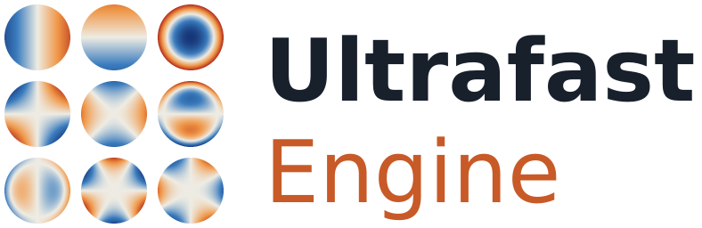

<p align="center">
<picture>
  <source media="(prefers-color-scheme: dark)" srcset="assets/logo/ultrafast-logo-large-dark.svg">
  
</picture>
</p>

<p align="center">
<b>Simulate an ultrafast laser system end to end: from the oscillator to the measurement your lab instruments would report.</b>
</p>

<p align="center">
<a href="https://github.com/JosephCodemard/UltrafastEngine/actions/workflows/ci.yml"></a>
<a href="https://github.com/JosephCodemard/UltrafastEngine/actions/workflows/docs.yml"></a>
<a href="https://josephcodemard.github.io/UltrafastEngine/"></a>


</p>
<p align="center">


</p>
<p align="center">


</p>

UltrafastEngine propagates an ultrashort pulse through a **complete optical system**: stretchers and compressors,
amplifiers, multi-pass cells, fibres, crystals, plates, gas cells, mirrors and coatings. It models the pulse as a
field with a spectrum, in real media, with dispersion to all orders, Kerr, Raman and plasma nonlinearities, χ(2)
mixing, gain, diffraction, and the beam's own geometry. It then reads the result out with **virtual instruments**
(spectrometer, autocorrelator, FROG, d-scan, cross-correlator, cameras) that include the resolution, sampling and
detector of the real device.

It is built for people who design and operate table-top and open-air laser systems and want to know, before building
or changing a beamline, what the pulse will look like at the end, and why a measurement differs from the design. The
focus is free-space optics, with single-mode fibres and gas cells where a system needs them.

**Why use it**

* **One model from design to measurement.** The same system file gives the pulse, the loss budget and the traces your
  diagnostics would record. A fitting plugin compares them with your data and finds the cause of the difference.
* **Validated, not just plausible.** Every component is run alone against its analytic answer (1691 checks), the
  suite pins the physics to published formulas and to an independent code ([pyNLO](https://github.com/pyNLO/PyNLO)),
  and twelve published experiments are replicated, with an honest account of what agrees and what does not.
* **Runs anywhere, no dependencies.** A C# core (.NET 10 and .NET Framework 4.8 for OpticStudio) with no NuGet
  packages. Use it from the command line, Python, C/C++ or any .NET language, on Windows, macOS (Apple silicon) and Linux.
* **Built to be changed.** Every physical ingredient is a replaceable model, and elements, instruments and solvers
  are plugins.

## Quick start

```bash
git clone https://github.com/JosephCodemard/UltrafastEngine.git && cd UltrafastEngine
dotnet build UltrafastEngine.sln -c Release
dotnet run --project src/UltrafastEngine.Cli -c Release -- run docs/examples/01-spm-plate/plate.ufs docs/examples/01-spm-plate/run.json -o results
```

```python
import ultrafast as uf
from ultrafast import build as b

system = b.system("plate", [b.bulk("plate", "FusedSilica", 5e-3, beam=b.gaussian_beam(100e-6, 2.5e-3))])
spec = b.run_spec(b.pulse(1.03e-6, 200e-15, energy=5e-6), instruments=[b.instrument("spectrometer"), b.instrument("compressor")])
result = uf.run(system, spec)
print(result.summary["output"]["fwhmS"], result.instrument("compressor")["compressedFwhmS"])
```

You describe the optics in a **system file** (`.ufs`, JSON) and an experiment in a **run spec** (input pulse, physics
options, instruments). The engine sizes its own time–frequency grid, propagates the pulse element by element, and
writes a self-describing results folder: scalar summaries (`summary.json`), arrays (`result.npz`, CSV), per-element
records, a loss budget, and the provenance of every model value. See [Getting started](docs/getting-started.md) for
Windows, macOS and Linux setup and the Python package.

## What it models

| Area | What is modelled |
|---|---|
| **Linear optics** | dispersion to all orders from Sellmeier / tabulated / [refractiveindex.info](https://refractiveindex.info) materials or ray-traced group delay; grating pairs, prisms (angular dispersion and pulse-front tilt of the tracked beam), chirped mirrors with GDD ripple; absolute (vacuum-referenced) indices and air |
| **Surfaces and losses** | Fresnel, thin-film coatings (transfer matrix), clipping, scatter, absorption, ND filters, thin-film polarisers — with an exact per-mechanism loss budget, peak fluence and LIDT margins |
| **Polarisation** | Jones calculus with s/p basis transport; waveplates (thick, zero-order, compound, with birefringent dispersion), polarisers, Faraday rotators |
| **Kerr nonlinearity** | self- and cross-phase modulation with the full χ(3) tensor (isotropic and cubic-crystal anisotropy), Raman and orientational responses (Blow–Wood, Lin–Agrawal, Hollenbeck–Cantrell, CS₂), self-steepening, user time-domain responses n(t, I); nonlinear ellipse rotation and cross-polarised-wave generation |
| **Fibres** | single-mode fibres and waveguides from Taylor coefficients or a dispersion curve, γ or γ(z), loss and gain, soliton and dispersive-wave diagnostics, quantum noise and supercontinuum coherence |
| **Gases** | rotational Raman of N₂, O₂, CO₂, H₂ and air; pressure and temperature scaling; photo-ionisation (PPT, ADK, Keldysh, MPI) and plasma; HITRAN absorption lines (plugin) |
| **χ(2) crystals** | SHG, SFG, DFG, OPA / OPCPA, birefringent and quasi-phase-matched (including chirped gratings), non-collinear with crossing beams and recorded output angles; phase-matching calculator |
| **Active media** | Yb, Ti:sapphire, Nd and user gain media with rate equations, pumping, thermal lens, multipass and regenerative amplifiers; mode-locked oscillators (Kerr-lens, SESAM) |
| **Beams and space** | Gaussian beam tracking (astigmatic) through lenses and off-axis mirrors; the Kerr-matched mode of a multi-pass cell; radial and cartesian full-field models with diffraction, self-focusing, Zernike aberrations, vector fields and a UPPE coupling |
| **Branched systems** | splitters, interferometers, loops and crystals fed by arms, with the carrier phase of each path, so interference needs no separate model |
| **Contrast** | input pedestals (pre/post-pulses, ASE, phase noise, a measured contrast trace), ghost reflections of plates, crystals and rods, third-order and single-shot cross-correlators with 100+ dB dynamic range |
| **Instruments** | energy meter, spectrometer, photodiode/scope, intensity and interferometric autocorrelator, FROG (SHG, polarisation gate, self-diffraction, XFROG), d-scan, cross-correlators, polarimeter, cameras, wavefront sensor, ideal compressor, and virtual probes (Wigner, field, space–time) — each with resolution, filters and a detector model |
| **Analysis** | parameter scans (grid, random, Latin hypercube, Sobol), optimisation, local and global sensitivities, FROG (including multi-trace) and d-scan pulse retrieval |

What is not modelled, and the limits of what is: [Capabilities and limitations](docs/capabilities.md).

## From the design to your lab

A model that only knows the design predicts the design. The **fitting plugin** (shipped with the engine) closes the
gap with your measurements:

* **`transform` elements**: physical changes to the beam that you insert where they happen: spectral phase (residual
  dispersion), spectral amplitude (gain narrowing, filters, optionally causal via Kramers–Kronig), energy,
  polarisation errors, contrast degradation (replicas, phase noise, ASE pedestals) and wavefront errors. Any of their
  numbers can be marked `"fit": true`.
* **Measured data** on any instrument (part of the core): CSV, NPZ or JSON, curves, traces and readings, compared on
  the recording's axis and range at the recording instrument's resolution, linearly or in dB
  ([Measured data](docs/reference/measured-data.md)). Measured input spectra are cleaned (sorted, duplicates merged,
  background subtracted).
* **Fitting** with Levenberg–Marquardt, CMA-ES or MCMC (or your own estimator), with priors, smoothness and
  instrument-response parameters. Results come in three layers (simulated → inferred → believed), with an influence
  map showing which measurement determines which number. The output includes `fitted-system.ufs`, which runs the
  fitted line on **new inputs**.
* **Backward propagation**: give it the field measured at the output and it finds the field at every plane upstream,
  including through nonlinear elements.

See [Fitting plugin](docs/plugins/fitting.md) and [example 26](docs/examples/26-transforms/README.md).

## Validation

| | |
|---|---|
| **Unit and physics tests** | 468 C# tests (analytic results, conservation laws, published values) and 127 Python tests, run on Linux, macOS and Windows in [CI](.github/workflows/ci.yml) |
| **Component tests** | [every component alone against its analytic answer](docs/component-tests.md): 1691 checks over lenses, mirrors, gratings, prisms, coatings, polarisation, fibres, gain, gases, crystals, spatial components and instruments, with plots |
| **Cross-code agreement** | fibre propagation with Raman and gain within 0.5 % and difference-frequency generation in PPLN within 1 % of [pyNLO](https://github.com/pyNLO/PyNLO); diffraction against LightPipes; gas lines against HAPI |
| **Published experiments** | [twelve papers replicated](docs/papers/README.md), from Michelson–Morley (1887) and Treacy's grating compressor (1969) to FROG, liquid-CS₂ pulse cleaning, multi-pass-cell compression and chirped-pulse parametric amplification. Each README ends with a table of how well the science matched and why any gap remains |
| **Examples** | [43 worked systems](docs/examples/README.md) and six [tutorials](docs/tutorials/index.md), re-run in CI with the numbers they quote checked |

The badges above are updated when the counts change (see [PROJECT_STATUS.md](PROJECT_STATUS.md) for the latest full run).

## Built to be changed

* **Every ingredient is a model.** Refractive index, n₂, Raman response, beam size, coatings, filters, gain media,
  time-domain responses — each can be given as data, an expression or a function (C#, Python, C), per material,
  per element or globally, without editing the system file. A provenance report records where every value came from.
* **Plugins.** Element types, instruments, models, run modes, estimators, retrieval algorithms, compute back-ends and
  CLI commands can be added as plugins that the engine discovers at start-up. Four live in `plugins/`: **fitting**
  (transforms, fitting, backward propagation), **zemax** (export a sequential OpticStudio system to a system file),
  **gpu** (CUDA and OpenCL back-ends) and **hitran** (gas lines in air). See [Plugins](docs/plugins/index.md).
* **Schemas everywhere.** Every option is declared once with its type, unit and default. From that declaration come
  the JSON Schemas (editor completion for `.ufs` and run specs), unknown-key warnings with suggestions, the
  [option reference](docs/reference/options.md), and Python TypedDicts for autocompletion and type checking.
* **One engine, every interface.** The same core runs from the CLI, from Python (in-process), from C/C++ through a
  C API (NativeAOT library), and from any .NET language.

## Documentation

The full documentation is at **<https://josephcodemard.github.io/UltrafastEngine/>**, built from `docs/` with
[MkDocs](https://www.mkdocs.org) (`pip install mkdocs && mkdocs serve`).

| | |
|---|---|
| [Getting started](docs/getting-started.md) | build on Windows, macOS (including Apple silicon) and Linux; Python setup |
| [Tutorials](docs/tutorials/index.md) | first run, diagnostics, a CPA chain, measured data, contrast, diffraction |
| [Examples](docs/examples/README.md) | 43 worked systems, from an SPM plate to a supercontinuum, regenerative amplifier, OPCPA, interferometers and instruments built from elements |
| [Reference](docs/reference/system-file.md) | system file, run spec, every element and instrument, models, results |
| [Capabilities and limitations](docs/capabilities.md) | what is modelled, how it is validated, and what is not |
| [Papers](docs/papers/README.md) and [component tests](docs/component-tests.md) | published results reproduced and every component checked, with plots |
| [Plugins](docs/plugins/index.md) | the fitting, zemax, gpu and hitran plugins, [installing](docs/plugins/installing.md), [writing your own](docs/reference/plugins.md) |
| [For AI agents](docs/agents.md) | how to drive and extend the engine programmatically ([`AGENTS.md`](AGENTS.md), [`llms.txt`](llms.txt)); the [Claude Code](docs/claude-code.md) setup |
| [Releasing](docs/releasing.md) | `build.sh` / `build.bat`: compiled packages for each platform, with only the plugins you choose |

## Repository layout

```
src/UltrafastEngine.Core     the engine (C#, net10.0 + net48, no NuGet dependencies)
src/UltrafastEngine.Cli      the `ultrafast` command
src/UltrafastEngine.Native   C API (include/ultrafast.h)
python/                      the `ultrafast` Python package
plugins/                     fitting, zemax, gpu, hitran
schemas/                     JSON Schemas of system files and run specs
docs/                        documentation, tutorials, examples, paper replications (docs/papers)
tests/                       C# test suite (no external framework) and tests/components (analytic checks with plots)
build/, build.sh, build.bat  MSBuild helpers and the release packager
CLAUDE.md, .claude/          Claude Code setup (docs/claude-code.md)
```

## Status

UltrafastEngine **2.2.0** is a stable release: file formats are versioned (older files are migrated on load with a
deprecation warning), the core is feature-complete for its scope, and the test suite pins the physics to analytic
results and reference codes. What is planned next (coating and crystal design plugins, further paper replications,
waveguides and fibre gain, deeper OpticStudio integration) is on the [roadmap](docs/roadmap.md); changes are in the
[changelog](CHANGELOG.md). The Python package and the C library are built from source (no PyPI or NuGet packages).

Contributions are welcome: see [CONTRIBUTING.md](CONTRIBUTING.md).

## Citing

If UltrafastEngine contributes to published work (a paper, thesis, report or talk), **please cite it**. GitHub's
"Cite this repository" button reads [CITATION.cff](CITATION.cff); the BibTeX entry is:

```bibtex
@software{codemard_ultrafastengine_2026,
  author    = {Codemard, Joseph},
  title     = {{UltrafastEngine}: nonlinear ultrashort-pulse propagation through complete optical systems},
  year      = {2026},
  version   = {2.2.0},
  url       = {https://github.com/JosephCodemard/UltrafastEngine},
  license   = {Apache-2.0}
}
```

Please also cite the published papers whose results you use; each replication in [docs/papers](docs/papers/README.md) names its source.

## Licence and attribution

UltrafastEngine is licensed under the [Apache License 2.0](LICENSE). The licence requires that redistributions and derivative
works keep the copyright notice and the [NOTICE](NOTICE) file, which names the author; the request to cite the software in
published work is in the NOTICE and above, and is a request, not a licence condition. The Ansys ZOS-API assemblies used by the
optional Zemax plugin are Ansys property and are never part of this repository or its packages.

## Contact

Joseph Codemard, [jac318@bath.ac.uk](mailto:jac318@bath.ac.uk): questions, collaboration, and bug reports that do not belong
in a public issue. Public bugs and feature requests: [GitHub issues](https://github.com/JosephCodemard/UltrafastEngine/issues).

## About this project and AI assistance

UltrafastEngine was written with substantial help from AI: the code, tests and documentation were developed with
**Anthropic's Claude** (Opus 5.5 and Sonnet 5.5), working under the direction and review of the author. The physics is
checked against analytic results and an independent code (pyNLO) by the test suite, but as with any simulation tool,
validate the results that matter to you against your own measurements before relying on them.
