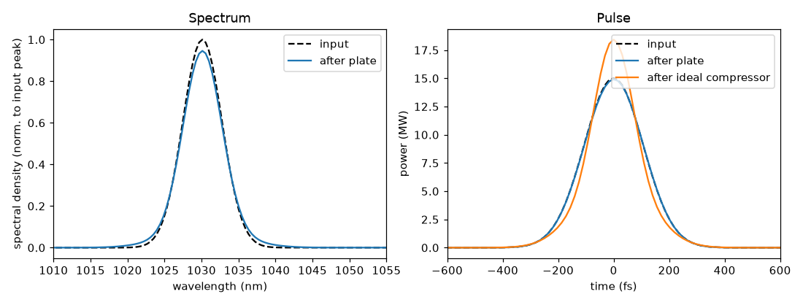

# 01 -- SPM in a fused-silica plate

The smallest complete example: an AR-coated 6.35 mm fused-silica plate with the beam focused to its centre.

```bash
ultrafast run plate.ufs run.json -o results
```

What to look at:

* `results/summary.json` -> `elements[1]`: B-integral of the plate (~0.6 rad), solver statistics, `criticalPowerRatio`.
* `instruments`: the spectrometer shows SPM broadening; `ideal_compressor` reports the GDD that would compress the
  broadened pulse and the resulting duration.
* `lossBudget`: the two AR coatings (0.2 % each).
* `provenance.json`: where every model came from (built-in Malitson index, built-in n2 = 2.6e-20 m^2/W, ...).

Try an override without touching the system file -- add to `run.json`:

```json
"overrides": [ { "target": "material:FusedSilica", "property": "n2", "value": 2.2e-20 } ]
```

Note: the peak power is above the critical power for self-focusing in silica; the engine warns because the plate
is simulated in 1-D. Add `"transverse": {"model": "radial"}` to the plate to resolve diffraction and Kerr lensing
(see [example 11](../11-spatial-kerr/README.md) and docs/transverse.md).

## Result



`python plot.py` draws this figure from `results/`. A 250 fs, 4 uJ pulse crosses the plate with a B-integral of
0.667 rad. The Kerr effect adds a phase proportional to the instantaneous power, which creates new frequencies:
the spectrum (left) gets weak wings and a lower peak, and its FWHM is 6.37 nm. The pulse (right) is almost
unchanged in time (251.5 fs FWHM) because SPM only changes the phase.
The ideal compressor removes the remaining chirp and shortens the pulse to 189 fs with a peak power of 18.4 MW,
close to the 184 fs transform limit of the broadened spectrum: the extra bandwidth is real and can be used.
