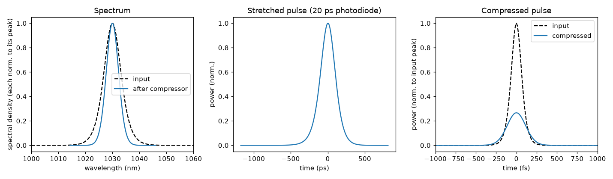

# 02 -- Stretcher, amplifier stand-in and compressor (analytic)

A CPA line built from analytic elements (Treacy grating pairs, a gain-narrowing filter, YAG, chirped mirrors).

```bash
ultrafast run cpa.ufs run.json -o results
```

* The grid is sized automatically from the stretcher's group-delay spread (hundreds of ps) -- see the notes
  printed at the start, and `edgeEnergyFraction` in the summary (should be ~0).
* `photodiode_stretched` shows the stretched pulse as a 20 ps-rise-time photodiode would.
* `residual` (the ideal-compressor instrument at the end) tells you how much GDD/TOD is left after the real
  compressor -- i.e. how far the chirped mirrors are from optimal.
* `lossBudget` separates grating efficiency (`grating`), the gain-narrowing filter (`filter`) and the
  chirped-mirror reflectance (`coating`).

To do the same with your OpticStudio stretcher, export it (example 07) and run the resulting `.ufs` instead.

## Diagnostics along the line

`run.json` places instruments where you would on the table: a spectrometer and an autocorrelator at the input, a
photodiode, a spectrometer and a (virtual) Wigner distribution after the stretcher (`probe_stretched`), and a
spectrometer, autocorrelator, a (virtual) field probe and the ideal compressor at the end. `ultrafast-plot results`
draws the system schematic (`plots/system.png`) with the instruments numbered in order, and every instrument panel
carries its number and location -- the Wigner panel shows the ~230 ps linear chirp the stretcher imposes.

## Result



`python plot.py` draws this figure from `results/`. The 150 fs input pulse is stretched to 232.6 ps by the grating
stretcher (middle), which is what keeps the peak power low in a real amplifier. The gain-narrowing filter then
trims the spectrum (left), so the compressed pulse (right) is longer than the input: 268.8 fs instead of 150 fs,
and the whole line transmits 45.38 % of the energy, so the peak power is lower than at the input.
Because the compressor and the chirped mirrors cancel the stretcher's GDD and TOD almost perfectly, the pulse
leaves at its transform limit (268.4 fs): the `residual` instrument reports a temporal Strehl ratio of 1.00.
