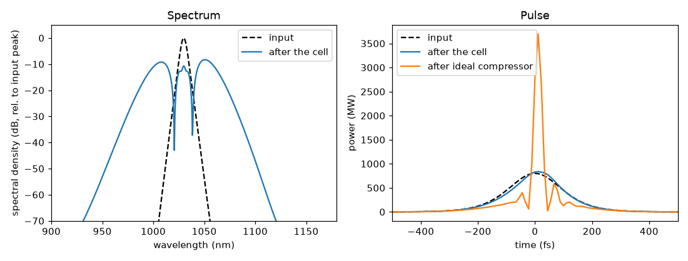

# 03 -- Argon multipass cell (Herriott MPC)

A 20-pass, 0.55 m Herriott cell filled with 2 bar argon, dispersive mirrors (-30 fs^2/bounce) and fused-silica
windows. The system file is generated by `make_mpc.py` with the Python builders (`ultrafast.build`), which is a
good template for parameter scans.

```bash
python make_mpc.py                       # (re)generates mpc.ufs
ultrafast run mpc.ufs run.json -o results
```

Things to look at in `results/summary.json`:

* per-pass `bIntegralRad` (~0.45 rad each) and `cumulativeBIntegralRad`, `criticalPowerRatio` (~0.1),
* the spectral broadening pass by pass (`probes` -> `probe_passNN_*` arrays in `result.npz`),
* `ideal_compressor` (how short the pulse could be: ~33 fs from 220 fs) and `gdd_scan`, a d-scan trace versus
  added GDD (what scanning a chirped-mirror/prism compressor would show),
* `lidtMargin` on every mirror (fluence vs the coating's scaled damage threshold),
* `lossBudget`: mirror reflectance (`coating`) vs window AR (`coating`) vs gas (none).

The Gaussian beam of each pass (`"kind": "gaussian"`, waist mid-pass) is what the Zemax binding would export
from GBPS/GBPW for a real cell (example 07).

## Result



`python plot.py` draws this figure from `results/`. Over the 20 passes the pulse collects a total B-integral of
9.12 rad. Self-phase modulation turns the narrow 220 fs input spectrum (dashed) into a broad two-lobed spectrum
with a FWHM of 61.9 nm and a dip at the centre, which is the signature of a large nonlinear phase. The pulse itself
stays 197.6 fs long, because the argon dispersion and the mirrors' -30 fs^2 per bounce hardly change its shape.
The ideal compressor shows what the new bandwidth is worth: 33.1 fs and 3.70 GW of peak power, against 0.8 GW at
the input. The compressed pulse has pedestals (temporal Strehl ratio 0.76) because the SPM chirp is not perfectly
quadratic, so a pure GDD compressor cannot remove all of it.
