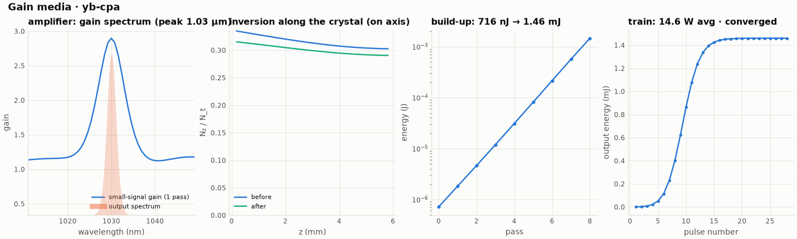

# 13 -- Yb:YAG multipass CPA amplifier

A 250 fs, 1 µJ seed at 10 kHz is stretched by a grating pair to ≈ 430 ps. It is amplified in 8 passes through a
6 mm Yb:YAG rod, pumped from both ends with 150 W of cw diode light at 940 nm, and recompressed by the matching
grating pair.

```bash
ultrafast run amp.ufs run.json -o results
ultrafast-plot results          # results/plots/gain.png: gain spectrum, inversion, build-up, pulse train
```

What the amplifier element does (docs/gain.md):

* iterates the pulse train with the rate equations. It converges after 28 pulses: the inversion is pumped up
  during the 100 µs between pulses and pulled down by each pulse;
* propagates the last pulse with the full model: per pass, 16 slices of saturated spectral gain with time-ordered
  extraction (16 arrival groups, because the pulse is stretched), YAG dispersion and SPM;
* applies 3 % loss and 3 mm of fused silica between passes;
* reports the thermal lens of the rod.

| quantity | value |
|---|---|
| absorbed pump | 120 W (of 150 W) |
| on-axis inversion before the pulse | 0.315 (small-signal gain 2.9 per pass) |
| output after the amplifier | 1.46 mJ (14.6 W), gain 2000 over 8 passes |
| extraction (of the energy stored above transparency) | 5.4 % |
| gain narrowing | 4.46 nm → 2.51 nm FWHM |
| compressed pulse | 535 fs, transform limited (Strehl 0.999) |
| B-integral | 0.07 rad (well stretched) |
| thermal lens | 10.5 W of heat, ΔT(0) = 57 K, f_th = 0.14 m |



`ultrafast-plot results` draws this figure (`results/plots/gain.png`). The left panel shows why the amplified
spectrum is narrower than the seed: the small-signal gain of Yb:YAG peaks at 1030 nm and falls off on both sides,
so the centre of the spectrum grows fastest. The second panel is the fraction of ions in the excited state along
the rod, before and after the pulse passes; the pulse takes only a small part of the stored energy, consistent
with the 5.4 % extraction in the table. The build-up panel is a straight line on the log scale, a constant gain
of about 2.9 per pass from 716 nJ to 1.46 mJ over 8 passes. The last panel is the pulse train: the first pulses
find an unpumped rod, and the output settles at 1.46 mJ after about 15 pulses (the engine runs 28 and reports 14.6 W average power).

Things to try:

* `"passes": 12`, or raise the seed to watch saturation flatten the build-up (`energyPerPass`);
* `"repRateHz": 1000` in run.json: more energy per pulse and less average power;
* replace the stretcher with a shorter one (`separationM: -0.05`) and watch the B-integral grow.
