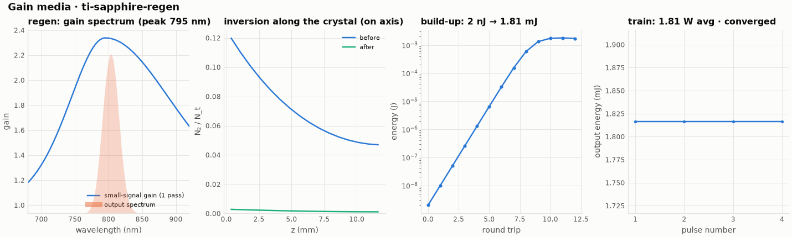

# 14 -- Ti:sapphire regenerative amplifier

The classic 1 kHz CPA front end:

* a 30 fs, 2 nJ oscillator pulse is stretched by an ideal stretcher (GDD 1.5 ps², TOD);
* it is amplified in a regen pumped by 10 mJ at 532 nm (Q-switched, double pass, 200 ns before injection),
  ejected automatically at the energy maximum;
* it is recompressed.

```bash
ultrafast run regen.ufs run.json -o results
ultrafast-plot results
```

| quantity | value |
|---|---|
| absorbed pump | 9.65 mJ; small-signal gain 2.34 per pass |
| round trips (auto) | 11 (2 passes each, 6 % cavity loss, 40 mm of fused silica per round trip) |
| output | 1.81 mJ (gain 9 × 10⁵), extraction 97 % of the stored energy |
| spectrum | 31.4 nm → 28.6 nm FWHM (gain narrowing), centroid shifts red (800.2 → 802.9 nm) |
| compressed | 41.1 fs (transform limit 34.3 fs; the remainder is higher-order phase of the cavity) |
| B-integral in the regen | 1.8 rad |



`ultrafast-plot results` draws this figure (`results/plots/gain.png`). The pulse grows from 2 nJ to 1.81 mJ in
the cavity. On the build-up panel the energy rises exponentially, a factor of about 5 per round trip (two passes at
2.34 each), until the gain saturates and the energy flattens, which is where the regen ejects the pulse. The
inversion panel shows the same thing in the crystal: the pump has excited up to 12 % of the ions near the entrance
face, and the amplified pulse leaves almost none (green), i.e. nearly all of the stored energy is extracted. The
gain spectrum (left) is broad but not flat, so the output spectrum (shaded) is narrower than the seed and shifted
towards the gain peak side; the output is identical for all 4 pulses of the train, because the upper state is
re-pumped from scratch every millisecond.

The compressor's GDD and TOD were tuned with the `compressor` instrument. Without the correction, the 11 round
trips of sapphire and silica (≈ 30 000 fs²) leave a 2.4 ps pulse. `el_regen_energyPerRoundTrip` holds the build-up
from 2 nJ. The pulse train is only 4 pulses long: at 1 kHz, the 3.2 µs upper-state lifetime forgets each pulse
before the next one.

The grid needs 512k points (30 fs bandwidth stretched to 150 ps), so this run takes ≈ 20 s.
