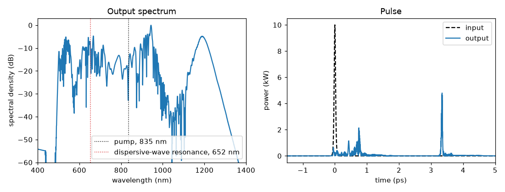

# 25 -- Supercontinuum in a photonic-crystal fibre

The standard benchmark of fibre supercontinuum codes (Dudley, Genty & Coen, Rev. Mod. Phys. 78, 1135 (2006),
Fig. 3): a 50 fs sech pulse at 835 nm with 10 kW peak power in 15 cm of photonic-crystal fibre (zero dispersion
near 780 nm), dispersion to beta_10, gamma = 0.11 /(W m), Blow-Wood Raman response (fR = 0.18), self-steepening.

```bash
ultrafast run pcf.ufs run.json -o results            # ~50 s
ultrafast study coherence.json -o coherence-results    # 6 runs with quantum noise, ~3 min
```

With an NVIDIA or OpenCL GPU, add `--backend auto` (or `"compute": {"backend": "auto"}`): the fibre runs on the
device with the same result ([GPU](../../plugins/gpu.md)). Installing FFTW (Windows / Linux) speeds up the CPU run.

What to look at:

* `results/summary.json → elements[0].values`: soliton number N = 8.7, L_D = 6.8 cm, L_NL = 0.9 mm, fission length
  ~8 mm, dispersive-wave resonance ~650 nm -- the numbers of the paper.
* `results/spectrum.csv` (`spectrum_db`): the spectrum spans ~450-1300 nm at -40 dB; Raman solitons on the red side,
  dispersive waves on the blue side. Energy falls to 91 % because the Raman shift moves photons to the red (photon
  number is conserved).
* `coherence-results/coherence.csv`: |g12(lambda)| over independent one-photon-per-mode noise realisations. The mean
  coherence is 0.97: a 50 fs pump gives a coherent supercontinuum, as in the paper. Make the pulse longer
  (`durationFwhmS` 150e-15 at the same peak power, N ~ 26) and the mean coherence drops to ~0.2: the spectrum is then
  seeded by noise-driven modulation instability.



`python plot.py` draws this figure from `results/`. The 50 fs pulse (dashed, right) has a soliton number of 8.65, so
it first compresses and then breaks up (fission) after about 8 mm into several short solitons. The spectrum (left)
shows what that does in the frequency domain: a dispersive wave appears on the blue side near the predicted 652 nm
resonance, the spectrum extends from about 500 nm to beyond 1300 nm, and the strongest red feature near 1200 nm
is the fundamental soliton, which the Raman effect has shifted away from the pump. In time, this Raman soliton has
slowed down and arrives about 3.3 ps after the others, because red light travels slower in this fibre.
The output keeps 91.06 % of the pulse energy, the rest of the photon energy goes to the vibrations of the glass.

The explicit grid (16384 points over 12.5 ps) resolves the full spectrum; the edges of the output spectrum are 60 dB
below its peak (check `edgeEnergyFraction`).
