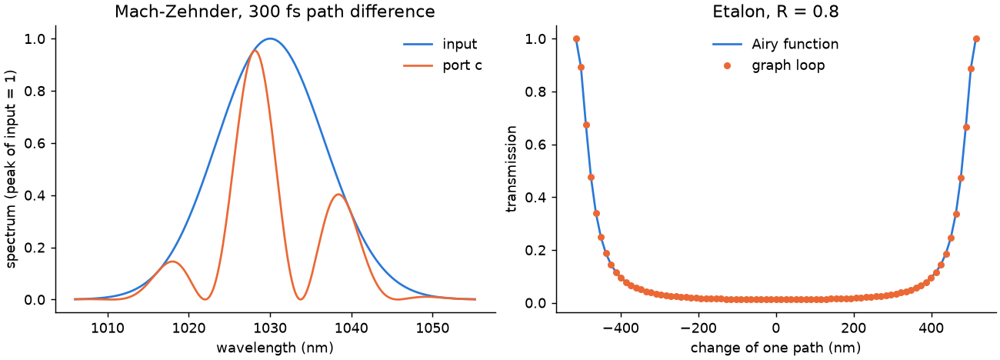

# 32 -- Two interferometers

Branched systems with a known answer, written with the Python API ([Branched systems](../../reference/branches.md)).

**A Mach-Zehnder:** two 50:50 splitters, with one arm 300 fs longer. Port `c` holds (1 − cos ω τ) / 2 of each frequency; the other port is a declared virtual output.

**An etalon:** two mirrors of R = 0.8 joined by a loop, with a single-frequency source. The link from `back` to `m1:2` closes the loop. A study moves one path over one wavelength, and the transmission follows the Airy function.

```bash
cd docs/examples/32-interferometers
python interferometers.py
```

```
Mach-Zehnder     output / input 0.5004   analytic 0.5004
spectral fringes largest error  4.1e-14 of the peak
budget closure   -1.0e-25 J
etalon           peak 1.0000   Airy 1.0000, largest error 3.5e-08
```



The Airy function uses the grid's carrier, `summary["outputGrid"]["omega0"]`, because the grid moves the requested wavelength slightly so that the carrier falls on a sample.
