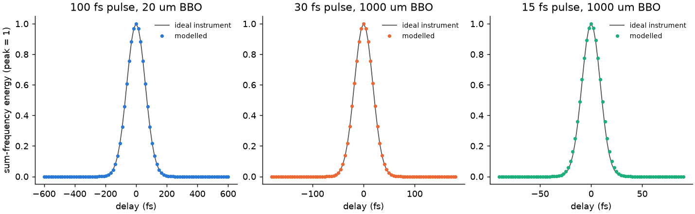

# 33 -- A modelled autocorrelator

The `autocorrelator` instrument is an ideal calculation on the field. Here is the apparatus, written with the Python API: a splitter, a delay stage, and a BBO crystal summing the two beams, with the sum-frequency energy recorded against delay. The comparison shows how far the real device can be trusted.

The crystal's second input comes from the `stage` arm (`b.aux_beam("b", from_port=True)`, [Branched systems](../../reference/branches.md#crystals)). The beams are collinear here, because crossing angles are not modelled. `uf.study` scans the delay, 81 points per pulse, and reuses every element upstream of the stage.

```bash
cd docs/examples/33-modelled-autocorrelator
python autocorrelator.py
```

```
100 fs     20 um   141.62    141.52    141.42
 30 fs   1000 um    42.61     42.45     42.43
 15 fs   1000 um    22.22     21.23     21.21
```

The columns are the pulse, the crystal, then the model, the instrument and the ideal √2 τ, in fs. The scan has steps of 0.15 τ, so the model's last figures depend on that sampling.



The model agrees with the instrument to 0.1 % for a thin crystal. For a 15 fs pulse in 1 mm of BBO it reads about 5 % long, which is the expected effect of the crystal's limited phase-matching bandwidth and group-velocity mismatch, left out by the ideal instrument.
