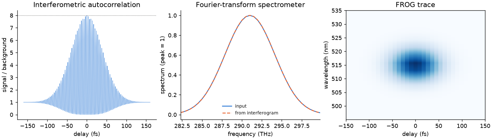

# 34 -- Instruments built from elements

Three instruments from the same parts, written with the Python API ([Branched systems](../../reference/branches.md)):

* an interferometer with an SHG crystal after it is an **interferometric autocorrelator**, with its 8:1 ratio of peak to background;
* with a plain detector it is a **Fourier-transform spectrometer**: the transform of the interferogram is the spectrum;
* a crystal fed by two arms, read by a spectrometer at each delay, is a **FROG**: `arrayOutputs` keeps the whole spectrum per point in `study.npz`.

```bash
cd docs/examples/34-modelled-instruments
python instruments.py              # about 1.5 minutes
```

```
IAC peak / background  8.000   analytic 8
FTS centroid 1030.21 nm   input 1030.21 nm
FROG marginal FWHM 84.9 fs   analytic 84.9 fs
```



An f-2f interferometer is [Example 37](../37-f2f-cep/README.md).
