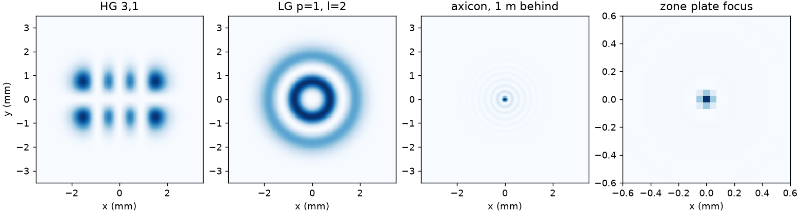

# 36 -- Structured beams

Modes and masks on a carried profile, written with the Python API ([Masks](../../reference/transverse.md#masks), [Initial profile](../../reference/transverse.md#initial-profile)).

```bash
cd docs/examples/36-structured-beams
python structured.py
```

```
HG 3,1        7.000 (7)        3.000 (3)
LG p=1, l=2   5.000 (5)        5.000 (5)
Bessel first zero 197.7 um   analytic 197.1 um
zone plate gain 96   analytic 100
```



`m2` and `m2Y` of the `beamProfile` instrument are central moments, so a tilted or decentred beam keeps its beam quality. The zone-plate gain sits 4 % under the ideal (2 N)² for N = 5 open zones, because each hard zone edge is averaged over a grid cell. The Bessel check needs the screen far enough behind the axicon that the ring feeding the axis lies many Fresnel widths out: at 0.3 m the core is 3 % wider.
