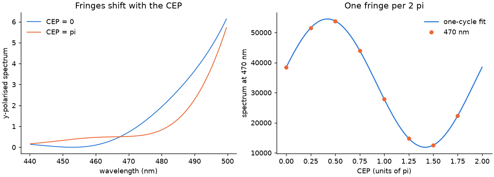

# 37 -- An f-2f interferometer

A 3 fs pulse is broad enough for its blue wing to meet the red wing of its own second harmonic. This example builds the interferometer with the Python API and shows the fringes following the carrier-envelope phase (`cepRad`). Beams with different carriers merge on the wider grid ([Interference](../../reference/branches.md#interference)).

```bash
cd docs/examples/37-f2f-cep
python f2f.py
```

```
modulation at one cycle per 2 pi of CEP   0.643 of the mean
at two cycles                             0.0000 of the one-cycle part
```



The signal at 470 nm repeats once per 2π of CEP and has no part at twice that rate.
