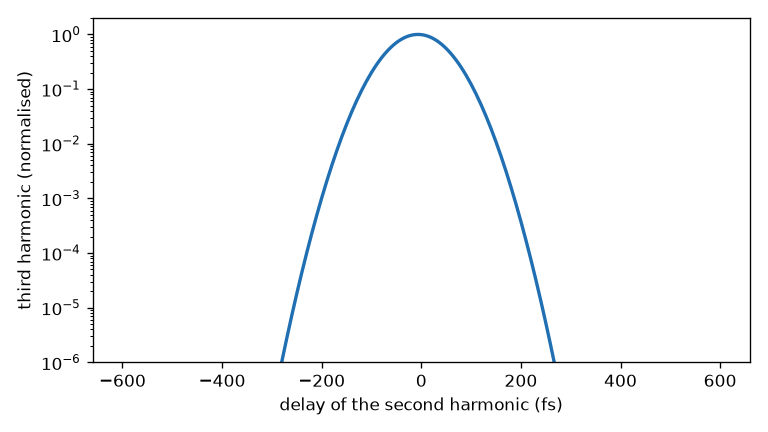

# 39 -- A third-order cross-correlator

The layout of a SEQUOIA or TOCC: a crystal makes the second harmonic, a stage delays it, and a second crystal mixes it with the remaining fundamental into the third harmonic, which goes to a detector. It is a Branched system in Python, and the scan is a study of the stage.

```bash
cd docs/examples/39-third-order-cross-correlator
python tocc.py
```

```
SHG cut 23.37 deg, THG cut 32.39 deg
trace FWHM 122.8 fs (Gaussians: 122.5 fs)
```



Each crystal's `cut: "auto"` solves for the colours reaching its ports, here 1030 nm and 515 nm. The trace is the correlation of the pulse with its second harmonic, so its width is √(τ² + τ²/2) for Gaussians.

**What this does not model.** Both crystals are collinear here; example [40](../40-noncollinear-correlators/README.md) crosses the beams to separate the signal. There is no noise floor or PMT response. A dynamic range measurement needs the `crossCorrelator` instrument. Polarisation is not tracked between the crystals: the waveplate a type I stage needs is assumed. See [Crystals](../../reference/crystals.md#what-a-crystal-does-not-model).
