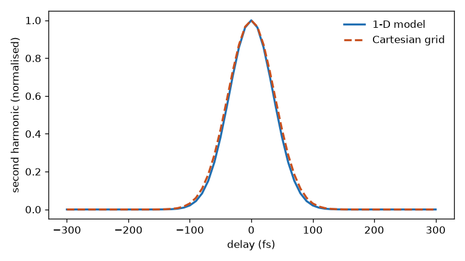

# 40 -- Beams crossing in a crystal

Two Branched systems in Python. The first is a background-free autocorrelator: a splitter, a delay, and both arms crossing at 3° in thin BBO. Non-collinear SHG takes two beams, so it is `sfg` with one colour on both. The second makes the third harmonic with the second harmonic arriving 3° off, and the tilt of its arm sets the geometry.

```bash
cd docs/examples/40-noncollinear-correlators
python correlators.py
```

```
1-D model        FWHM 85.1 fs (sqrt 2 tau = 84.9 fs)
Cartesian grid   FWHM 89.9 fs (with 29.1 fs of smearing: 89.7 fs)
THG cut 32.48 deg, inside the crystal 1.81 deg apart
leaving at 0.00 deg (1030 nm), 3.00 deg (515 nm), 2.00 deg (343 nm)
```



Crossing beams meet at a different time at each point across the beam, which broadens the trace by the geometric smearing. The 1-D model has one point across the beam, so it gives the ideal width and warns when the smearing matters. A Cartesian grid carries the pulse-front tilt and gives the broadened width. `ny = 1` here keeps one transverse axis, which is enough for the shape of the trace but not for its energy.

The third harmonic leaves at ω₃ sin t₃ = ω₁ sin t₁ + ω₂ sin t₂, so it is separated from both inputs. That is why a real correlator crosses them. The angles are in the crystal's `values`. See [Crystals](../../reference/crystals.md#non-collinear-sum-frequency).
