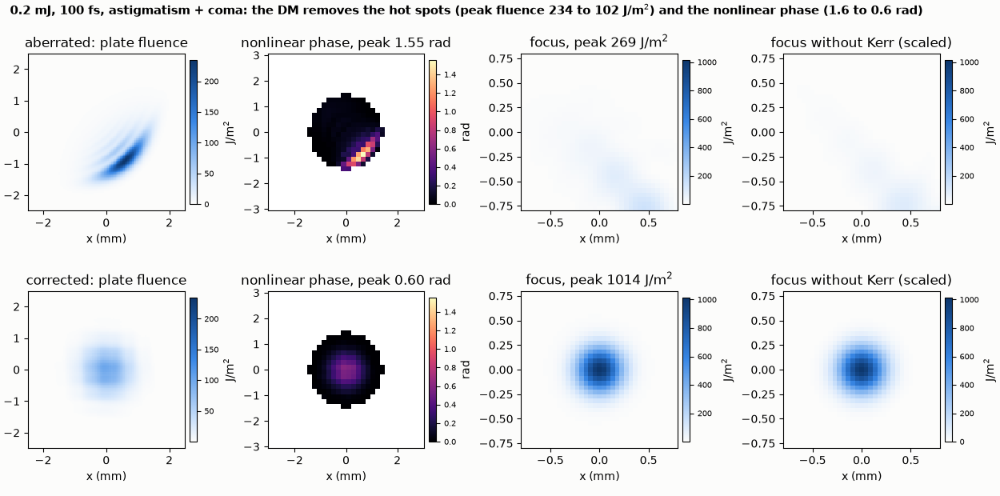

# An aberrated high-power beam: what a deformable mirror does for the nonlinear phase

A deformable mirror removes the hot spots of an aberrated 2 GW beam and cuts the peak nonlinear phase in a Kerr plate from 1.55 to 0.60 rad.

**The story.** At high peak power an aberrated beam is not just blurry: after some distance of free space its aberrations turn into
**hot spots**, and a Kerr medium (a window, an amplifier crystal, air) writes the hot spots into the beam as nonlinear phase. A 0.2 mJ,
100 fs pulse (2 GW) with astigmatism and coma passes 0.6 m of free space and then a 5 mm plate of Kerr material (n₂ = 3 x 10⁻²⁰ m²/W).
The deformable mirror at the start of the line, set to cancel the aberration, removes the hot spots: peak fluence on the plate falls
from 234 to 102 J/m², the peak nonlinear phase from 1.55 to 0.60 rad, and the focus gets 3.8 times brighter.



**Layout** (`high_power.py`): Gaussian source (1 mm) → aberration screen → `deformableMirror` (14 x 14, 0.45 mm) → 0.6 m free space
→ Kerr plate (5 mm, cartesian transverse grid, 8 spectral samples) → lens f = 1 m → focal-plane camera. Each case runs twice,
at 0.2 mJ and at 10⁻⁴ of it; the **nonlinear phase map** is the difference of the two wavefront-sensor maps (2π x waves) just after the plate,
so it contains only what the Kerr effect added.

```bash
python high_power.py            # four engine runs, about 45 s
python make_figures.py
```

```
beam radius 1 mm, 0.2 mJ, 100 fs: peak power 1.9 GW; aberration (Noll: waves rms) {5: 0.9, 7: 0.7, 8: -0.5}
5 mm of Kerr medium (n2 3e-20 m^2/W) after 0.6 m of free space, then a lens of 1.0 m
aberrated peak fluence on the plate 234.5 J/m^2 (the flat-phase Gaussian: 127.3), peak nonlinear phase within 1.5 mm of the axis 1.55 rad, focal peak fluence 269 J/m^2 (the same beam without the Kerr plate's effect: 294)
corrected peak fluence on the plate 101.6 J/m^2 (the flat-phase Gaussian: 127.3), peak nonlinear phase within 1.5 mm of the axis 0.60 rad, focal peak fluence 1014 J/m^2 (the same beam without the Kerr plate's effect: 1006)
checks passed
```

**What it shows.** The aberrated beam concentrates its power in a crescent of the beam (peak fluence 1.8 times that of the ideal Gaussian, 127 J/m²)
and the nonlinear phase follows it (1.55 rad there). The corrected beam is nearly the ideal Gaussian, with a lower peak than
the Gaussian's 127 J/m² because the finite mirror leaves some residual (the printed fluence is the peak after the 0.6 m drift).

**Limits.** The nonlinear phase map is measured on a 32 x 32 lenslet grid inside 1.5 mm of the axis; lenslets outside the beam see no
light and are masked. The plate is thin: its B-integral is about a radian, so there is no self-focusing collapse in it; the example does not test thicker plates.
