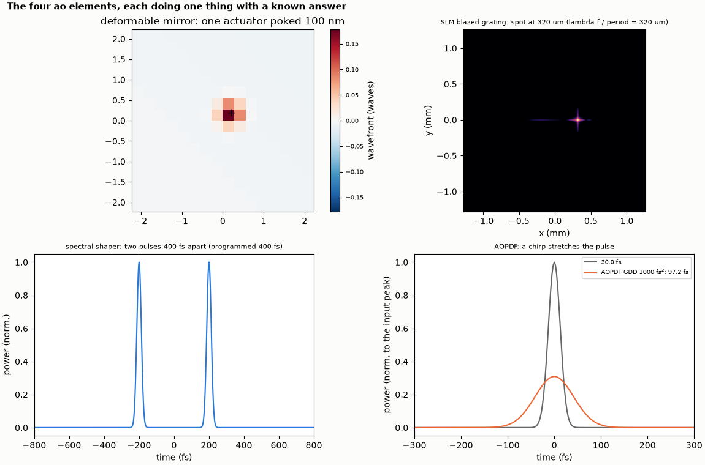

# The ao elements side by side

Each element of the `ao` plugin does one simple thing here, and the result is compared with the number a textbook gives. The four deeper examples of this group use them for real work.

**Question.** Does each device do what its parameters say: a poked actuator, a blazed grating, a programmed double pulse, a programmed chirp?



## Setup

`ao_components.py` runs four small systems (all in `ultrafast_ao` builders; the files and numbers are in the script):

| element | what is set | what to expect |
|---|---|---|
| `deformableMirror` | one actuator of a 10 × 10 mirror (pitch 0.4 mm) moved 100 nm; read by the bench's Shack-Hartmann sensor | a wavefront of about 2 × 100 nm / 1030 nm = 0.194 waves at the actuator, falling to the neighbour coupling (0.15) one pitch away |
| `slm` | a blazed grating of 8 pixels (20 µm pitch, 256 grey levels) in front of a lens at its critical focal length f = n dx² / λ | the spot sits λ f / period = 320 µm from the axis (16 focal-plane pixels) |
| `spectralShaper` | the transfer function (e^{−iωτ/2} + e^{+iωτ/2}) / 2 of two pulses τ = 400 fs apart on 1024 pixels | two pulses 400 fs apart |
| `aopdf` | `gddFs2: 1000` on a 30 fs Gaussian pulse at 800 nm | τ = τ₀ √(1 + (4 ln 2 · GDD / τ₀²)²) = 97.2 fs |

```bash
python ao_components.py
python make_figures.py          # optional: hero.png
```

## What is checked

The references are the formulas in the table (analytic). `ao_components.py` asserts: SLM spot within one focal-plane pixel of λ f / period; two pulses with a spacing within 2 % of the programmed one; the chirped duration within 2 % of the Gaussian formula; and, for the deformable mirror, a peak within 12 % of 2 × poke with the neighbour reading between 5 and 25 % of the peak. The deformable mirror's own influence function (1 at the actuator, exactly the coupling at one pitch) is checked to 1e-12 in `AoDeviceTests`; the sensor reading below is a looser end-to-end check.

## Results

```
deformable mirror: one actuator moved 100 nm: sensor peak 0.178 waves (2 x poke = 0.194), 0.036 waves one pitch away (coupling 0.15)
SLM blazed grating (8 pixels): the spot is 320 um from the axis (lambda f / period = 320 um), 16 pixels of 20 um
spectral shaper: 2 pulses, 400 fs apart (programmed 400 fs)
AOPDF: GDD 1000 fs^2 stretches 30.0 fs to 97.2 fs (97.2 fs for a Gaussian)
checks passed
```

* The SLM, the shaper and the AOPDF agree with their formulas to the printed precision.
* **The deformable mirror's sensor reading is 8 % below 2 × poke** (0.178 against 0.194 waves) and the neighbour reads 0.036 waves where the coupling alone would give 0.029. The count of lenslets does not change the peak (16, 32 and 48 lenslets all give 0.178), so it is not the sensor's sampling; the reconstruction of the sensor's map (a mean piston removed, or a smoothing) is the likely cause but **was not traced**. The element itself is exact (see above). Treat the sensor reading as a visualisation, not a calibration, until this is understood.

## Extend it

* Change `period_pixels` in `slm_steering` and watch the spot move; try fewer grey levels (`grey_levels=16`) and compare with the quantisation figure of [slm-beam-shaping](../slm-beam-shaping/README.md).
* Program three or more pulses with `double_pulse` as a template (the comb of [temporal-shaping](../temporal-shaping/README.md)).
* Give the AOPDF a `todFs3` and a `windowS` and see which part of the pulse is cut by the acoustic window.
* Close the loop on the mirror: [dm-correction](../dm-correction/README.md).

## Limits and provenance

* Generic devices without vendor data. This example sets no actuator stroke limit, no SLM crosstalk and no AOPDF replica; the parameters exist (see the [ao plugin page](../../../plugins/ao.md)).
* The deformable-mirror reading is the open point above. Nothing here is compared with a published measurement; the references are the analytic formulas.
