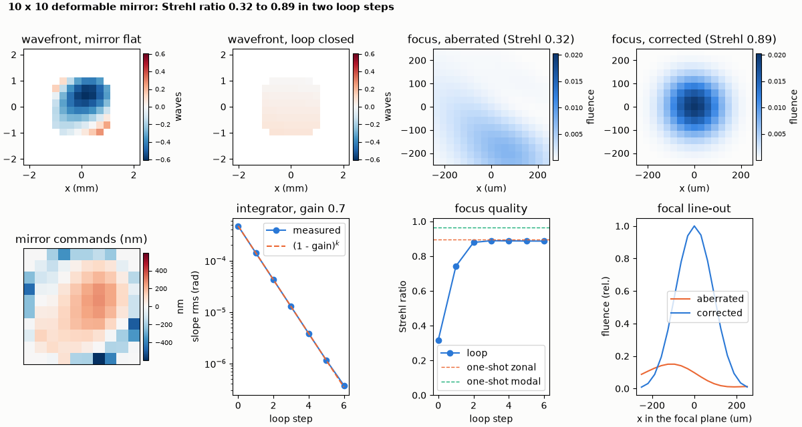
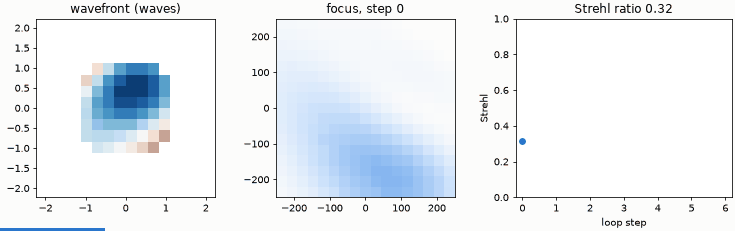
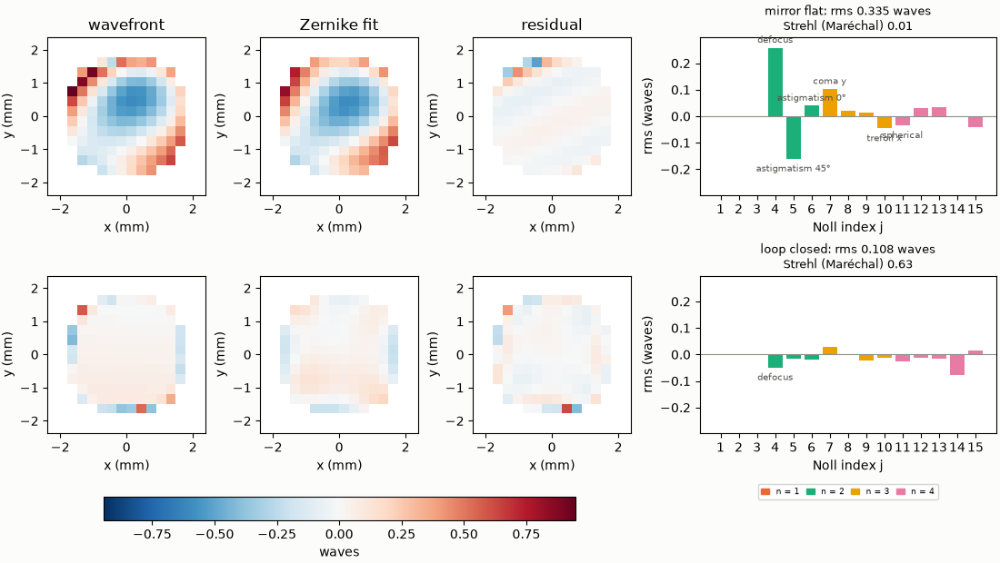

# Deformable-mirror correction of an aberrated focus

A 10 x 10 deformable mirror, calibrated and run in a closed loop, restores the focus of a beam with defocus, astigmatism and coma (Strehl 0.32 to 0.89).

**The story.** A laser beam picks up defocus, astigmatism and coma on its way to the experiment (0.30, 0.20 and 0.15 waves rms) and
its focus is smeared out: the focal peak is 0.32 of the diffraction limit (the Strehl ratio). A 10 x 10 actuator deformable mirror
(`ao` plugin), a wavefront sensor and a few lines of control restore it. The example measures the aberration, **calibrates** the
mirror by poking every actuator (the interaction matrix), **corrects** in one shot, and **closes the loop** with an integrator.





*Left to right in the animation: the measured wavefront, the focus and the Strehl ratio at each loop step.*

The Zernike decomposition of the same wavefront before and after (`ultrafast.plotting.zernike`):



**Layout** (`dm_correction.py`): Gaussian source (1 mm radius, 1030 nm) → aberration screen (a `modulator`) → `deformableMirror`
(10 x 10, 0.4 mm pitch, Gaussian influence with 15 % coupling) → [`wavefrontSensor` instrument, 16 lenslets] → lens (f = 0.5 m) →
camera (`beamProfile`). Each measurement is one engine run (about 0.1 s). `ultrafast_ao.DmBench` builds this bench.

```bash
python dm_correction.py
python make_figures.py          # hero.png, zernike.png, animation.gif (about 10 s)
```

```
aberration (Noll index: waves rms) {4: 0.3, 5: -0.2, 7: 0.15}, DM 10 x 10 actuators of 0.4 mm
Strehl ratio: aberrated 0.32, one-shot zonal 0.90, one-shot modal 0.97
closed loop, gain 0.7: slope rms per step 4.72e-04 1.42e-04 4.25e-05 1.27e-05 3.82e-06 1.16e-06 3.73e-07
closed loop, gain 0.7: Strehl per step 0.32 0.74 0.88 0.89 0.89 0.89 0.89
slope rms falls by 0.30 per step (integrator: 1 - gain = 0.30)
checks passed
```

**What it shows.** The one-shot zonal correction (command = minus the control matrix times the slopes) takes the Strehl ratio from
0.32 to 0.90; fitting Zernike modes and commanding exactly those gives 0.97, because the mirror then does not chase the noise of
the lenslet array. The closed loop is an integrator: each step removes the fraction `gain` of the remaining error, so the slope rms
falls by `1 - gain = 0.30` per step (measured 0.30, the dashed line in the figure). The loop settles at 0.89, the zonal limit:
the mirror has 10 x 10 actuators and cannot make the finest part of the wavefront.

**Limits.** The device is idealised (no hysteresis or creep; see [the plugin page](../../../plugins/ao.md)). The sensor is the engine's
ideal zonal `wavefrontSensor`; the physical lenslet model is `ultrafast.algorithms.control.shack_hartmann`. Strehl is the ratio of the
focal peak fluences of the aberrated and the unaberrated beam, refined between pixels.
