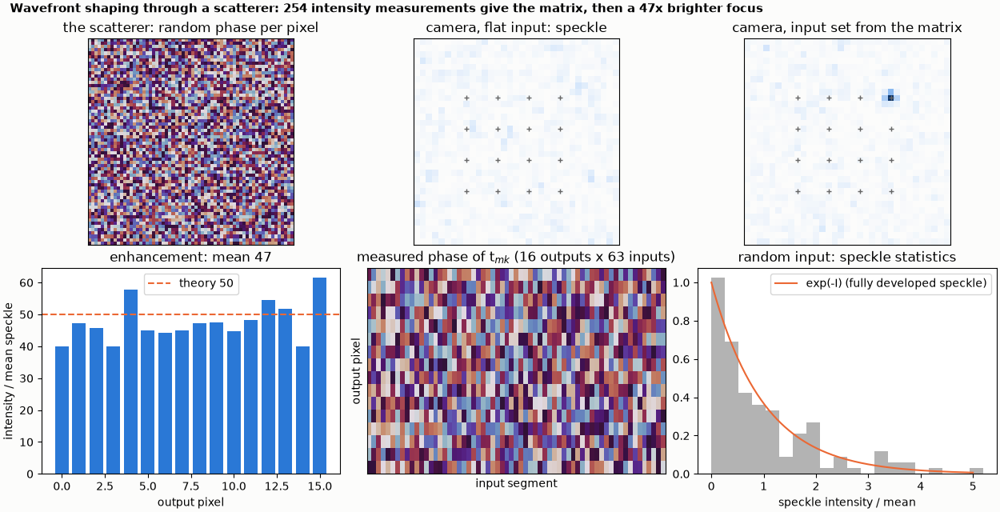
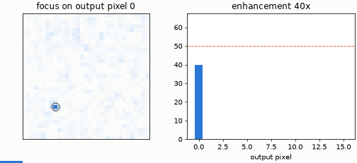

# Focusing through a scatterer by wavefront shaping

Wavefront shaping measures a scatterer's transmission matrix from intensities alone and turns speckle into a focus about 47 times brighter.

**The story.** Behind a diffuser a laser beam is a random speckle pattern. But the diffuser is linear: the field at every output
pixel is a weighted sum of the fields from the input pixels, `E_m = Σ_k t_mk E_k`. A phase-only device in front of it with 64
segments can measure the transmission matrix `t_mk` using only intensities (phase stepping, four measurements per segment, no
reference arm), and then set each segment's phase to minus the phase of `t_mk`: all 64 contributions arrive in phase at output pixel
m and a bright focus appears where there was speckle (Vellekoop and Mosk, Opt. Lett. 32, 2309 (2007)). The diffuser here is an
engine `modulator` with a random phase per pixel; the algorithm treats the engine as a black box.





**Layout** (`scatterer.py`): Gaussian beam (0.9 mm) → 64-segment phase-only device (8 x 8 grid cells per segment, a `modulator`) →
random-phase diffuser (64 x 64 pixels of 20 µm) → 100 mm of free space → camera. Output pixels: a 4 x 4 lattice near the centre.

```bash
python scatterer.py
python make_figures.py          # optional: hero.png, animation.gif (about 20 s)
```

```
64-segment phase-only input device, random diffuser (pixel phases uniform in 0..2 pi), camera 100 mm behind it
transmission matrix of 16 outputs measured from intensities alone: 254 engine runs (4 (N - 1) + 2 = 254)
focusing enhancement over the 16 outputs: mean 47.5 (+- 1.6), range 39.9 to 61.4
expected (pi/4)(sum a)^2 / sum a^2 + 1 - pi/4 for the Gaussian beam's segment amplitudes: 50.0 (equal amplitudes: (pi/4)(N - 1) + 1 = 50.5)
checks passed
```

**What it shows.** 254 engine runs measure the transmission phases of 16 output pixels (`4 (N - 1) + 2`). Focusing on each pixel
then makes it 47 times brighter than the mean speckle, with a spread of 40-61 across pixels; the expectation for a Rayleigh
transmission matrix and this Gaussian beam is 50, close to `(π/4)(N - 1) + 1 = 50.5` for equal amplitudes. The speckle of a random
input follows `exp(-I)` (right-hand panel).

**Limits.** The enhancement is a statistic of a random diffuser: the example prints its mean over 16 pixels and its range. The
diffuser is a thin phase screen with no depth, and the engine is noiseless, so a real experiment gets less (noise, drift, the
finite number of grey levels).
