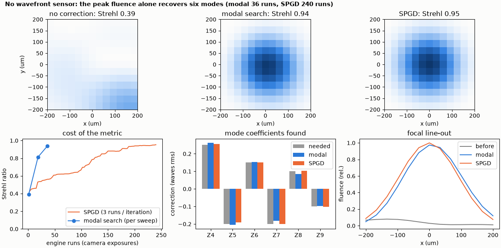
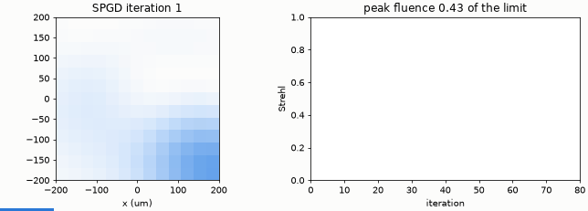

# Sensorless adaptive optics

With only the focal peak as a metric, modal search (36 camera exposures) and SPGD (240) improve a six-mode aberration from Strehl 0.39 to 0.94.

**The story.** Often there is no wavefront sensor: the only thing a camera or a photodiode tells you is *how bright the focus is*.
Two classic ways to improve it with a deformable mirror, using nothing but that number:

* **modal search**: for each Zernike mode try three settings, fit a parabola to the metric, move to its vertex;
* **SPGD** (stochastic parallel gradient descent): shake all modes at random, step along the measured gradient.

A hidden aberration of six Zernike modes (0.10-0.25 waves rms each) degrades the focus to a Strehl ratio of 0.39. Both algorithms
climb to 0.94-0.95, and the example counts the engine runs (camera exposures) each one needs.





**Layout** (`sensorless.py`): the same bench as [dm-correction](../dm-correction/README.md); the metric is the focal peak fluence over
its diffraction-limited value; the unknown is a vector of six mode coefficients, converted to mirror commands by
`DmBench.zernike_commands`. `ultrafast.algorithms.sensorless` provides `modal_search` and `spgd`.

```bash
python sensorless.py
python make_figures.py          # hero.png, animation.gif (about 20 s)
```

```
hidden aberration {4: -0.25, 5: 0.2, 6: -0.15, 7: 0.2, 8: -0.1, 9: 0.1} waves rms; the camera peak fluence is the only measurement
Strehl ratio before: 0.39
modal Strehl 0.94 after 36 engine runs; coefficient error rms 0.011 waves (truth [0.25, -0.2, 0.15, -0.2, 0.1, -0.1])
spgd  Strehl 0.95 after 240 engine runs; coefficient error rms 0.004 waves (truth [0.25, -0.2, 0.15, -0.2, 0.1, -0.1])
checks passed
```

**What it shows.** Modal search needs 36 runs and finds the coefficients to 0.011 waves rms: a peak-type metric is nearly
quadratic and separable in the modes close to the optimum, which is exactly what it assumes. SPGD needs 240 runs for the same
strehl because it learns the gradient from noisy, random pairs; its advantage is that it scales to hundreds of actuators, where a
mode-by-mode search does not. The SPGD settings (gain 3, shake amplitude 0.05 waves) are tuned for this example: with gain 5 it
reaches 0.80 and with gain 1.5 only 0.64 in the same 80 iterations.

**Limits.** The metric is noiseless here (a camera adds noise and drift, which favours SPGD's averaging). Six modes are searched;
the mirror itself, with 100 actuators, could do more.
