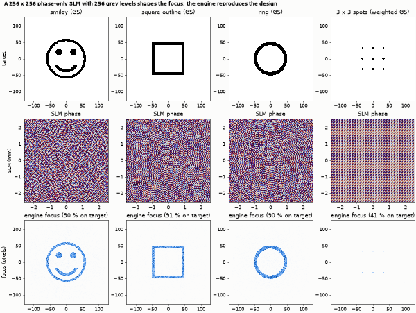
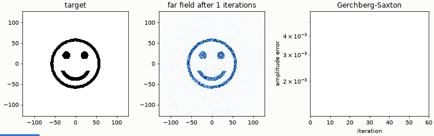
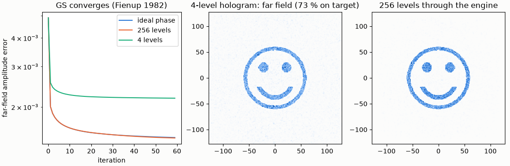
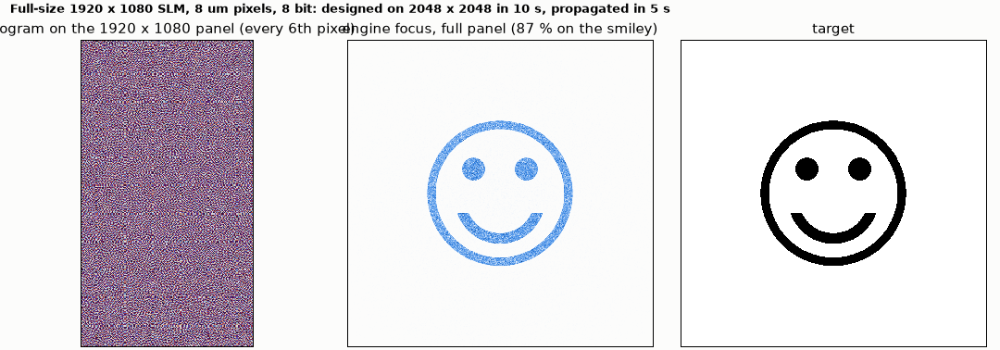

# Beam shaping with a phase-only SLM

A phase-only SLM with 256 grey levels turns a Gaussian beam into a smiley, a square, a ring and a spot array (Gerchberg-Saxton holograms), up to a full 1920 x 1080 panel.

**The story.** A spatial light modulator writes only phase, yet the focus of a lens behind it can be any pattern. The
Gerchberg-Saxton algorithm finds the phase: iterate between the SLM plane (a known Gaussian beam, free phase) and the focal plane
(the wanted amplitude, free phase). Here the hologram is quantised to **256 grey levels (8 bit)** *inside* the loop, written to the
`slm` element, and the engine propagates the beam through the lens. A smiley face, a square, a ring and a 3 x 3 spot array
(weighted GS) all come out of the same device.





*The far field after 1, 2, 3, ... 60 iterations, with the amplitude error beside it.*

**Layout** (`slm_shaping.py`): Gaussian beam (1.4 mm radius, 800 nm) → `slm` (256 x 256 pixels of 20 µm, 256 linear grey levels) →
lens f = N dx² / λ = 128 mm → camera. With this focal length the engine's focal-plane pixels are exactly the FFT bins of the
hologram, so the design and the engine result share one lattice. The panel is shifted by half a pixel (`offset_x_m`, `offset_y_m` = -pitch/2) so that its pixel
centres lie on the engine's grid points: the grid has a sample on the axis, an even panel has a pixel *edge* there, and without the shift every grid cell would average two
pixels. The reference in the output is an exact NumPy propagation of the same sampled field: Gaussian x quantised hologram x thin lens, angular spectrum over f
(`exact_prediction`).

```bash
python slm_shaping.py
python make_figures.py          # optional: hero.png, quantisation.png, full-panel.png, animation.gif (about 40 s)
```

```
panel 256 x 256 pixels of 20 um, 256 grey levels, lambda 800 nm, f = 128.0 mm (focal pixels = FFT bins), beam radius 1.4 mm
smiley  energy on target pixels 0.90 (design 0.88); against the exact propagation of the written phase: open edge 0.009, absorbing edge 0.129  GS error 0.005 -> 0.001
square  energy on target pixels 0.91 (design 0.89); against the exact propagation of the written phase: open edge 0.009, absorbing edge 0.138  GS error 0.005 -> 0.001
ring    energy on target pixels 0.90 (design 0.87); against the exact propagation of the written phase: open edge 0.010, absorbing edge 0.117  GS error 0.005 -> 0.001
spots   energy on target pixels 0.41 (design 0.43); against the exact propagation of the written phase: open edge 0.000, absorbing edge 0.056  GS error 0.006 -> 0.003
GS error is non-increasing after the first iterations (Fienup 1982)
checks passed
```

**What it shows.** 90-91 % of the light lands on the pixels of the smiley, the square and the ring (the GS design predicts 87-89 %). The sharper the target, the more
light a GS hologram leaves elsewhere: the weighted-GS spot array puts 41 % of the light into the nine spots.

**What was checked, and a finding.** The numbers after "against the exact propagation" are the relative L2 distance between the engine's focal fluence and the exact
propagation of the same sampled field (both normalised to unit sum). With the engine's absorbing edge switched off the distance is **0.9-1.0 %** (a bound; its cause is not separated further). With the absorbing edge on, which is the engine's default, it is 12-14 %: the periodic
grid wraps the diffraction orders of the pixelated hologram round the window, and the edge absorbs them, so the engine shows the isolated pattern and the periodic
reference the pattern plus its replicas. The earlier version of this example compared with a plain FFT and reported a correlation of 0.98-0.99; the missing
light had two causes found in this check: (1) the panel was half a pixel off the grid, so each grid cell averaged two pixels (an ideal blaze of P pixels per period then keeps only
cos²(π/P) of its light in the engine: 0.854 at P = 8, 0.962 at P = 16, exactly the values measured before the fix; with the shift it keeps 1.0000), and (2) the
absorbing edge. The engine now warns when the device pitch equals the grid step and the cell edges fall on grid points.

Quantisation: `quantisation.png` compares the GS error with an ideal phase, 256 levels and 4 levels, and shows the far field of a
4-level hologram next to the 256-level one through the engine. The S3 measurements found that quantisation inside the loop helps at
2 and 3 levels but not at 4 or 8 on this kind of target.



**The full panel.** `python slm_shaping.py --full` designs the smiley for a **1920 x 1080** panel (8 µm pixels, 8 bit) on the 2048 x
2048 grid the engine uses and propagates it (about 15 s on a laptop; the panel's phase goes in as a callback, not as JSON):
87 % of the light on the smiley (the GS design predicts 86 %).



**Limits.** Patterns stay inside the inner half of the focal window: the periodic FFT of a pixelated hologram repeats the pattern
at the diffraction orders and the engine's absorbing edge removes what the FFT would wrap round. The default SLM birefringence
preset is generic and unverified; this example runs at a single wavelength so it does not enter.
