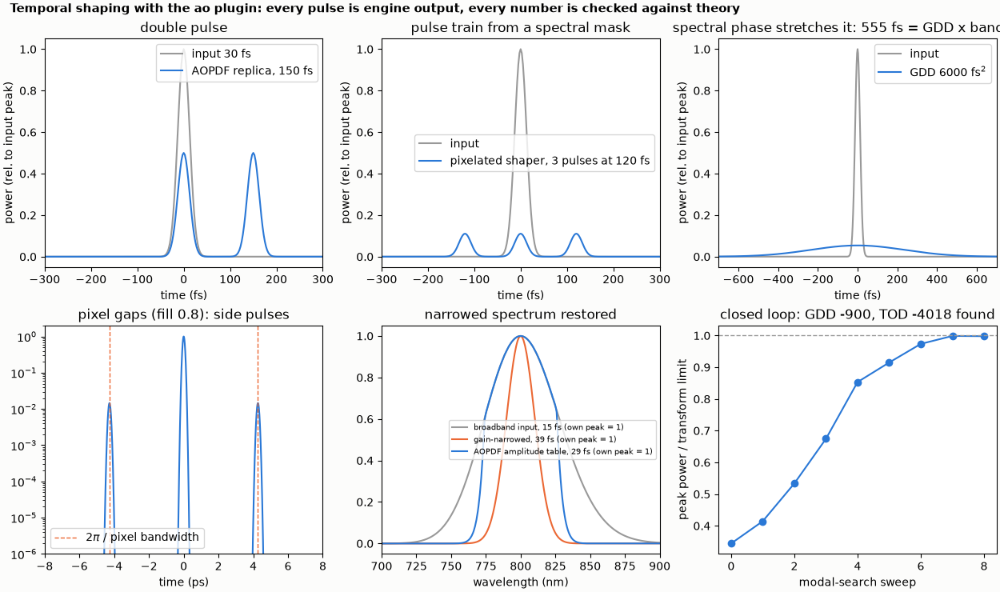
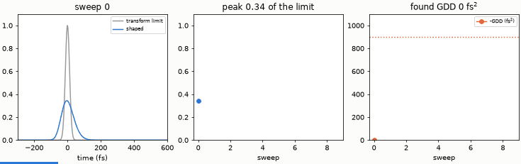

# Temporal pulse shaping

A spectral shaper and an AOPDF make double pulses and pulse trains, show the side pulses of pixel gaps, restore a narrowed spectrum and find an unknown chirp in a closed loop.

**The story.** Between a laser and an experiment sits a pulse shaper: a 4f line with a programmable mask, or an acousto-optic
programmable dispersive filter (AOPDF). Whatever you write into the spectrum is a pulse shape in time. The `ao` plugin has both as
elements (`spectralShaper`, `aopdf`). Here they make a double pulse, a three-pulse train and a stretched pulse; they show the
**side pulses** of a pixelated, gapped mask at `2π / pixel bandwidth` (Weiner); they restore a spectrum that gain narrowing has
squeezed; and a **closed loop** finds an unknown chirp (GDD and TOD) from the peak power alone.





*The animation: each sweep of the modal search moves the AOPDF's GDD and TOD closer to minus the chirp; the pulse returns to the
transform limit.*

```bash
python temporal_shaping.py
python make_figures.py          # hero.png, animation.gif (a few seconds)
```

```
input pulse: 30.0 fs FWHM, 800 nm
double pulse (aopdf replica, 150 fs): peaks at [-75.0, 75.0] fs, height ratio 1.000
3-pulse train (shaper, 120 fs): 3 pulses spaced 120 fs
stretched (GDD 6000 fs^2): FWHM 555 fs (stationary phase: GDD x bandwidth = 554 fs)
pixel gaps (fill factor 0.8, pixel 500 um): side pulse at 4.27 ps (2 pi / pixel bandwidth = 4.27 ps), energy ratio 0.0159 (formula 0.0159)
gain narrowing: FWHM 15.0 fs (broad input) -> 39.3 fs (narrowed) -> 29.3 fs (restored by the AOPDF amplitude table)
closed loop, unknown chirp GDD 900 fs^2 and TOD 4000 fs^3: peak power per sweep (fraction of the transform limit): 0.34 0.41 0.53 0.67 0.85 0.91 0.97 1.00 1.00
  found GDD -900 fs^2, TOD -4018 fs^3
checks passed
```

**What it shows.**

* **Double pulse**: an AOPDF replica (`replicaAmplitude` 1, delay 150 fs) gives two equal pulses 150 fs apart.
* **Pulse train**: the shaper's mask is the transfer function `Σ_k exp(iωkτ)/3` (a phase and an amplitude per pixel, 1024
  pixels over 120 nm) and gives three pulses 120 fs apart.
* **Stretching**: a GDD of 6000 fs² stretches 30 fs to 555 fs, as `GDD x bandwidth` predicts (554 fs).
* **Pixel gaps**: a mask with fill factor 0.8 and 0.5 nm pixels leaves a side pulse at 4.27 ps = 2π / pixel bandwidth, with the energy
  ratio `[sin(πf)/(πf)]² exp(-2(π w₀/p)²)` = 0.0159 (Weiner, Rev. Sci. Instrum. 71, 1929 (2000)); measured 0.0159. The run sets
  `grid.windowS` to 40 ps because the planner does not know about side pulses.
* **Gain narrowing restored**: a Gaussian amplitude filter (a stand-in for gain narrowing, not a gain model) stretches a 15 fs
  pulse to 39 fs; an AOPDF amplitude table that is the inverse of the filter, limited to a factor 4 so that it stays passive,
  brings it back to 29 fs, not 15 fs: the limit on the correction is the dynamic range, not the device.
* **Closed loop**: the unknown chirp is 900 fs² of GDD and 4000 fs³ of TOD; eight sweeps of modal search on the peak power find
  -900 fs² and -4018 fs³ (the peak power reaches 1.00 of the transform limit).

**Limits.** The shaper is the 1-D spectral transfer function (no spatial chirp), with a field-overlap model of the spot
(the Weiner test checks the implementation, not the choice). FROG or d-scan is not wired in as the closed-loop metric; any function
of a run works, here the peak power.
