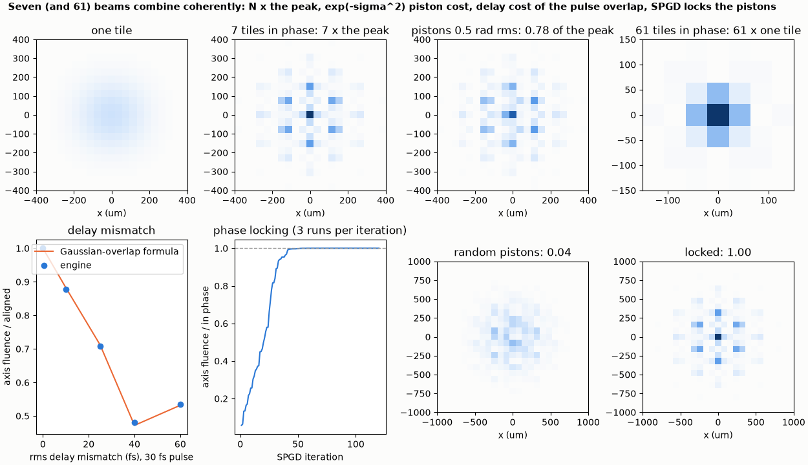
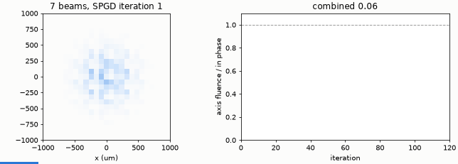

# Coherent tiled-aperture combining

Seven and 61 coherent beams combine to N times the peak; piston and delay errors cost what theory says, and SPGD locks the phases.

**The story.** Instead of one big beam, combine many small ones: seven (or 61) fibre or amplifier channels on a hexagonal lattice,
each with its own phase. In phase they add coherently and the central peak is **N times** that of a single beam at the same total
power. Phase errors cost `|Σ exp(iφ)|² / N²`; delay errors cost the overlap of the pulse envelopes; and a feedback loop (SPGD) can
lock the phases using nothing but the on-axis power. All of it runs through the engine's coherent tile source.





**Layout** (`tiled_array.py`): `ultrafast_ao.tiled_array` builds the core tile source (hex lattice, 3 mm pitch, 0.5 mm tile radius,
800 nm, 30 fs pulses where time matters) → lens f = 0.5 m → focal-plane camera. The reference for every ratio is an engine run of
the same array with all pistons and delays zero.

```bash
python tiled_array.py
python make_figures.py          # optional: hero.png, animation.gif (about 30 s)
```

```
7 tiles of radius 0.5 mm on a hex lattice of pitch 3 mm, lambda 800 nm, f = 0.5 m
in phase: peak fluence 7.00 x one tile at the same total power (N = 7)
pistons of 0.5 rad rms: axis fluence 0.785 of in phase (|sum exp(i phi)|^2 / N^2 = 0.787)
61 tiles (4 rings): peak 61.0 x one tile (N = 61)
energy in the central lobe 0.17, in the first grating lobes 0.59
delay mismatch of the 30 fs tiles: axis fluence over the aligned value (engine, formula)
  rms  0 fs   1.000   1.000
  rms 10 fs   0.878   0.883
  rms 25 fs   0.707   0.712
  rms 40 fs   0.481   0.472
  rms 60 fs   0.535   0.532
SPGD locking of the 7 pistons: axis fluence 0.04 -> 1.00 of the in-phase value in 120 iterations (360 engine runs)
checks passed
```

**What it shows.**

* In phase, 7 tiles give 7.00 times and 61 tiles 61.0 times the peak of one tile (the 61-tile array needs a longer lens, 1.5 m,
  so that its focal spot spans more than one pixel of the window).
* Pistons of 0.5 rad rms cost 0.785 of the peak against `|Σ exp(iφ)|²/N² = 0.787` for the same draw.
* A delay mismatch moves the envelope of each tile: for a 30 fs pulse an rms mismatch of 25 fs costs 30 % of the on-axis fluence, and
  the engine follows the Gaussian-overlap formula `(1/N²) Σ exp(-ln2 (τ_k - τ_l)²/τ_p²)` to 2 %. For the 7 random delays drawn
  at 60 fs rms the value rises again (0.535): it is a sample of seven, not an average. Timing, not just phase, matters for
  few-cycle pulses.
* SPGD (gain 10, shake 0.2 rad) takes the pinhole signal from 0.04 to the in-phase value in about 60 iterations. The loop runs on 128 x 128 cells with a lens of
  f = 1 m. **Finding (the earlier version of this example ended at 1.02 of the in-phase value):** at f = 0.5 m the lens phase of a tile 3 mm off the axis changes by 3.7 rad per cell on
  128 cells, more than π, so the lens is under-sampled, and the seven identical tiles reach the axis with fluences that differ by a factor of 56 (one tile alone: 1, 1, 0.08, 4.6, 0.08, 1, 1
  times the central tile's). The zero-piston sum was then not the maximum, and SPGD found a better one. At f = 1 m (1.9 rad per cell) the seven fluences are equal to 1e-3, and so is
  the case of 256 cells at f = 0.5 m, which the other runs of this example use; the lock then ends at the in-phase value and not above it, and the example asserts both bounds
  (`test_tiled_array_identical_tiles_reach_the_axis_alike_only_when_the_lens_is_resolved`). A NumPy model of the sampled field does not reproduce the engine's weights in the aliased case, which
  is why the cause is stated as the under-sampled lens (the symptom, equal tiles reaching the axis unequally, is measured) and not decomposed further.

**Limits.** Tiles are identical Gaussians of one radius: no fibre mode-field profile, no coupling between cores, no per-channel
dispersion or nonlinearity beyond a delay. The engine normalises the total power.
