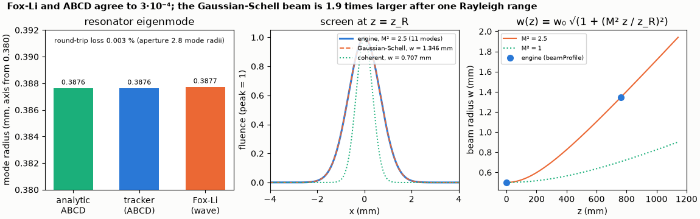

# A resonator and a partially coherent beam

A Fox-Li iteration finds the ABCD eigenmode of an apertured lens guide (radius 0.3877 mm against 0.3876 mm analytic, 0.003 % loss per round trip), and a Gaussian-Schell beam of M² = 2.5 is 1.9 times larger than a coherent one after a Rayleigh range (1.346 mm against 0.707 mm).

**The story.** Two short runs with one-frequency (`"shape": "cw"`) sources, each with an analytic answer. **A ring resonator** (`lens-guide.ufs`) is a lens of f = 0.5 m every 0.6 m, with a 1.1 mm aperture. The tracker gives the round-trip matrix and the Gaussian eigenmode; the `transverse` grid adds the Fox-Li iteration, a wave calculation that knows nothing of ABCD matrices ([Resonators](../../../reference/oscillators.md#resonators)). **A Gaussian-Schell beam** (`beam.ufs`, `run-m2.json`) has a 0.5 mm waist and M² = 2.5; `"coherence"` turns the run into coherent modes (those above 10⁻⁴ of the energy) ([Partial coherence](../../../reference/transverse.md#partial-coherence)). Its radius after one Rayleigh range follows w(z) = w₀ √(1 + (M² z / z_R)²).



**Layout** (`lens-guide.ufs`, `beam.ufs`): the resonator is a ring with a 0.3 m gap, a lens of 0.5 m, an aperture of radius 1.1 mm and a second 0.3 m gap, on a radial grid of 256 points over 3.5 mm, at most 800 round trips with tolerance 1e-7. The beam is a Gaussian of 0.5 mm radius on a cartesian grid of 512 points over 16 mm, then 0.7624 m of vacuum (one Rayleigh range of the M² = 2.5 beam). Both sources are 1 W at 1030 nm. About 5 s.

**Run it** in the example folder. The two tabs run the same two simulations and print the same numbers.

=== "CLI"

    ```bash
    ultrafast run lens-guide.ufs run-cavity.json -o results-cavity
    ultrafast run beam.ufs run-m2.json -o results-m2
    python report.py
    ```

    ```
    (A + D) / 2      0.4000   analytic 0.4000
    mode radius (mm) 0.3876   analytic 0.3876
    Fox-Li radius    0.3877   round-trip loss 0.003 %, 29 round trips
    waist (mm)       0.4998   analytic 0.5000
    at z_R (mm)      1.3456   analytic 1.3463
    ```

=== "Python"

    <!-- snippet -->
    ```python
    import math

    import ultrafast as uf
    from ultrafast import build as b

    LAM, F, L = 1030e-9, 0.5, 0.6

    # the resonator: Fox-Li iteration on a radial grid, next to the tracker's ABCD eigenmode
    cavity = uf.run(uf.System.load("lens-guide.ufs"), b.run_spec(b.cw(LAM, 1.0)))
    v = cavity.elements()[0]["values"]
    w0 = math.sqrt(LAM / math.pi * math.sqrt(L * (4 * F - L)) / 2)
    print(f"(A + D) / 2      {v['stabilityX']:.4f}   analytic {1 - L / (2 * F):.4f}")
    print(f"mode radius (mm) {v['modeRadiusXM'] * 1e3:.4f}   analytic {w0 * 1e3:.4f}")
    print(f"Fox-Li radius    {v['foxLiRadiusXM'] * 1e3:.4f}   round-trip loss {v['roundTripLoss'] * 100:.3f} %, {v['foxLiRoundTrips']:.0f} round trips")

    # the Gaussian-Schell beam: M2 = 2.5 as a sum of coherent modes
    beam = uf.run(uf.System.load("beam.ufs"), b.run_spec(b.cw(LAM, 1.0), coherence=b.coherence(2.5, modes=40),
                                                          instruments=[b.instrument("beamProfile", at="screen", name="screen")]))
    w = {e["id"]: e["beam"]["radiusXM"] for e in beam.elements()}
    print(f"waist (mm)       {w['waist'] * 1e3:.4f}   analytic 0.5000")
    print(f"at z_R (mm)      {w['screen'] * 1e3:.4f}   analytic {0.5 * math.sqrt(1 + 2.5 ** 2):.4f}")
    ```

    ```
    (A + D) / 2      0.4000   analytic 0.4000
    mode radius (mm) 0.3876   analytic 0.3876
    Fox-Li radius    0.3877   round-trip loss 0.003 %, 29 round trips
    waist (mm)       0.4998   analytic 0.5000
    at z_R (mm)      1.3456   analytic 1.3463
    ```

The figure comes from `python make_figures.py`.

**What it shows.** The Fox-Li mode has the radius of the ABCD eigenmode, and the aperture, 2.8 mode radii, costs 0.003 % per round trip. The Gaussian-Schell beam has the same waist as a coherent one but
is 1.9 times larger after a Rayleigh range (1.346 mm against 0.707 mm), as w(z) = w₀ √(1 + (M² z / z_R)²) says.

* Close the aperture to 0.6 mm (1.5 mode radii): the loss rises and the mode shrinks and departs from the Gaussian.
* Make the cavity unstable (`lengthM` of 1.2 m each, L > 4 f): a warning, and no eigenmode.
* `"m2": 1`: one mode, the coherent beam.

**Limits.** The resonator has no gain, no mirror errors and no thermal lens; the partially coherent beam is a Gaussian-Schell model, not an arbitrary mutual-intensity function. Related: [Resonators](../../../reference/oscillators.md#resonators).
