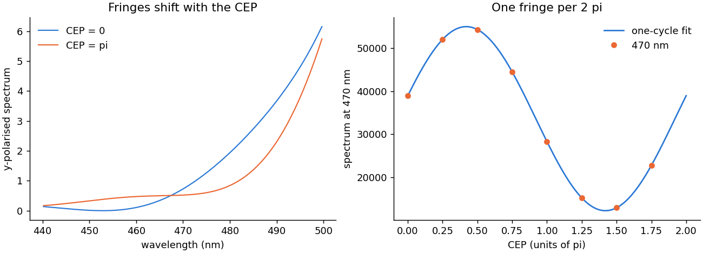

# An f-2f interferometer

A 3 fs pulse is broad enough for its blue wing to meet the red wing of its second harmonic; the fringes at 470 nm follow the carrier-envelope phase with a one-cycle modulation of 0.637 of the mean and no second harmonic of the CEP.

**The story.** A 3 fs pulse is broad enough for its blue wing to meet the red wing of its own second harmonic. A branched system splits the pulse, doubles one copy in a BBO crystal, delays the other by 40 fs and merges them again. The spectral fringes where the two overlap follow the carrier-envelope phase (`cepRad`), which is how f-2f interferometers measure it. Beams with different carriers merge on the wider grid ([Interference](../../../reference/branches.md#interference)). The check is a symmetry: the signal at 470 nm must repeat once per 2π of CEP and have no part at twice that rate.



**Layout** (`f2f.py`): a 3 fs, 1 nJ pulse at 800 nm, polarised at 45°, on a 50:50 splitter. Arm `x`: 5 µm of type I BBO (second harmonic, beam radius 20 µm). Arm `ref`: a delay of 40 fs. A second 50:50 splitter merges them; one port is a virtual output. Grid: 2^15 points over 2 ps. Eight CEP values from 0 to 7π/4. About 3 s.

**Run it** in the example folder. The CLI tab runs the example's script, which also draws `f2f.png`; the Python tab is its builder core (no plotting), with the same output.

=== "CLI"

    ```bash
    python f2f.py                 # about 3 s; writes f2f.png
    ```

    ```
    modulation at one cycle per 2 pi of CEP   0.637 of the mean
    at two cycles                             0.0000 of the one-cycle part
    ```

=== "Python"

    <!-- snippet -->
    ```python
    import math

    import numpy as np
    import ultrafast as uf
    from ultrafast import build as b

    C, LAM_OVERLAP = 299792458.0, 470e-9      # where the blue wing of the pulse meets the red wing of its harmonic

    system = b.system("f-2f", b.Branched([
        b.link(b.beam_splitter("bs"), {"c": "x", "d": "ref"}),
        b.link(b.crystal("x", "BBO", 5e-6, "shg", type="I", output="sh", beam=b.gaussian_beam(20e-6)), "merge:1"),
        b.link(b.delay("ref", delay_s=40e-15), "merge:2"),
        b.link(b.beam_splitter("merge"), {"c": "end", "d": "virtual"}),
    ]))


    def spectrum(cep):
        pulse = b.pulse(800e-9, 3e-15, energy=1e-9, cepRad=cep, polarization="45")
        res = uf.run(system, b.run_spec(pulse, grid=b.grid(n=2 ** 15, window_s=2e-12)))
        # type I: the harmonic is polarised along y, so the y part of the reference is what it beats with
        return res["output_omega_rad_s"], np.abs(res["output_ay_re"] + 1j * res["output_ay_im"]) ** 2


    ceps = np.arange(8) * math.pi / 4
    curves = [spectrum(c) for c in ceps]
    w = curves[0][0]
    at = np.abs(w - 2 * math.pi * C / LAM_OVERLAP).argmin()
    signal = np.array([c[1][at] for c in curves])
    component = (signal * np.exp(-1j * ceps)).sum() / len(ceps)
    second = abs((signal * np.exp(-2j * ceps)).sum() / len(ceps))
    print("modulation at one cycle per 2 pi of CEP   %.3f of the mean" % (2 * abs(component) / signal.mean()))
    print("at two cycles                             %.4f of the one-cycle part" % (second / abs(component)))
    ```

    ```
    modulation at one cycle per 2 pi of CEP   0.637 of the mean
    at two cycles                             0.0000 of the one-cycle part
    ```

**What it shows.** The signal at 470 nm is a mean plus a term that repeats once per 2π of CEP: the fringes are 0.637 of the mean deep, and the part at two cycles is zero to four digits. The CEP of the fundamental enters the second harmonic twice and the beat with the fundamental once, so a single cycle is what the physics gives.

**Limits.** The crystal is thin and the harmonic is generated in a plane-wave-like model with a fixed beam radius; no CEP noise or detector response is included. Related: [Two interferometers](../interferometers/README.md), [Branched systems](../../../reference/branches.md).
