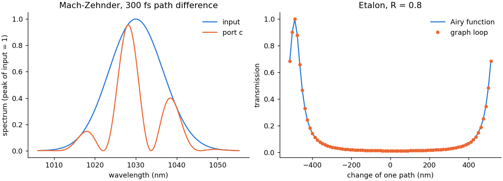

# Two interferometers

A Mach-Zehnder and a loop etalon written as branched systems reproduce their analytic results: port c carries 0.5004 of the input against 0.5004 analytic, and the etalon follows the Airy function to 3.3e-08.

**The story.** Branched systems with a known answer, written with the Python API ([Branched systems](../../../reference/branches.md)). In a Mach-Zehnder with one arm 300 fs longer, port `c` holds (1 − cos ω τ) / 2 of each frequency; the other port is a declared virtual output. An etalon of two mirrors with R = 0.8, joined by a loop, transmits the Airy function (1 − R)² / (1 + R² − 2 R cos δ) when a path moves over one wavelength.



**Layout** (`interferometers.py`): Mach-Zehnder: two 50:50 splitters, arms `armA` and `armB` with 0 and 300 fs delay, a 100 fs, 1 nJ pulse at 1030 nm, 8192 points over 20 ps. Etalon: two mirrors of R = 0.8, 10 mm gaps, a cw source of 1 W; the link from `back` to `m1:2` closes the loop (`ringDown`, tolerance 1e-16). A study moves the `back` gap over one wavelength in 81 points. About 2 s.

**Run it** in the example folder. The CLI tab runs the example's script, which also draws `interferometers.png`; the Python tab is its builder core (no plotting), with the same output.

=== "CLI"

    ```bash
    python interferometers.py                 # about 2 s; writes interferometers.png
    ```

    ```
    Mach-Zehnder     output / input 0.5004   analytic 0.5004
    spectral fringes largest error  below 1e-12 of the peak
    budget closure   below 1e-12 of the input
    etalon           peak 0.9996   Airy 0.9996, largest error 3.3e-08
    ```

=== "Python"

    <!-- snippet -->
    ```python
    import numpy as np
    import ultrafast as uf
    from ultrafast import build as b

    C, LAM = 299792458.0, 1030e-9
    TAU = 300e-15

    # Mach-Zehnder: one arm 300 fs longer. Port c holds (1 - cos(w tau)) / 2 of each frequency
    mz = b.system("mach-zehnder", b.Branched([
        b.link(b.beam_splitter("bs1"), {"c": "armA", "d": "armB"}),
        b.link(b.delay("armA", delay_s=0.0), "bs2:1"),
        b.link(b.delay("armB", delay_s=TAU), "bs2:2"),
        b.link(b.beam_splitter("bs2"), {"c": "end", "d": "virtual"}),
    ]))
    res = uf.run(mz, b.run_spec(b.pulse(LAM, 100e-15, energy=1e-9), grid=b.grid(n=8192, window_s=20e-12)))
    graph = res.summary["graph"]
    w = res["output_omega_rad_s"]
    s_in, s_out = res["input_spectrum"], res["output_spectrum"]
    fringes = (1 - np.cos(w * TAU)) / 2
    band = s_in > 1e-3 * s_in.max()
    print("Mach-Zehnder     output / input %.4f   analytic %.4f" % (s_out.sum() / s_in.sum(), (s_in * fringes).sum() / s_in.sum()))
    # the error is double-precision rounding (~1e-14, last digit platform dependent): print the bound it meets
    err = np.abs(s_out - s_in * fringes)[band].max() / s_in.max()
    print("spectral fringes largest error  %s 1e-12 of the peak" % ("below" if err < 1e-12 else "ABOVE"))
    # the closure is rounding noise (~1e-25 J on 1 nJ, platform dependent): print the bound it meets
    print("budget closure   %s 1e-12 of the input" % ("below" if abs(graph["energyClosureJ"]) < 1e-12 * 1e-9 else "ABOVE"))

    # etalon: two mirrors of R = 0.8 joined by a loop, and a cw source. Scanning a path over one wave passes one Airy peak
    R, GAP = 0.8, 0.01
    etalon = b.system("etalon", b.Branched([
        b.link(b.beam_splitter("m1", R), {"c": "forth", "d": "virtual"}, loop=b.loop("ringDown", max_round_trips=2000, tolerance=1e-16)),
        b.link(b.gap("forth", GAP, medium="Vacuum"), "m2:2"),
        b.link(b.beam_splitter("m2", R), {"c": "back", "d": "end"}),
        b.link(b.gap("back", GAP, medium="Vacuum"), "m1:2"),
    ]))
    offsets = np.linspace(-LAM / 2, LAM / 2, 81)
    scan = uf.study(etalon, b.run_spec(b.cw(LAM, 1.0)), parameters=[{"path": "element:back/lengthM", "values": list(GAP + offsets), "nominal": GAP}], outputs=["energy:end"])
    transmission = np.array([row["energy:end"] for row in scan["rows"]])
    nominal = uf.run(etalon, b.run_spec(b.cw(LAM, 1.0))).summary
    transmission /= nominal["graph"]["energyInJ"]
    delta = nominal["outputGrid"]["omega0"] * (2 * GAP + offsets) / C      # the grid's carrier, which is the source's frequency in the run
    airy = (1 - R) ** 2 / (1 + R * R - 2 * R * np.cos(delta))
    print("etalon           peak %.4f   Airy %.4f, largest error %.1e" % (transmission.max(), airy.max(), np.abs(transmission - airy).max()))
    ```

    ```
    Mach-Zehnder     output / input 0.5004   analytic 0.5004
    spectral fringes largest error  below 1e-12 of the peak
    budget closure   below 1e-12 of the input
    etalon           peak 0.9996   Airy 0.9996, largest error 3.3e-08
    ```

**What it shows.** The Mach-Zehnder output spectrum equals the input times (1 − cos ω τ) / 2 to rounding error, and the energy budget of the graph closes. The Airy function uses the grid's carrier, `summary["outputGrid"]["omega0"]`; a cw source sits exactly on the requested wavelength, so it is that wavelength. The etalon peak is 0.9996, not 1, because the 81 scan points do not fall exactly on the resonance (the round trip is about 19 400 waves long, so the position of the peak within the scan depends on the sixth digit of the carrier). Engine and Airy function agree equally well at every point.

**Limits.** Mirrors are lossless splitters without dispersion and the beams are plane; no mode matching or alignment error is modelled. Related: [Pump-probe](../pump-probe/README.md), [Branched systems](../../../reference/branches.md).
