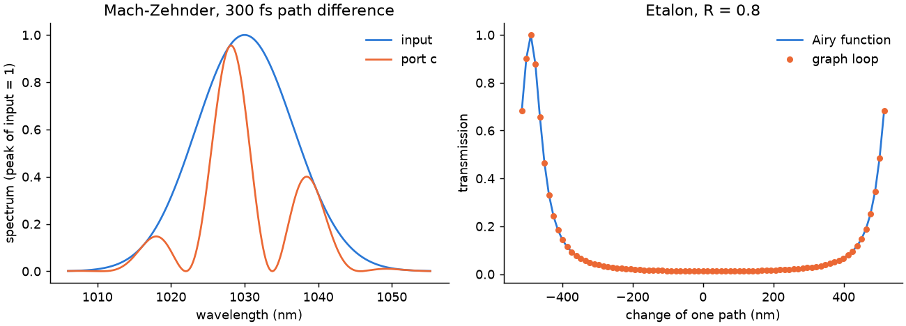

# 32 -- Two interferometers

Branched systems with a known answer, written with the Python API ([Branched systems](../../../reference/branches.md)).

**A Mach-Zehnder:** two 50:50 splitters, with one arm 300 fs longer. Port `c` holds (1 − cos ω τ) / 2 of each frequency; the other port is a declared virtual output.

**An etalon:** two mirrors of R = 0.8 joined by a loop, with a single-frequency source. The link from `back` to `m1:2` closes the loop. A study moves one path over one wavelength, and the transmission follows the Airy function.

```bash
cd docs/examples/Branched/interferometers
python interferometers.py
```

```
Mach-Zehnder     output / input 0.5004   analytic 0.5004
spectral fringes largest error  below 1e-12 of the peak
budget closure   below 1e-12 of the input
etalon           peak 0.9996   Airy 0.9996, largest error 3.3e-08
```



The Airy function uses the grid's carrier, `summary["outputGrid"]["omega0"]`; a cw source sits exactly on the requested wavelength, so it is that wavelength. The peak is 0.9996, not 1, because the 81 scan points do not fall exactly on the resonance (the round trip is about 19 400 waves long, so the position of the peak within the scan depends on the sixth digit of the carrier). Engine and Airy function agree equally well at every point.
