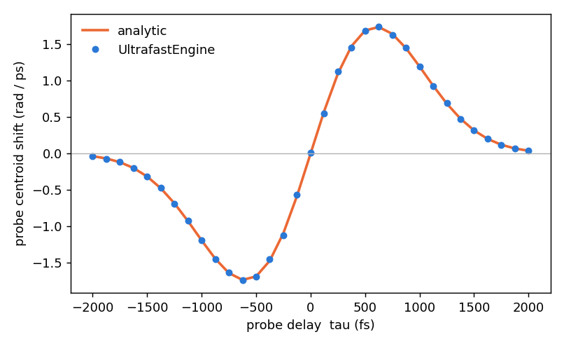

# Pump-probe: cross-phase modulation of a delayed probe

A pump and a delayed probe from one pulse cross a Kerr plate in a branched system; the probe's centroid shift follows the exact cross-phase result to 1.8 % of the peak shift (1.745e12 rad/s against 1.735e12).

**The story.** A strong pump and a weak probe come from one pulse on a 98:2 splitter and travel in two arms of a Branched system
([Branched systems](../../../reference/branches.md)). A quarter-wave plate at +45° in the pump arm and one at −45° in the
probe arm make them **opposite circular polarisations**; the probe arm is delayed by τ. The arms recombine on a 50:50
splitter and cross a 2 mm fused-silica plate (Kerr only: no Raman, no self-steepening). A quarter-wave plate and a
polariser then pass only the probe, and the probe's spectrum is measured. The reference is exact (see below).



**Layout** (`pump_probe.py`): 1030 nm, 1 ps pulses, 5 µJ into the first splitter (reflectivity 0.98 towards the pump arm), beam area 4e-10 m², 2 mm of `FusedSilica`, a grid of 8192 points over 40 ps, 33 delays from −2 ps to +2 ps. Each delay is run with and without the Kerr term. About 4 s.

**Run it** in the example folder. The CLI tab runs the example's script, which also draws `pump_probe.png`; the Python tab is its builder core (no plotting), with the same output.

=== "CLI"

    ```bash
    python pump_probe.py                 # about 4 s; writes pump_probe.png
    ```

    ```
    probe energy at the output 50.027 nJ  (expected 50.000 nJ; the pump is blocked)
    peak cross-phase B = 2.43 rad; largest centroid shift 1.744e+12 rad/s (analytic 1.735e+12)
    largest deviation from the analytic shift  1.76e-02 of the peak shift
    packets at the end: [1]
    ```

=== "Python"

    <!-- snippet -->
    ```python
    import math

    import numpy as np
    import ultrafast as uf
    from ultrafast import build as b

    C, LAM, N2, L = 299792458.0, 1030e-9, 2.6e-20, 2e-3       # n2 of the engine's FusedSilica (m^2/W)
    FWHM, E_IN, AREA, SPLIT = 1e-12, 5e-6, 4e-10, 0.98        # pump and probe duration, energy into the splitter, beam area
    TP = FWHM / (2 * math.sqrt(math.log(2)))                  # 1/e half-width of the intensity


    def system(tau_s):
        """The pump arm carries the pump, the probe arm the probe; the arm that arrives early gets no extra delay."""
        return b.system("pump-probe", b.Branched([
            b.link(b.beam_splitter("bs1", reflectivity=SPLIT), {"c": "probeQwp", "d": "pumpQwp"}),
            b.link(b.waveplate("pumpQwp", "quarter", axis_deg=45), "pumpDelay"),
            b.link(b.delay("pumpDelay", delay_s=max(0.0, -tau_s)), "bs2:1"),
            b.link(b.waveplate("probeQwp", "quarter", axis_deg=-45), "probeDelay"),
            b.link(b.delay("probeDelay", delay_s=max(0.0, tau_s)), "bs2:2"),
            b.link(b.beam_splitter("bs2", reflectivity=0.5), {"c": "plate", "d": "virtual"}),
            b.link(b.bulk("plate", "FusedSilica", L, beam=b.constant_beam(area_m2=AREA)), "analyserQwp"),
            b.link(b.waveplate("analyserQwp", "quarter", axis_deg=45), "analyser"),
            b.link(b.polarizer("analyser", axis_deg=0), "end"),
        ]))


    def run(tau_s, kerr=True):
        spec = b.run_spec(b.pulse(LAM, FWHM, energy=E_IN), grid=b.grid(n=8192, window_s=40e-12),
                          physics={"raman": False, "selfSteepening": False, "nonlinear": kerr})
        res = uf.run(system(tau_s), spec)
        w, s = res["output_omega_rad_s"], res["output_spectrum"]
        return res, float((w * s).sum() / s.sum())


    def reference(tau_s, i_pump_w_m2):
        """Exact centroid shift (rad/s) of a Gaussian probe in the cross-phase of a Gaussian pump."""
        t = np.linspace(-12 * TP, 12 * TP, 20001)
        probe = np.exp(-((t - tau_s) / TP) ** 2)
        phase = 4.0 / 3.0 * (2 * math.pi * C / LAM / C) * N2 * L * i_pump_w_m2 * np.exp(-(t / TP) ** 2)
        return float(-(probe * np.gradient(phase, t)).sum() / probe.sum())


    # pump intensity at the plate: the pump arm carries SPLIT of the energy, bs2 sends half on, a Gaussian pulse peaks at 0.9394 E / tau
    pump_energy = E_IN * SPLIT * 0.5
    i_pump = 0.9394 * pump_energy / FWHM / AREA
    taus = np.linspace(-2e-12, 2e-12, 33)
    ref_res, centroid0 = run(0.0, kerr=False)
    print("probe energy at the output %.3f nJ  (expected %.3f nJ; the pump is blocked)" % (
        ref_res.summary["output"]["energyJ"] * 1e9, E_IN * (1 - SPLIT) * 0.5 * 1e9))
    shift, packets = [], []
    for tau in taus:
        res, c = run(tau)
        shift.append(c - run(tau, kerr=False)[1])
        packets.append(res.summary["graph"]["packetsAtEnd"])
    shift = np.array(shift)
    model = np.array([reference(t, i_pump) for t in taus])
    err = np.abs(shift - model).max() / np.abs(model).max()
    print("peak cross-phase B = %.2f rad; largest centroid shift %.3e rad/s (analytic %.3e)" % (
        4 / 3 * 2 * math.pi / LAM * N2 * L * i_pump, np.abs(shift).max(), np.abs(model).max()))
    print("largest deviation from the analytic shift  %.2e of the peak shift" % err)
    print("packets at the end: %s" % sorted(set(packets)))
    ```

    ```
    probe energy at the output 50.027 nJ  (expected 50.000 nJ; the pump is blocked)
    peak cross-phase B = 2.43 rad; largest centroid shift 1.744e+12 rad/s (analytic 1.735e+12)
    largest deviation from the analytic shift  1.76e-02 of the peak shift
    packets at the end: [1]
    ```

**Why opposite circular polarisations.**

For two opposite circular polarisations an isotropic χ(3) only adds a phase: the probe phase is
φ(t) = (2/3) k0 n2 L (I_probe + 2 I_pump(t − τ)), with no coherent-artefact term. With orthogonal *linear* polarisations the
term A_y² A_x* couples the beams by their relative phase and the result depends on the carrier-envelope phase of the arms.

A pure phase modulation shifts the spectral centroid exactly by minus the intensity-weighted mean of dφ/dt, so the reference is
exact, not a perturbation result: δω(τ) = −(4/3) k0 n2 L ⟨dI_pump/dt⟩ over the probe. For Gaussian pulses it is odd in τ, zero at τ = 0 and
extremal at τ = ±√((T_p² + T_r²)/2) (here ±0.6 ps).

**What it shows.**

* The engine's shift follows the reference to 1.8 % of the peak shift at every delay (the residual is largest where the curve is steepest).
* `packetsAtEnd == 1`: the pump and the probe stay one packet. A merged packet needs the same source and a window that holds both
  delays; a pump from a separate virtual input, or a delay of more than half the window, would propagate without cross-phase.
* The probe channel holds the probe's energy to 0.05 % and the pump is blocked (1e-6 of it leaks).

**Why the pulses are 1 ps.**

The waveplates are the dispersionless design model (retardance ∝ ω). A QWP pair then does not extinguish the pump's spectral wings:
at 100 fs about 1e-4 of the pump leaks into the probe channel and shifts the measured centroid by up to 20 % of the peak shift. At 1 ps
the leak is 1e-6. A real waveplate has the same property; the example shows how to see it, by repeating the run with `FWHM = 100e-15`
and `AREA = 4e-9`.

**Limits.** The plate is thin and the beams are plane (a constant beam area); no diffraction, dispersion of the waveplates or birefringence is modelled. Related: [Two interferometers](../interferometers/README.md), [Branched systems](../../../reference/branches.md).
