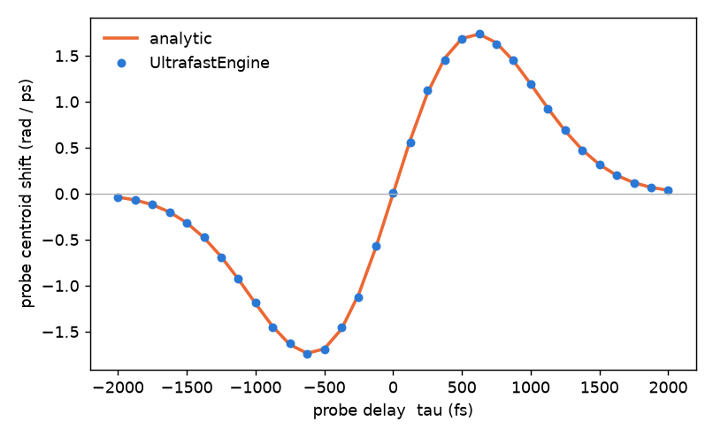

# 41 -- Pump-probe: cross-phase modulation of a delayed probe

A strong pump and a weak probe come from one pulse on a 98:2 splitter and travel in two arms of a Branched system
([Branched systems](../../../reference/branches.md)). A quarter-wave plate at +45° in the pump arm and one at −45° in the
probe arm make them **opposite circular polarisations**; the probe arm is delayed by τ. The arms recombine on a 50:50
splitter and cross a 2 mm fused-silica plate (Kerr only: no Raman, no self-steepening). A quarter-wave plate and a
polarizer then pass only the probe, and the probe's spectrum is measured.

```bash
cd docs/examples/Branched/pump-probe
python pump_probe.py
```

```
probe energy at the output 49.987 nJ  (expected 50.000 nJ; the pump is blocked)
peak cross-phase B = 2.43 rad; largest centroid shift 1.745e+12 rad/s (analytic 1.735e+12)
largest deviation from the analytic shift  1.76e-02 of the peak shift
packets at the end: [1]
```



## Why opposite circular polarisations

For two opposite circular polarisations an isotropic χ(3) only adds a phase: the probe phase is
φ(t) = (2/3) k0 n2 L (I_probe + 2 I_pump(t − τ)), with no coherent-artefact term. With orthogonal *linear* polarisations the
term A_y² A_x* couples the beams by their relative phase and the result depends on the carrier-envelope phase of the arms.

A pure phase modulation shifts the spectral centroid exactly by minus the intensity-weighted mean of dφ/dt, so the reference is
exact, not a perturbation result: δω(τ) = −(4/3) k0 n2 L ⟨dI_pump/dt⟩ over the probe. For Gaussian pulses it is odd in τ, zero at τ = 0 and
extremal at τ = ±√((T_p² + T_r²)/2) (here ±0.6 ps).

## What the example checks

* The engine's shift follows the reference to 1.8 % of the peak shift at every delay (the residual is largest where the curve is steepest).
* `packetsAtEnd == 1`: the pump and the probe stay one packet. A merged packet needs the same source and a window that holds both
  delays; a pump from a separate virtual input, or a delay of more than half the window, would propagate without cross-phase.
* The probe channel holds the probe's energy to 0.03 % and the pump is blocked (1e-6 of it leaks).

## Why the pulses are 1 ps

The waveplates are the dispersionless design model (retardance ∝ ω). A QWP pair then does not extinguish the pump's spectral wings:
at 100 fs about 1e-4 of the pump leaks into the probe channel and shifts the measured centroid by up to 20 % of the peak shift. At 1 ps
the leak is 1e-6. A real waveplate has the same property; the example shows how to see it, by repeating the run with `FWHM = 100e-15`
and `AREA = 4e-9`.
