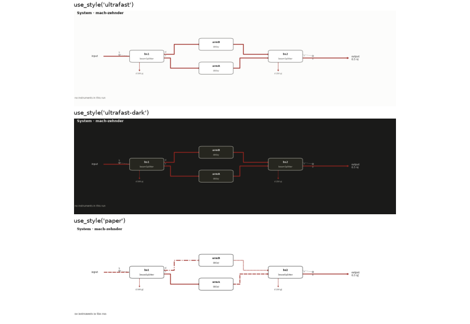
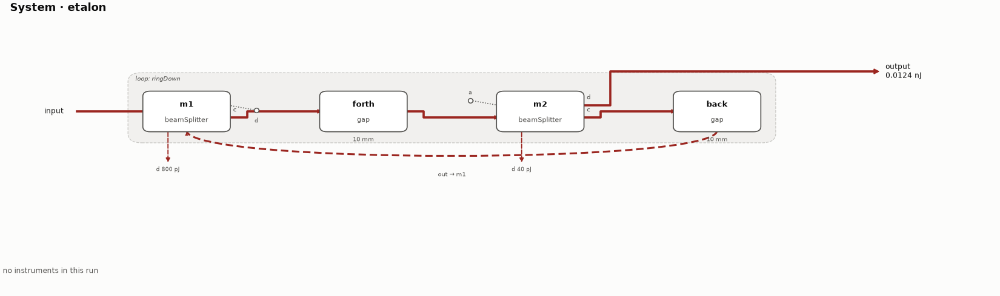
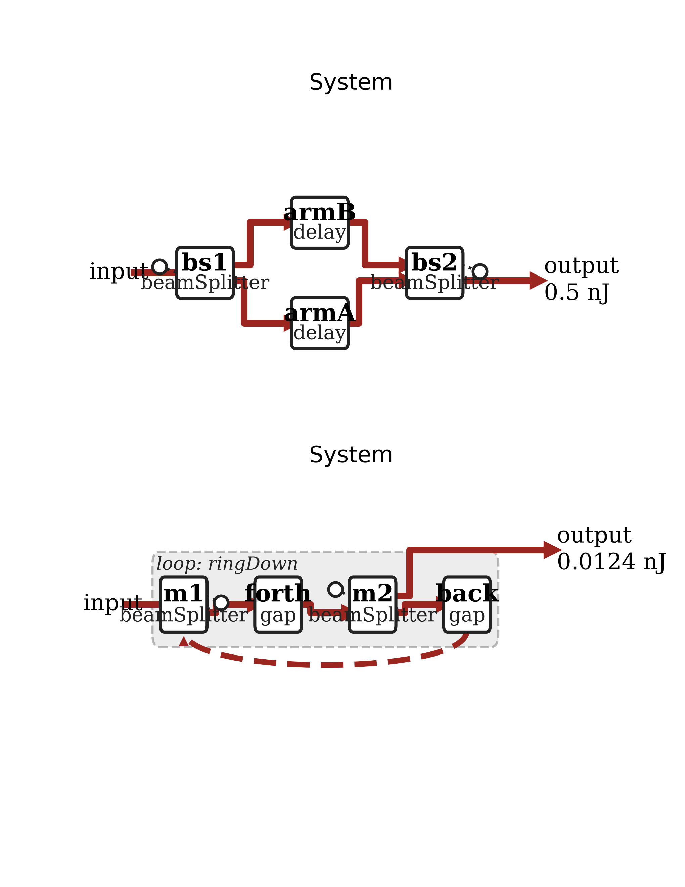

# Drawing branched systems: schematics and plot styles

ultrafast.plotting draws a Mach-Zehnder and a resonator with a loop as deterministic schematics in four plot styles: default, dark, paper and science.

**The story.** A branched system is a graph: beam splitters send light into arms, arms rejoin, a loop feeds a mirror back on itself. A line of boxes
cannot show that, so `up.system(result)` lays the graph out in layers, routes every link in orthogonal channels, draws loops as a dashed arc inside a
labelled region, and writes the energy that leaves at each port. The layout is code, not a hand drawing, so the same system always gives the same picture
(decision V2). This example runs two small systems whose answers are known (the [interferometers](../interferometers/README.md) example checks their
physics) and draws them in every style.



**Layout** (`schematics.py`): a Mach-Zehnder (`bs1`, arms `armA` / `armB` with 0 and 300 fs delay, `bs2`) run with a 100 fs, 1 nJ pulse at 1030 nm, and a
ring-down etalon (two 80 % mirrors 10 mm apart joined by a loop) run with a cw source. About 5 s.

**Run it** in the example folder. The CLI tab runs the example's script (all four styles, the compact figures and `hero.png`); the Python tab is its core for the three styles that need no extra package. With SciencePlots installed (`pip install ultrafast-engine[paper]`) the script's fourth style line becomes `mach-zehnder drawn in style science`.

=== "CLI"

    ```bash
    python schematics.py                 # about 5 s; writes styles/*.png and hero.png
    ```

    ```
    mach-zehnder drawn in style ultrafast
    mach-zehnder drawn in style ultrafast-dark
    mach-zehnder drawn in style paper
    style science not available (SciencePlots missing): skipped
    layout deterministic: True  nodes: 4
    ```

=== "Python"

    <!-- snippet -->
    ```python
    from pathlib import Path

    import matplotlib
    matplotlib.use("Agg")
    import matplotlib.pyplot as plt
    import ultrafast as uf
    from ultrafast import build as b
    from ultrafast import plotting as up
    from ultrafast.plotting.graph_layout import layout_graph

    TAU = 300e-15
    mz = b.system("mach-zehnder", b.Branched([                      # two arms, one 300 fs longer
        b.link(b.beam_splitter("bs1"), {"c": "armA", "d": "armB"}),
        b.link(b.delay("armA", delay_s=0.0), "bs2:1"),
        b.link(b.delay("armB", delay_s=TAU), "bs2:2"),
        b.link(b.beam_splitter("bs2"), {"c": "end", "d": "virtual"}),
    ]))
    etalon = b.system("etalon", b.Branched([                        # two 80 % mirrors joined by a loop
        b.link(b.beam_splitter("m1", 0.8), {"c": "forth", "d": "virtual"}, loop=b.loop("ringDown", max_round_trips=200, tolerance=1e-12)),
        b.link(b.gap("forth", 0.01, medium="Vacuum"), "m2:2"),
        b.link(b.beam_splitter("m2", 0.8), {"c": "back", "d": "end"}),
        b.link(b.gap("back", 0.01, medium="Vacuum"), "m1:2"),
    ]))
    result = uf.run(mz, b.run_spec(b.pulse(1030e-9, 100e-15, energy=1e-9), grid=b.grid(n=4096, window_s=20e-12)))
    loop = uf.run(etalon, b.run_spec(b.cw(1030e-9, 1.0)))

    out = Path("styles")
    out.mkdir(exist_ok=True)
    for style in ("ultrafast", "ultrafast-dark", "paper"):
        with up.use_style(style):
            fig = up.system(result, params=True)                    # params=True: key numbers under each box
            fig.savefig(out / f"mach-zehnder-{style}.png", dpi=up.save_dpi(fig, 110))
            plt.close(fig)
            print("mach-zehnder drawn in style", up.current_style())
    with up.use_style("ultrafast"):
        fig = up.system(loop)                                       # a loop is a dashed arc inside a labelled region
        fig.savefig(out / "etalon-ultrafast.png", dpi=110)
        plt.close(fig)
    layout = layout_graph(result.summary)
    print("layout deterministic:", layout == layout_graph(result.summary), " nodes:", len(layout["nodes"]))
    ```

    ```
    mach-zehnder drawn in style ultrafast
    mach-zehnder drawn in style ultrafast-dark
    mach-zehnder drawn in style paper
    layout deterministic: True  nodes: 4
    ```

**What it shows.**

* **Choosing a style.** `up.use_style("paper")` stays in force; `with up.use_style("ultrafast-dark"):` holds only inside the block;
  `ULTRAFAST_PLOT_STYLE=paper` and `ultrafast-plot --style paper` do the same from the environment and the command line. `up.current_style()` says what is in force.
  `science` without SciencePlots warns and gives `paper`; the script checks `current_style()` and skips the file.
* **A loop** is a dashed arc under the row, from the element that closes the loop to the one it feeds, inside a shaded region labelled with the loop kind.

  

* **Compact schematics** (`up.system_diagram(result, ax, compact=True)`) draw into an axes of your own figure, for a corner of a larger plot.
  In the `paper` styles with `column="single"` the figure is 3.4 in wide and saved at 600 dpi:

  

* **Determinism.** `layout_graph(summary)` returns the same positions every time (the last output line); the tests keep golden layouts.

**Limits.** The schematic shows the topology and the energy at each port, not the geometry of the beams. A sequential system keeps the beam line with glyphs
per element. See [plotting](../../../reference/plotting.md) for every function, the palette checks and the animation and 3-D spectrogram figures.
