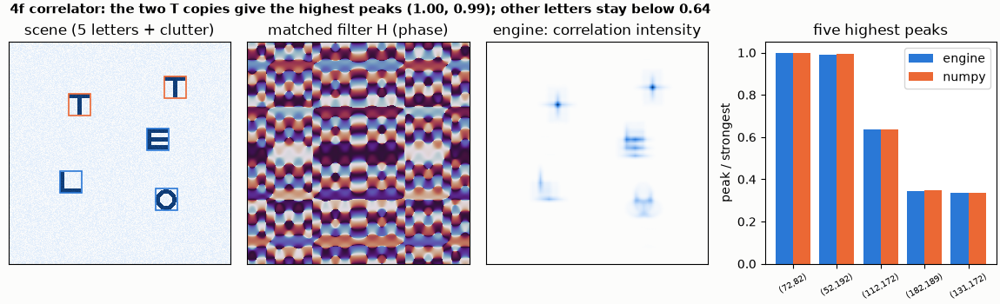
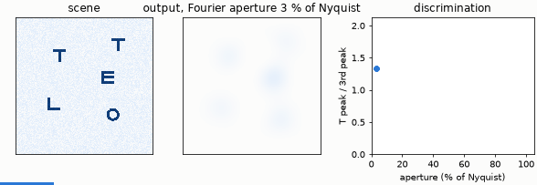

# 4f correlator

A scene of five letters on a clutter background, and a matched filter for the letter T in the Fourier plane of a 4f system. One pass
of light puts a bright peak at the centre of every T. The engine's result is compared with the correlation theorem in numpy.





*The animation opens the Fourier-plane aperture from 3 % to 100 % of the Nyquist frequency: the output forms, and the peak of the T
against the strongest decoy sharpens.*

**Layout** (`correlator.py`): object (256 x 256 pixels of 20 µm, 800 nm) → gap f → lens f → gap f (Fourier plane) → **mask** → gap f → lens f → gap f →
image, with f = N dx² / λ = 128 mm. The mask is H = conj(FFT(pattern)), written as a `mask` of kind `file` (amplitude and `phase_rad`).
Two Fourier transforms in a row invert the image; `upright()` undoes that so peaks line up with the scene.

```bash
python correlator.py
```

```
grid 256 x 256, pitch 20 um, wavelength 800 nm, focal length f = N dx^2 / lambda = 128.0 mm
engine against numpy (correlation theorem): correlation 0.99929, relative l2 error 0.038
correlation peaks (pixel i, j; height relative to the strongest):
  engine ( 72,  82) 1.000   numpy ( 72,  82) 1.000
  engine ( 52, 192) 0.989   numpy ( 52, 192) 0.994
  engine (112, 172) 0.636   numpy (112, 172) 0.637
  engine (182, 189) 0.345   numpy (182, 189) 0.347
  engine (131, 172) 0.337   numpy (131, 172) 0.334
the two T copies are the two highest peaks; offsets from their true centres (pixels): [(0, 0), (0, 0)]
strongest decoy (another letter) / weakest T peak: 0.64
multiply-accumulates of the equivalent digital correlation (N x N filter on N x N pixels): N^4 = 4.29e+09
checks passed
```

**What it shows.** Both T copies are the two highest peaks, at their true centres (offset 0, 0 pixels); the nearest decoy (the E)
reaches 0.64 of the weaker T. Peak positions agree with numpy to the pixel and heights to 0.5 %. The relative l2 error of the whole
map is 3.8 %: the mask carries a different phase at every pixel, and the engine samples it on the grid.

**Cost.** A digital correlation with an N x N filter needs N⁴ = 4.3 x 10⁹ multiply-accumulates (or two FFTs). The light crosses the
system once: 4 f / c = 1.7 ns. See [parallelism-and-time](../parallelism-and-time/README.md) for how this scales, and for what the
engine's own run time means.

**Limits.** The mask is passive: |H| cannot exceed 1, so the largest value is scaled to 1 (the example prints nothing about the scale, which
only changes the overall brightness). The sampling rule f = N dx² / λ keeps the lens phase and the Fourier plane inside the grid; a
scene that fills the grid right to its edge would wrap around.
