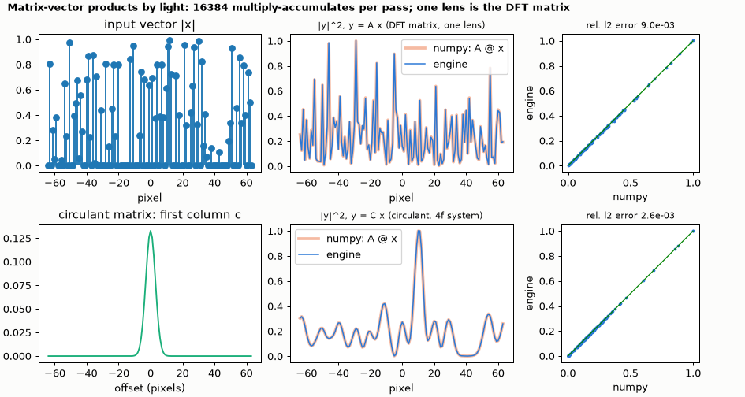
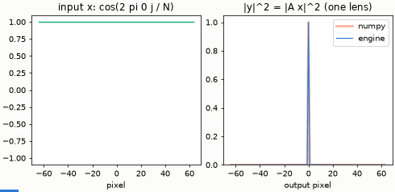

# Matrix-vector multiplication by light

y = A x with A a fixed matrix and x a vector of N complex numbers written on N pixels (amplitude and phase). Two matrices are
built from existing elements: **A = the DFT matrix**, done by one lens and a gap of its focal length, and **A = a circulant matrix**
(a convolution), done by a 4f system whose filter is the FFT of the matrix's first column. The camera sees |y|², compared with
`|A @ x|²`.





*The animation feeds x = cos(2π m j / N) for m = 0 … 20: the output of the lens is two lines that move out from the centre, the
rows of the DFT matrix at work.*

The field is constant along y on a grid of 4 rows, so the system is one-dimensional.

```bash
python matrix_vector.py
```

```
vector of N = 128 complex numbers on N pixels of 20 um; wavelength 800 nm; lens f = N dx^2 / lambda = 64.0 mm
y = A x, A = DFT matrix (one lens):       relative l2 error of |y|^2 8.95e-03, correlation 0.999911
y = C x, C = circulant matrix (4f system): relative l2 error of |y|^2 2.63e-03, correlation 0.999995
multiply-accumulates done by the optics in one pass: N^2 = 16384 for each product
checks passed
```

**What it shows.** The lens is the DFT matrix to 0.9 % in |y|² (a random vector with sharp pixel edges); the 4f circulant matrix
to 0.3 %. Each product is N² = 16 384 multiply-accumulates done in one pass of light.

**What it does not show.** A general matrix needs the anamorphic layout (cylindrical lenses and a mask, Goodman's vector-matrix
multiplier). The engine's `lens` has one focal length for both axes, so a general A is not buildable with today's elements; the two
matrices above are the ones a round-lens system gives. Phase is not read: a camera records intensity only.
