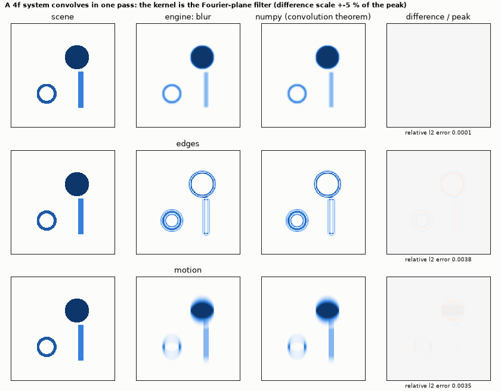
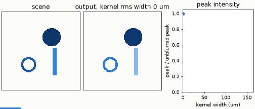

# Optical convolution

The same 4f layout as a convolution engine. The Fourier-plane filter *is* the kernel's transfer function; three of them are tried on
a scene of a disc, a bar and a ring: a Gaussian blur, edge detection (Laplacian of a Gaussian, signed) and a one-dimensional motion
blur (a box along x). The output intensity is compared with numpy's FFT, multiply, inverse FFT.





*The animation widens the Gaussian kernel from 0 to 160 µm (rms): the filter in the Fourier plane narrows and the image blurs.*

```bash
python convolution.py
```

```
grid 256 x 256, pitch 20 um, f = N dx^2 / lambda = 128.0 mm; the output is intensity |scene * kernel|^2
kernel    correlation  relative l2   (engine against numpy: FFT, multiply by H, inverse FFT)
blur          1.00000       0.0001
edges         0.99999       0.0038
motion        0.99999       0.0035
each kernel has N x N taps: N^4 = 4.29e+09 multiply-accumulates for a direct digital convolution, done in one pass of light (4 f / c = 1.71 ns)
worst relative l2 error 0.004 (the mask and the lens phase are sampled on the grid)
checks passed
```

**What it shows.** The convolution theorem holds for the engine's propagation: smooth filters agree to 10⁻⁴, filters with detail
to 4 x 10⁻³. The edge detector is signed in amplitude; the camera sees its square (intensity), as a real sensor would.

**Cost.** Each kernel has N x N taps, so a direct digital convolution is N⁴ = 4.3 x 10⁹ multiply-accumulates; the optics does it in
one transit of 1.7 ns. The engine simulates that on a digital machine in a fraction of a second, with FFTs.
