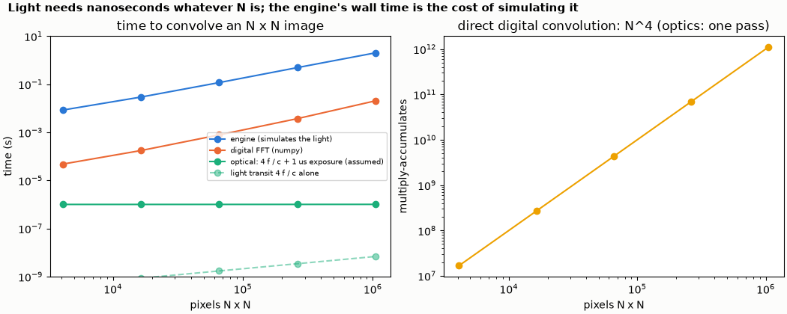
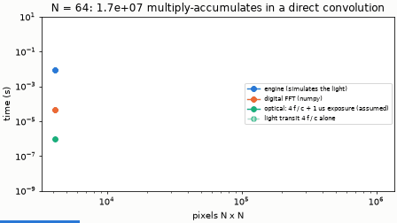

# Parallelism and time

The same Gaussian blur on N x N pixels (pitch 20 µm; the aperture and the focal length f = N dx² / λ grow with N), done three ways:
by the engine, by numpy (two FFTs and a product: the digital way), and "optically" (the light crosses 4 f once, plus an assumed
sensor exposure). N = 64 … 1024.





```bash
python scaling.py
```

```
N      pixels     MACs (direct, N^4)  f (mm)   light 4f/c (ns)  error vs numpy (bound)
64     4096       1.678e+07           32.0     0.43             0.002
128    16384      2.684e+08           64.0     0.85             0.001
256    65536      4.295e+09           128.0    1.71             0.001
512    262144     6.872e+10           256.0    3.42             0.001
1024   1048576    1.100e+12           512.0    6.83             0.001
checks passed
```

The second table (wall times) is machine dependent and is printed but not quoted here. On the machine that wrote this README it read
(seconds; N = 64 … 1024): engine 0.02, 0.07, 0.2, 0.4, 1.6; digital FFT 0.00004, 0.00016, 0.0008, 0.0035, 0.021; optical about 10⁻⁶.

**What it shows.**

* *Digital cost* of the convolution: a direct sum is N⁴ multiply-accumulates; with FFTs it is of order N² log N, and the measured FFT time
  grows with a log-log slope of about 1.1 against the pixel count.
* *The engine's wall time* is the cost of simulating the light (FFT propagation on a grid, per element), so it grows too, with a slope of
  about 0.7 over the three largest sizes (fixed overheads and threads hide part of the growth at small N). It is **not** the physical time.
* *The optical time* is a model: the path 4 f / c (0.4 to 7 ns here) plus the sensor's exposure, assumed to be 1 µs. It does not grow
  with the number of pixels once the system exists. A real processor also pays for loading the scene and the filter (an SLM refreshes in
  milliseconds) and for reading the result; those, not the transit, set its speed.

The agreement of the engine with numpy is printed per N: the relative l2 error is at most 1.3 x 10⁻³ (printed as a bound, never below 10⁻³). The whole example takes a few seconds;
the largest engine run (N = 1024) about 2 s.
