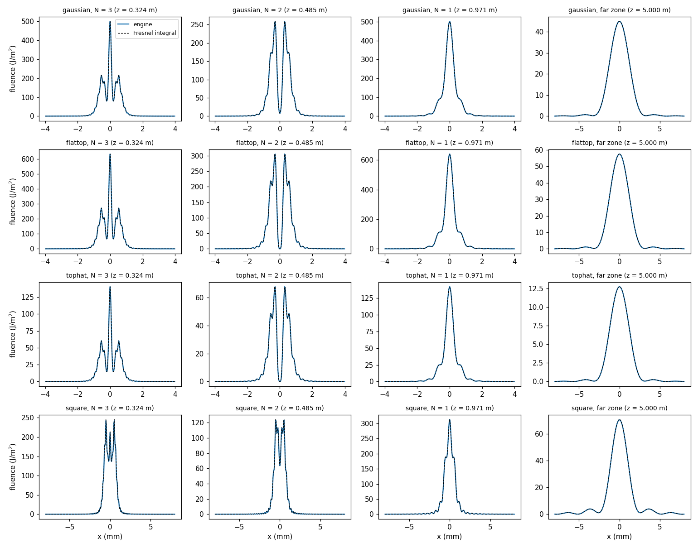
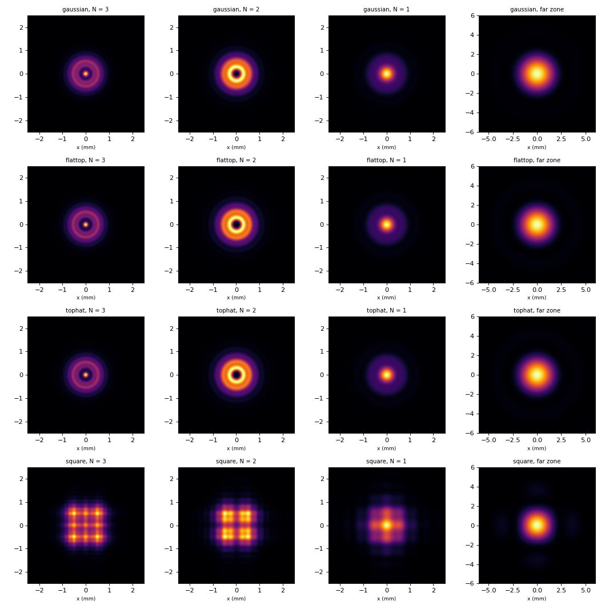

# Diffraction by an iris: four beam shapes, four distances

Four beams (Gaussian, round flat-top, uniform, square flat-top) pass a 1 mm iris and are imaged at Fresnel numbers 3, 2 and 1 and in the far zone; every pattern agrees with the Fresnel diffraction integral to 1.3 % of its peak or better.

**The story.** Four beams pass a 1 mm iris and are imaged at four distances. The beams are a Gaussian (w = 2 mm), a round flat-top (super-Gaussian of order
10, w = 1.5 mm), a uniform beam (a hard-edged tophat of radius 3 mm, a plane wave as far as the iris is concerned) and a square
flat-top (half-width 1.5 mm). The round beams pass a round iris of radius a = 1 mm; the square beam passes a 2 x 2 mm square aperture. The
distances are where the Fresnel number N = a² / (λ z) of the opening is 3, 2 and 1, and the far zone at 5 m (N = 0.19). `compare.py`
checks every pattern against the Fresnel diffraction integral, which it evaluates by its own quadrature. The step-by-step version is
[Tutorial 6: Diffraction by an iris](../../../tutorials/06-diffraction.md).





**Layout** (`gaussian.ufs`, `flattop.ufs`, `tophat.ufs`, `square.ufs`, `run.json`; `iris.py`): each system is a zero-length `gap` that sets the beam
(`transverse.initialProfile`), the `aperture`, and free-space gaps to the four planes (`n3`, `n2`, `n1`, `far`: z = 0.3236, 0.4854,
0.9709 and 5.0 m). Every element has the same grid, so the profile is handed on unchanged. Pulse: Gaussian, `centerWavelengthM` = 1030e-9,
`durationFwhmS` = 1e-12 (narrowband: the Fresnel number varies by 0.15 % over its spectrum), `energyJ` = 1e-3. Instruments: a beam profile
and a camera image (201 pixels) at every plane. About 3 to 5 s per beam.

```jsonc
"transverse": { "model": "radial", "points": 1024, "radiusM": 12e-3, "absorbingBoundary": true,
                "initialProfile": { "kind": "tophat", "radiusM": 3e-3 } }          // or gaussian / flatTop; square: "geometry": "square"
```

* **Radial grid, 1024 points over 12 mm** (11.7 µm steps, 85 samples across the iris radius). The square case uses a cartesian grid,
  512 x 512 over 24 mm (47 µm, 21 samples across the half-width), with `"spectralSamples": 4`: a 1 ps pulse needs only a few stored
  frequencies, and memory scales with them.
* **`absorbingBoundary`**: a hard edge sends light to large angles. Without the absorber that light reflects at the edge of a radial grid
  (and focuses back onto the axis) or wraps around a cartesian one. The absorbed energy is booked as `grid boundary` and reported as
  `absorbedAtBoundaryFraction`: 0.07 % at N = 3, 0.45 % at N = 1 and 3.9 % at 5 m for the uniform beam -- the outer Airy rings, which at
  5 m lie beyond the 12 mm window (they are real light at angles above ~2 mrad).
* **Linear gaps propagate only the profile** at its stored frequencies (`representation` in `summary.json` says so), so each run takes
  a few seconds.

**Run it** in the example folder. The two tabs run the same four simulations and print the same key numbers.

=== "CLI"

    ```bash
    for b in gaussian flattop tophat square; do ultrafast run $b.ufs run.json -o results-$b; done   # 3-5 s each
    ```

    ```
    energy 0.0003789 J (T = 37.89 %), FWHM 1000 fs (TL 1000 fs), peak 3.559E+08 W, B = 0 rad
    energy 0.0004766 J (T = 47.66 %), FWHM 1000 fs (TL 1000 fs), peak 4.477E+08 W, B = 0 rad
    energy 0.0001058 J (T = 10.58 %), FWHM 1000 fs (TL 1000 fs), peak 9.94E+07 W, B = 0 rad
    energy 0.0004767 J (T = 47.67 %), FWHM 1000 fs (TL 1000 fs), peak 4.478E+08 W, B = 0 rad
    ```

=== "Python"

    <!-- snippet -->
    ```python
    import numpy as np
    import ultrafast as uf
    from ultrafast import build as b

    planes = ("n3", "n2", "n1", "far")                 # Fresnel number N = 3, 2, 1 and the far zone at 5 m
    spec = b.run_spec(                                 # run.json: a 1 ps pulse, a beam profile and a camera at each plane
        b.pulse(1030e-9, 1e-12, energy=1e-3),
        name="iris diffraction",
        instruments=[b.instrument("beamProfile", name="p_iris", at="iris")]
        + [b.instrument("beamProfile", name="p_" + p, at=p) for p in planes]
        + [b.instrument("camera", name="cam_" + p, at=p, sensor={"pixels": 201, "pixelSizeM": 60e-6 if p == "far" else 25e-6}) for p in planes],
    )
    for beam in ("gaussian", "flattop", "tophat", "square"):
        res = uf.run(uf.System.load(beam + ".ufs"), spec)
        res.write("results-" + beam)                   # python compare.py reads results-<beam>/
        out, tot = res.summary["output"], res.summary["totals"]
        print(f"{beam}: energy {out['energyJ']:.4G} J (T = {100 * tot['energyTransmission']:.2f} %), FWHM {out['fwhmS'] * 1e15:.4G} fs "
              f"(TL {out['transformLimitFwhmS'] * 1e15:.4G} fs), peak {out['peakPowerW']:.4G} W, B = {tot['bIntegralRad']:.3G} rad")
        iris = next(e for e in res.elements() if e["id"] == "iris")["values"]["transmission"]
        on_axis = []
        for p in planes:                               # fluence on the axis: the first radial sample, or the sample nearest x = 0 (square)
            prof = res.instrument("p_" + p)
            on_axis.append(prof["fluence_j_m2"][0] if "fluence_j_m2" in prof else prof["fluence_x_j_m2"][np.argmin(np.abs(prof["x_m"]))])
        print(f"  iris transmission {iris:.4f}; F(0) at N = 3, 2, 1 and 5 m: " + ", ".join(f"{f:.4G}" for f in on_axis) + " J/m^2")
    ```

    ```
    gaussian: energy 0.0003789 J (T = 37.89 %), FWHM 1000 fs (TL 1000 fs), peak 3.559E+08 W, B = 0 rad
      iris transmission 0.3926; F(0) at N = 3, 2, 1 and 5 m: 499.6, 7.976, 502.3, 44.94 J/m^2
    flattop: energy 0.0004766 J (T = 47.66 %), FWHM 1000 fs (TL 1000 fs), peak 4.477E+08 W, B = 0 rad
      iris transmission 0.4992; F(0) at N = 3, 2, 1 and 5 m: 632.2, 0.004825, 640.3, 57.48 J/m^2
    tophat: energy 0.0001058 J (T = 10.58 %), FWHM 1000 fs (TL 1000 fs), peak 9.94E+07 W, B = 0 rad
      iris transmission 0.1108; F(0) at N = 3, 2, 1 and 5 m: 140.4, 0.001049, 142.2, 12.76 J/m^2
    square: energy 0.0004767 J (T = 47.67 %), FWHM 1000 fs (TL 1000 fs), peak 4.478E+08 W, B = 0 rad
      iris transmission 0.4945; F(0) at N = 3, 2, 1 and 5 m: 212, 63.56, 313.4, 70.59 J/m^2
    ```

The comparison with the Fresnel integral, from the results folders either tab wrote:

```bash
python compare.py            # engine vs Fresnel integral; writes diffraction-cuts.png, diffraction-images.png (about 8 s)
```

`F(0)` is the fluence on the axis (radial grids: the first sample, r = 11 µm); `max err` is the largest difference between the engine and
the Fresnel integral over the pattern, as a fraction of its peak:

```
beam      at      z (m)      N  T iris    F(0) engine   F(0) Fresnel    max err
gaussian  n3     0.3236      3  0.3926          499.6          500.1      0.09%
gaussian  n2     0.4854      2  0.3926          7.976          7.949      0.03%
gaussian  n1     0.9709      1  0.3926          502.3          500.1      0.45%
gaussian  far    5.0000   0.19  0.3926          44.94          44.95      0.01%
flattop   n3     0.3236      3  0.4992          632.2          632.9      0.10%
flattop   n2     0.4854      2  0.4992       0.004825       0.001678      0.03%
flattop   n1     0.9709      1  0.4992          640.3            637      0.52%
flattop   far    5.0000   0.19  0.4992          57.48          57.49      0.01%
tophat    n3     0.3236      3  0.1108          140.4          140.5      0.05%
tophat    n2     0.4854      2  0.1108       0.001049      0.0003552      0.06%
tophat    n1     0.9709      1  0.1108          142.2          141.4      0.57%
tophat    far    5.0000   0.19  0.1108          12.76          12.76      0.04%
square    n3     0.3236      3  0.4945            212          213.8      1.30%
square    n2     0.4854      2  0.4945          63.56          63.81      0.75%
square    n1     0.9709      1  0.4945          313.4          313.3      0.25%
square    far    5.0000   0.19  0.4945          70.59          70.94      0.48%
largest difference over all patterns: 1.30 % of the peak
```

`iris.py` is a second, Python-only run: it builds the Gaussian system with the builders and scans the iris radius a, with the screen where
the iris holds one Fresnel zone (N = 1). It compares the transmission with 1 − exp(−2a²/w²) and the fluence on the axis with the Fresnel
integral on the axis of a Gaussian field cut at r = a:

```bash
python iris.py               # about 12 s
```

```
 a (mm)   z (m)   T engine   T analytic   F(0) engine   F(0) Fresnel
  0.50    0.243     0.1162       0.1175         595.5          598.4
  1.00    0.971     0.3926       0.3935         502.3          500.4
  1.50    2.184     0.6746       0.6753         379.9            380
  2.00    3.883     0.8639       0.8647         270.3          270.4
  3.00    8.738     0.9889       0.9889         128.5          128.5
```

The engine's transmission is below the analytic value by at most 0.0013 (0.1 % of the incident energy, the edge cells) and the axis fluence agrees to 0.5 %.

**What it shows.**

* **Fresnel zones.** For the uniform beam the axis is bright, 4 x the incident fluence, at odd N (4 x 35.4 = 141.5 J/m²) and dark at
  N = 2: the iris then holds exactly two Fresnel zones, whose waves cancel on the axis (Born & Wolf, Principles of Optics, 8.8). The flat-top
  does the same. For the Gaussian the edge wave is weaker (the field at the edge is e^-0.25 of the centre), so the centre at N = 2 is dim,
  not dark.
* **Transmission.** The iris passes 1 − exp(−2a²/w²) = 39.35 % of the Gaussian (engine 39.26 %), (1/3)² = 11.11 % of the uniform beam
  (11.08 %), and 50.07 % / 50.26 % of the round / square flat-tops (49.92 % / 49.45 %). The grid cells on the edge transmit the fraction of
  their area inside the opening. That puts the edge in the right place between samples, but light diffracted beyond the grid's largest angle
  is lost, so the transmission converges from below, by about dx / 3a times the edge fluence (1.6 % for the square at 21 samples, 0.6 % at
  1024 x 1024).
* **The far zone** is the Fraunhofer pattern: the Airy disc of the round iris, first dark ring at 0.61 λz/a = 3.14 mm, and the sinc² of the
  square, first zero at λz/2a = 2.58 mm along x.

**Limits.** The model is scalar and paraxial, so it holds for openings much larger than the wavelength and angles of a few mrad. The
grid sets the accuracy: the square case, with 21 samples across the half-width, is 1.3 % off the integral and the round ones 0.6 % or
better. Related: [Structured beams](../structured-beams/README.md), [transverse reference](../../../reference/transverse.md).

Things to try:

* **Grids.** Halve `points` (radial) or `nx`/`ny` (square) and run `compare.py` again: the errors grow. With fewer than 10 samples across the
  opening the engine warns that the aperture is under-resolved. Turn `absorbingBoundary` off and watch the far-zone pattern of the square pick up the light
  that wrapped around (about 20 % error on the axis).
* **Near field.** At N = 19 (z = 5 cm) the outermost Fresnel zone at the edge is λz/2a = 26 µm wide; the grid needs several samples across
  it (dx = 11.7 µm radial gives 2, the 47 µm cartesian grid less than 1): refine the grid before trusting the pattern there.
* **A pinhole filter.** Put a `lens` before the iris and the iris in its focal plane (the beam's Fourier plane) to clean a beam up, or replace
  the iris by a soft aperture (`"softRadiusM"`, `"order"`) to suppress the rings.
* **Broadband light.** Use a 20 fs pulse: every colour has its own Fresnel number, so the fine rings of the near field average out
  ([Transverse: chromatic diffraction](../../../reference/transverse.md#physics-in-a-spatial-bulk-element)); keep the default 48 `spectralSamples`.
