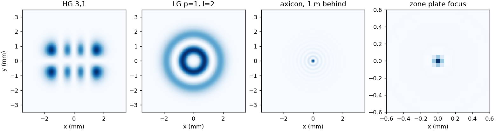

# Structured beams: modes, a Bessel core and a zone-plate focus

Hermite-Gauss and Laguerre-Gauss modes keep their beam quality (M² = 7 and 3, and 5, as the formulas say), an axicon makes a Bessel core whose first zero is at 197.7 µm against 197.1 µm analytic, and a 5-zone zone plate raises the fluence at its focus by 96 against (2N)² = 100.

**The story.** A beam can be shaped by what it carries (a mode written into the `initialProfile` of the first element) or by a mask it passes
([Masks](../../../reference/transverse.md#masks), [Initial profile](../../../reference/transverse.md#initial-profile)). Four cases have an
analytic answer. A Hermite-Gauss mode HG(m, n) has M² = 2m + 1 along x and 2n + 1 along y, and a Laguerre-Gauss mode LG(p, l) has
M² = 2p + |l| + 1. An axicon of cone angle θ turns a Gaussian beam into a Bessel beam whose first zero is at 2.405 / (k sin θ). A zone plate
with N open zones focuses a uniform beam to (2 N)² times the incident fluence, because the zones add in phase.



**Layout** (`structured.py`): wavelength 1030 nm, a 1 ps, 1 mJ pulse. Modes: radius 1 mm on a cartesian grid of 256 x 256 points over 12 mm,
1 m of vacuum behind the source (HG with `modeX` = 3, `modeY` = 1; LG with `modeP` = 1, `modeL` = 2). Axicon: a Gaussian beam of
`radiusM` = 4 mm, `coneAngleRad` = 2e-3, a radial grid of 2048 points over 12 mm, screen at 1 m. Zone plate: a tophat beam of radius
√(10 λ f) = 1.435 mm (10 zones, 5 of them open), `focalLengthM` = 0.2, a radial grid of 1024 points over 12 mm. About 5 s.

**Run it** in the example folder. The CLI tab runs the example's script, which also draws `structured.png`; the Python tab is its builder
core (no plotting), with the same output.

=== "CLI"

    ```bash
    python structured.py                 # about 5 s; writes structured.png
    ```

    ```
    mode          M2x (analytic)   M2y (analytic)
    HG 3,1        7.000 (7)        3.000 (3)
    LG p=1, l=2   5.000 (5)        5.000 (5)
    Bessel first zero 197.7 um   analytic 197.1 um
    zone plate gain 96   analytic 100
    ```

=== "Python"

    <!-- snippet -->
    ```python
    import math

    import numpy as np
    import ultrafast as uf
    from ultrafast import build as b

    LAM, N, HALF = 1030e-9, 256, 6e-3
    SPEC = b.run_spec(b.pulse(LAM, 1e-12, energy=1e-3), instruments=[b.instrument("beamProfile", at="end", name="p")])


    def grid(profile=None):                            # 256 x 256 cartesian grid over 12 mm, carrying the profile from element to element
        return b.transverse("cartesian", nx=N, ny=N, half_width_m=HALF, spectral_samples=2, initial_profile=profile, absorbing_boundary=True)


    def beam_quality(first):                           # source -> 1 m of free space; M2 from the central moments of the beam profile
        p = uf.run(b.system("mode", [b.gap("source", 0.0, medium="Vacuum", transverse=grid(first)), b.gap("screen", 1.0, medium="Vacuum", transverse=grid())]), SPEC).instrument("p")
        return p["m2"], p["m2Y"]


    print("mode          M2x (analytic)   M2y (analytic)")
    for name, profile, ax, ay in (("HG 3,1", b.initial_profile("hermiteGauss", radius_m=1e-3, mode_x=3, mode_y=1), 7, 3),
                                  ("LG p=1, l=2", b.initial_profile("laguerreGauss", radius_m=1e-3, mode_p=1, mode_l=2), 5, 5)):
        mx, my = beam_quality(profile)
        print("%-12s %6.3f (%d)       %6.3f (%d)" % (name, mx, ax, my, ay))

    # axicon: the first zero of the Bessel core is at 2.405 / (k sin(angle)); a fine radial grid resolves it
    angle = 2e-3
    radial = dict(points=2048, radius_m=12e-3, absorbing_boundary=True, spectral_samples=2)
    res = uf.run(b.system("axicon", [b.gap("source", 0.0, medium="Vacuum", transverse=b.transverse("radial", **radial, initial_profile=b.initial_profile("gaussian", radius_m=4e-3))),
                                     b.mask("axicon", "axicon", cone_angle_rad=angle), b.gap("screen", 1.0, medium="Vacuum", transverse=b.transverse("radial", **radial))]), SPEC)
    r, cut = np.array(res.instrument("p")["radius_m"]), np.array(res.instrument("p")["fluence_j_m2"])
    zero = r[np.argmax(np.diff(cut) > 0)]              # the first sample where the fluence rises again
    print("Bessel first zero %.1f um   analytic %.1f um" % (zero * 1e6, 2.405 / (2 * math.pi / LAM * math.sin(angle)) * 1e6))

    # zone plate: N open zones of a uniform beam add in phase at the focus, so the fluence there is (2 N)^2 x the incident one (N = 5: 100)
    focal, zones = 0.2, 10
    radius = math.sqrt(zones * LAM * focal)
    incident = 1e-3 / (math.pi * radius ** 2)
    fine = dict(points=1024, radius_m=2 * HALF, absorbing_boundary=True, spectral_samples=2)
    sharp = uf.run(b.system("zp", [b.gap("source", 0.0, medium="Vacuum", transverse=b.transverse("radial", **fine, initial_profile=b.initial_profile("tophat", radius_m=radius))),
                                   b.mask("zp", "zonePlate", focal_length_m=focal), b.gap("focus", focal, medium="Vacuum", transverse=b.transverse("radial", **fine))]), SPEC)
    print("zone plate gain %.0f   analytic 100" % (sharp.elements()[-1]["values"]["onAxisFluenceOutJPerM2"] / incident))
    ```

    ```
    mode          M2x (analytic)   M2y (analytic)
    HG 3,1        7.000 (7)        3.000 (3)
    LG p=1, l=2   5.000 (5)        5.000 (5)
    Bessel first zero 197.7 um   analytic 197.1 um
    zone plate gain 96   analytic 100
    ```

**What it shows.**

* **Beam quality.** `m2` and `m2Y` of the `beamProfile` instrument are central moments, so a tilted or decentred beam keeps its beam
  quality. The modes give 7.000 and 3.000 for HG 3,1 and 5.000 for LG p=1, l=2 in both directions, equal to the formulas.
* **Bessel core.** The first zero is at 197.7 µm against 197.1 µm analytic (0.3 % wider). The check needs the screen far enough behind the
  axicon that the ring feeding the axis lies many Fresnel widths out: at 0.3 m the core is 3 % wider (203.5 µm).
* **Zone plate.** The gain is 96 against the ideal (2 N)² = 100 for N = 5 open zones: 4 % under, because each hard zone edge is averaged
  over a grid cell.

**Limits.** The modes and masks act on a scalar, paraxial profile; the axicon and the zone plate are thin phase and amplitude masks without
thickness or material dispersion, and a pulse of 1 ps keeps chromatic effects negligible.
Related: [Diffraction by an iris](../iris-diffraction/README.md), [transverse reference](../../../reference/transverse.md).
