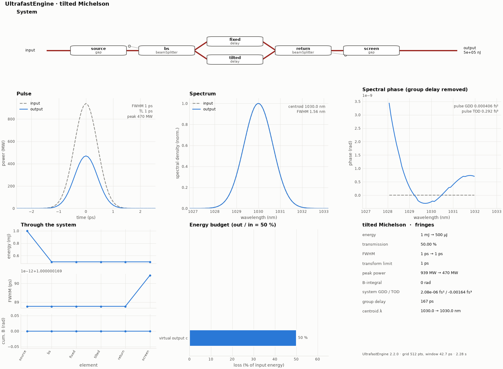

# Fringes from a tilted mirror

A Michelson interferometer on the command line, in a branched .ufs file: one arm is tilted by 2 mrad, carried profiles add point by point at the return, and straight fringes appear with a period of 515.0 µm against λ / angle = 515.0 µm.

**The story.** A beam splitter sends a Gaussian beam (radius 3 mm, 1030 nm) into two arms. One arm is tilted by 2 mrad, so its wavefront
meets the other at an angle, and the two cross at the return. Carried transverse profiles add point by point there, so straight fringes
appear with no fringe model. Their period is the textbook λ / θ = 1030 nm / 2 mrad = 515 µm. The plate is met twice: the return is a
second element with `"sameAs": "bs"` and `"side": 2`, which reverses the sign of r
([Beam splitters](../../../reference/branches.md#beam-splitters)).



*`python make_figures.py` redraws the overview figure (`hero.png`).*

**Layout** (`michelson.ufs`, `run.json`): a `gap` source of zero length with a cartesian profile (128 x 128 points over `halfWidthM` = 8e-3,
Gaussian `radiusM` = 3e-3, `spectralSamples` = 2), a `beamSplitter` with `reflectivity` = 0.5, two `delay` elements (`delayS` = 0; the
second with `tiltXRad` = 2e-3), the return splitter, and a `gap` of 50 mm to the screen. Pulse: Gaussian, 1030 nm, 1 ps, 1 mJ. One beam
profile on the screen. About 2 s.

**Run it** in the example folder. The two tabs run the same simulation and print the same key numbers. `ultrafast validate michelson.ufs
--graph` prints the branches and links of the system first.

=== "CLI"

    ```bash
    ultrafast validate michelson.ufs --graph
    ultrafast run michelson.ufs run.json -o results     # about 2 s
    python report.py                                    # fringe period from results/result.npz
    ```

    ```
    energy 0.0005 J (T = 50.00 %), FWHM 1000 fs (TL 1000 fs), peak 4.697E+08 W, B = 0 rad
    fringe period 515.0 um   lambda / angle 515.0 um
    ```

=== "Python"

    <!-- snippet -->
    ```python
    import numpy as np
    import ultrafast as uf
    from ultrafast import build as b

    LAM, TILT = 1030e-9, 2e-3
    system = uf.System.load("michelson.ufs")           # a branched Michelson: one arm tilted by 2 mrad, the beam splitter met twice
    spec = b.run_spec(                                 # run.json: a 1 ps, 1 mJ pulse and a beam profile on the screen
        b.pulse(LAM, 1e-12, energy=1e-3),
        name="fringes",
        instruments=[b.instrument("beamProfile", name="screen", at="end")],
    )
    res = uf.run(system, spec)
    res.write("results")                               # python report.py reads results/result.npz
    out, tot = res.summary["output"], res.summary["totals"]
    print(f"energy {out['energyJ']:.4G} J (T = {100 * tot['energyTransmission']:.2f} %), FWHM {out['fwhmS'] * 1e15:.4G} fs "
          f"(TL {out['transformLimitFwhmS'] * 1e15:.4G} fs), peak {out['peakPowerW']:.4G} W, B = {tot['bIntegralRad']:.3G} rad")
    prof = res.instrument("screen")                    # fringe period: the strongest spatial frequency above the Gaussian envelope
    x, f = np.asarray(prof["x_m"]), np.asarray(prof["fluence_x_j_m2"])
    dx = x[1] - x[0]
    spectrum = np.abs(np.fft.rfft(f - f.mean()))
    first = int(len(x) * dx / 2e-3)                    # periods shorter than 2 mm
    peak = first + spectrum[first:].argmax()
    a, c, d = np.log(spectrum[peak - 1:peak + 2])      # refine between samples: the top of a parabola through the three largest bins
    period = len(x) * dx / (peak + 0.5 * (a - d) / (a - 2 * c + d))
    print("fringe period %.1f um   lambda / angle %.1f um" % (period * 1e6, LAM / TILT * 1e6))
    ```

    ```
    energy 0.0005 J (T = 50.00 %), FWHM 1000 fs (TL 1000 fs), peak 4.697E+08 W, B = 0 rad
    fringe period 515.0 um   lambda / angle 515.0 um
    ```

**What it shows.** The fringe period agrees with λ / angle to the printed precision: the measured value comes from the strongest spatial
frequency of the screen profile above the Gaussian envelope, refined between samples with a parabola. Half the energy leaves towards the
screen (T = 50.00 %): the tilt gives many fringes across the beam, so the arms' interference averages out and the other half leaves
through the virtual output.

**Limits.** The model is scalar and paraxial, and both arms keep the same pulse (`delayS` = 0, no dispersion), so the fringes have full
contrast at every point of the overlap. The other half of the energy leaves through the virtual output `c` of the return splitter, which is
not read. Related: [Branched systems reference](../../../reference/branches.md), [Diffraction by an iris](../iris-diffraction/README.md).
