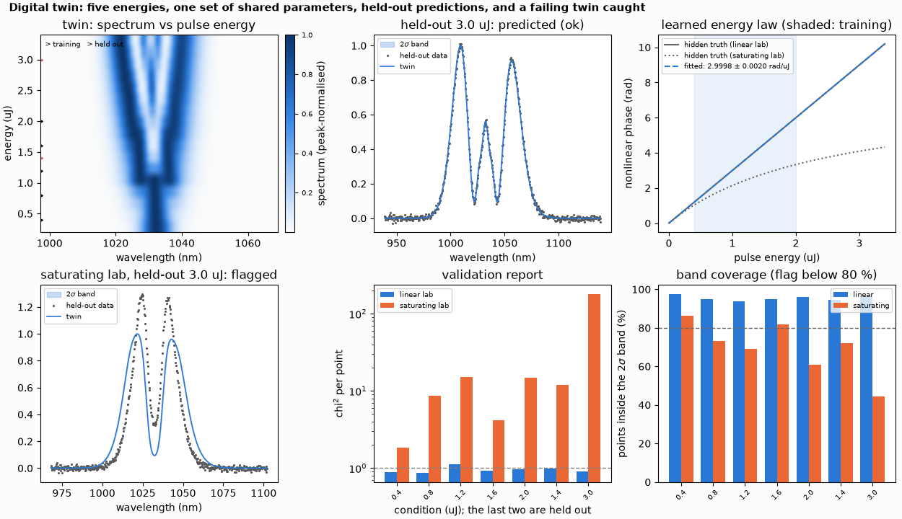
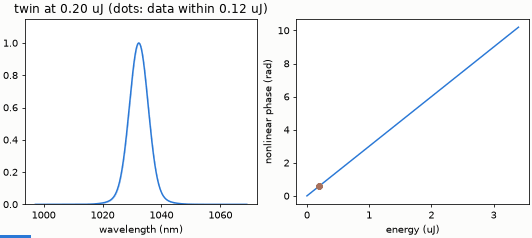

# Build a digital twin: fit across conditions, predict, validate

A digital twin fitted to spectra at five pulse energies recovers the hidden filter and nonlinear phase, predicts two held-out energies with credible bands, and flags a twin that only fits its training data.

**The story.** A lab has a spectral filter and a Kerr-like element, read by a spectrometer. The written description says the filter is
centred at 1030 nm, 12 nm wide, and that the nonlinear phase is 2 rad/µJ. The lab is in fact 1033.0 nm, 8.5 nm and 3.0 rad/µJ
(hidden in a data generator: `ultrafast_twin.synthetic`). The **digital twin** fits the engine model to spectra measured at **five pulse
energies at once**, with one set of shared parameters, so each parameter is constrained by all the data. Then it predicts two
energies it was **not** fitted to, one inside and one outside the training range, with credible bands, and a **validation report** says
whether the twin can be trusted. A second lab, whose phase saturates at high energy, shows what a failing twin looks like.





*The animation scrubs the twin from 0.2 to 3.4 µJ with its 2σ band; dots are the measurements within 0.12 µJ.*

**Layout** (`build_twin.py`): `ultrafast_twin.init` writes a project (`twin.json`, `system.ufs`, `data/*.csv`); `project.fit()` runs
the fitting plugin's multi-condition fit: parameters `filter.fwhmNm`, `filter.centerNm` and a proportional dependence
`kerr.bRad = slope x energy`; `twin.validate()` simulates every condition with 12 draws from the fit covariance.
The same thing from the command line: `ultrafast twin init lab`, `ultrafast twin fit lab`, `ultrafast twin validate lab`
(set `ULTRAFAST_PYTHON` to a Python that has NumPy and the `ultrafast` package).

```bash
python build_twin.py
python make_figures.py          # hero.png, animation.gif (about 10 s)
```

```
synthetic lab: a spectral filter (hidden centre 1033.0 nm, FWHM 8.5 nm) and a nonlinear phase of 3.0 rad/uJ; the description says 1030 nm, 12 nm, 2 rad/uJ
fit: five energies [0.4, 0.8, 1.2, 1.6, 2.0] uJ, one shared filter and one slope
recovered centre 1033.008 +- 0.006 nm (truth 1033.0), FWHM 8.497 +- 0.010 nm (truth 8.5), slope 2.9998 +- 0.0020 rad/uJ (truth 3.0)
held-out E1.4uJ    chi2 per point 0.98, 95 % of points inside the 2-sigma band: ok
held-out E3.0uJ    chi2 per point 0.90, 96 % of points inside the 2-sigma band: ok
verdict of the validation report: ok
saturating lab, held-out E1.4uJ    chi2 per point 11.9: flagged
saturating lab, held-out E3.0uJ    chi2 per point 180.4: flagged
saturating lab verdict: fits-training-only
checks passed
```

**What it shows.** The fit recovers the hidden centre, width and slope within their stated uncertainty (centre 1033.008 ± 0.006 nm,
width 8.497 ± 0.010 nm, slope 2.9998 ± 0.0020 rad/µJ). The held-out energies are predicted at the noise level (chi² per point 0.98 and 0.90, 95 % of the points inside
the 2σ band; the band is calibrated). The saturating lab is the acceptance case: the twin still fits poorly even its training data (chi² 2 to 15 per point) and its prediction of the held-out
energies is off by chi² 12 and 180 per point; the report flags it `fits-training-only`. A twin that did not hold out data would
have called it a decent fit.

**Limits.** The lab is synthetic: the noise is Gaussian and the model is the right one. The validation rules (flag above 3 x the
training chi² or below 80 % coverage) are stated in `ultrafast_twin/validate.py`, not tuned.
