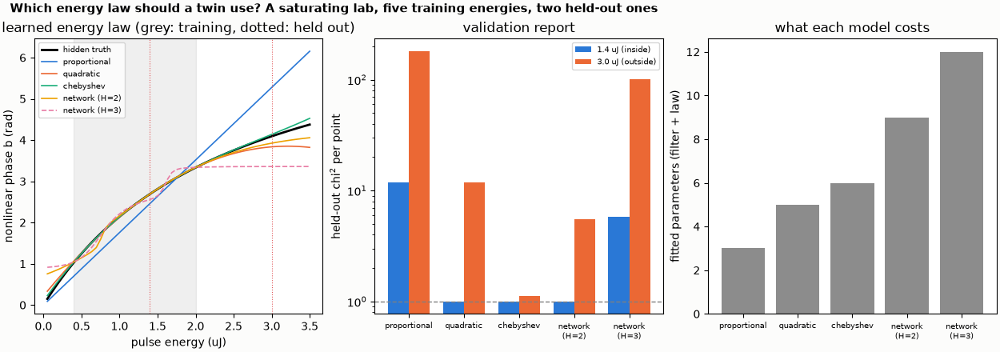

# Which model of an unknown law should a twin use?

A twin that learns how a lab changes with pulse energy needs a model of that law. Five choices are fitted to the same data and judged only on energies they were not fitted to.

**Question.** The lab's nonlinear phase saturates, b = 3 E / (1 + E / 2.5 µJ) rad (hidden in the synthetic lab, `ultrafast_twin.synthetic`). The twin is trained on five energies
(0.4 to 2.0 µJ). Which model of b(E) predicts 1.4 µJ (inside the training range) and 3.0 µJ (outside it)?



## Setup

`compare.py` builds the saturating lab (`ultrafast_twin.init(folder, "synthetic-lab-saturating")`), replaces the dependence of the parameter `kerr.bRad` on the condition variable `energyJ`, fits, and runs the
validation report (`twin.validate`) with 12 draws from the fit covariance. The filter (centre, width) is fitted in every case; only the energy law changes:

| model | `dependence.kind` | parameters of the law |
|---|---|---|
| proportional | `proportional` (b = c u) | 1 |
| quadratic | `polynomial`, degree 2 | 3 |
| Chebyshev | `chebyshev`, degree 3 on the training range | 4 |
| network (H=2) | `network`, 2 tanh units, `monotone: increasing`, `output: positive` | 7 |
| network (H=3) | the same with 3 units | 10 |

```bash
python compare.py
python make_figures.py          # optional: hero.png
```

## What is checked

The reference is the hidden law. A model passes a held-out condition when the validation report calls it `ok` (chi² per point near 1, at least 80 % of the data inside the 2σ band; the rules are in `ultrafast_twin/validate.py`).
`compare.py` asserts the outcome of every row below.

## Results

```
hidden law: b = 3 E / (1 + E / 2.5 uJ) rad; trained on [0.4, 0.8, 1.2, 1.6, 2.0] uJ
model         params held-out 1.4 uJ (inside)  held-out 3.0 uJ (outside)  verdict
proportional       3        11.87 flagged             180.41 flagged     fits-training-only
quadratic          5         1.00 ok                   11.82 flagged     fits-training-only
chebyshev          6         1.00 ok                    1.12 ok          ok
network (H=2)      9         1.00 ok                    5.51 flagged     fits-training-only
network (H=3)     12         5.78 flagged             101.25 flagged     fits-training-only
checks passed
```

(`params` counts the filter's two parameters as well.)

* **The physics-shaped guess fails first.** A phase proportional to the energy cannot follow the saturation; both held-out energies are flagged.
* **A low-order polynomial interpolates and does not extrapolate:** the quadratic passes at 1.4 µJ and is flagged at 3.0 µJ (chi² 11.8).
* **The Chebyshev series passes both** (chi² 1.00 and 1.12): its degree-3 shape follows the saturating law over the range that matters here. It is the only model whose verdict is `ok`.
* **The network is not a free lunch.** With 2 units it interpolates (chi² 1.00) but its tanh units flatten outside the training range, so 3.0 µJ is flagged. With 3 units the fit from the default start stops in a poor local minimum, which the report catches even inside the training range (the flat step at 1.6 µJ in the figure). More iterations do not help (the fit has converged); a different start would.
* The report did its job in every row: no model was called good that was not.

## Extend it

* Change the size of the models in `MODELS` (the network's `hidden`, the Chebyshev `degree`) and read the verdicts: H=2 and H=3 above differ only in that number.
* Put 2.5 µJ into `TRAIN_UJ` in `ultrafast_twin/synthetic.py` (training now reaches the bend) and see which models recover; `twin.design(...)` ranks candidate measurements by how much they would tell you.
* Change `SATURATION_UJ` in the same file to move the bend inside or outside the training range.
* Fit smooth surfaces over a condition for several numbers at once: [fitting plugin, smooth surfaces](../../../plugins/fitting.md#smooth-surfaces).

## Limits and provenance

* The lab is synthetic, the noise Gaussian and the filter model exact; real data would add model error that no dependence can absorb.
* There is **no spline dependence** in the plugin: splines act on spectral phase and amplitude (`knots`, with smoothness and causality constraints), not on a condition variable. The Chebyshev series is the smooth-series representative here.
* One synthetic dataset and one seed: the ranking of the quadratic and the H=2 network at 3.0 µJ is not a statement about all laws. The Chebyshev success is specific to a degree that matches the bend; the table is a demonstration of the validation workflow, not a benchmark of model families.
* Not checked against any published value (the check is the hidden truth of the generator).
