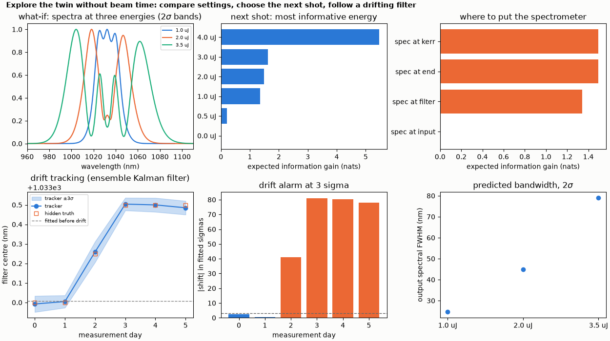
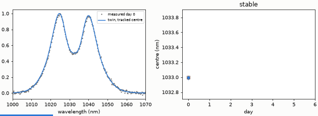

# Explore the twin without beam time

A fitted twin answers what-if questions with credible bands, ranks the next measurement by information gain and follows a drifting filter with an ensemble Kalman filter.

**The story.** Once a twin is fitted it is a cheap, honest stand-in for the lab. Three things you can do without touching the lab:

* **What-if**: compare settings (here three pulse energies) with credible bands. The same parameter draws are used for every
  variant, so the difference between two variants has a proper (paired) uncertainty.
* **Design the next experiment**: of several candidate shots, which one would shrink the uncertainty of the model most
  (expected information gain from the fit covariance)? And where should the spectrometer be placed?
* **Track drift**: the lab drifts. An ensemble Kalman filter updates the parameters from each new measurement, and an alarm
  goes off when a parameter has moved by more than three fitted sigma.





**Layout** (`explore.py`): the synthetic lab of [build-the-twin](../build-the-twin/README.md). The hidden filter centre shifts by
0, 0, 0.25, 0.5, 0.5, 0.5 nm over six "days" and the tracker (16 members) assimilates one spectrum per day.

```bash
python explore.py
python make_figures.py          # hero.png, animation.gif (about 30 s)
```

```
what-if (no beam time): predicted output pulse of the lab at three energies, +- 1 sigma of the twin
  1.0 uJ: FWHM 209.9 +- 0.1 fs, spectral FWHM 24.57 +- 0.01 nm
  2.0 uJ: FWHM 209.9 +- 0.1 fs, spectral FWHM 44.89 +- 0.01 nm
  3.5 uJ: FWHM 209.9 +- 0.1 fs, spectral FWHM 78.96 +- 0.03 nm
next measurement to learn the slope: expected information gain per candidate energy
  energyJ=4e-06          gain 5.46  -> slope sigma 0.00077
  energyJ=3e-06          gain 1.63  -> slope sigma 0.00101
  energyJ=2e-06          gain 1.49  -> slope sigma 0.00104
  energyJ=1e-06          gain 1.35  -> slope sigma 0.00073
  energyJ=5e-07          gain 0.20  -> slope sigma 0.00181
  energyJ=0              gain -0.00  -> slope sigma 0.00195
best: energyJ=4e-06 (current slope sigma 0.00195)
where to put the spectrometer: spec at kerr 1.49, spec at end 1.49, spec at filter 1.34, spec at input -0.00
drift tracking of the filter centre (hidden shifts [0.0, 0.0, 0.25, 0.5, 0.5, 0.5] nm):
  day 0: 1032.992 +- 0.014 nm
  day 1: 1033.005 +- 0.011 nm
  day 2: 1033.259 +- 0.018 nm   DRIFT FLAGGED
  day 3: 1033.504 +- 0.011 nm   DRIFT FLAGGED
  day 4: 1033.500 +- 0.012 nm   DRIFT FLAGGED
  day 5: 1033.485 +- 0.012 nm   DRIFT FLAGGED
checks passed
```

**What it shows.** The planner ranks the candidate energies by information gain and the best one is the highest (4 µJ): this is the
planner's output for these six candidates; S4 found that in general the information about the slope is not monotonic in energy (fringes finer than the resolution lose it). Placement: a spectrometer at the input sees nothing
of the filter or the Kerr element (gain 0), at the Kerr element or the end it sees all of it. The tracker follows the centre to
within 0.02 nm and flags the drift on the day it reaches 0.25 nm.

**Limits.** The tracker needs the expected drift in physical units (`process_sigma`, 0.3 nm here): with the process noise at the
fitted sigma (0.006 nm) it followed a 0.5 nm shift only 17 % in three steps. The information gain is linearised around the fit.
