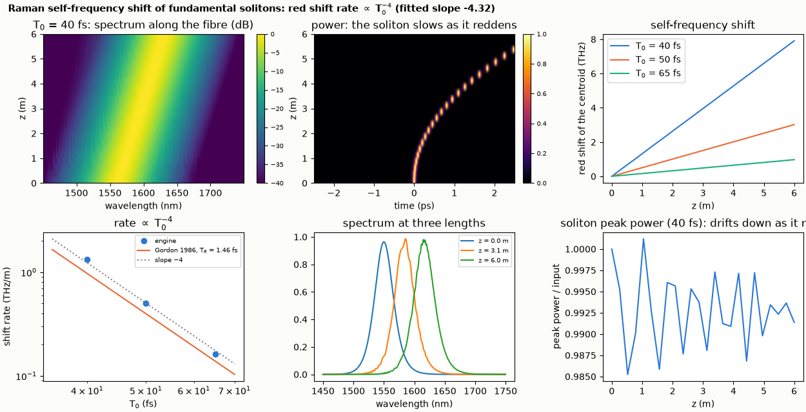
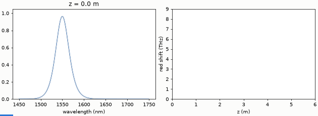

# Raman self-frequency shift of solitons

Raman scattering pushes fundamental solitons to the red at a rate proportional to T0^-4 (Gordon 1986); the engine reproduces the scaling.

**The story.** A short soliton is so broad in frequency that its blue edge can pump its red edge through Raman scattering. The
soliton slides to the red, and because a shorter soliton is broader, it slides faster: Gordon (Opt. Lett. 11, 662 (1986)) found a
rate `dΩ/dz = -8 T_R |β₂| / (15 T₀⁴)`, so halving the pulse width speeds the shift up sixteen times. The example propagates three
fundamental solitons (T₀ = 40, 50, 65 fs) through 6 m of fibre with the engine's silica Raman response and measures the shift of
the spectral centroid along the fibre.





**Layout** (`raman_shift.py`): `fiber` element, β₂ = -20 ps²/km, γ = 1.3 /(W km), `raman: silica` (Blow and Wood, f_R = 0.18),
self-steepening off, 6 m, N = 1 at the input (P₀ = |β₂| / (γ T₀²)). The red shift is the change in the power-weighted mean
angular frequency of the spectrum. T_R in Gordon's formula is computed from the engine's own response: `f_R ∫ t h_R(t) dt`.

```bash
python raman_shift.py
python make_figures.py          # hero.png, animation.gif (about 40 s)
```

```
fundamental solitons N = 1, beta2 = -20 ps^2/km, gamma = 1.3 /(W km), 6 m of silica fibre, Raman response of the engine (T_R = 1.46 fs from the model)
T0 = 40 fs: shift after 6 m -7.9 THz (63 nm), rate -1.319 THz/m; Gordon -8 T_R |beta2| / (15 T0^4) = -0.969 THz/m (ratio 1.36)
T0 = 50 fs: shift after 6 m -3.0 THz (24 nm), rate -0.503 THz/m; Gordon -8 T_R |beta2| / (15 T0^4) = -0.397 THz/m (ratio 1.27)
T0 = 65 fs: shift after 6 m -1.0 THz (8 nm), rate -0.162 THz/m; Gordon -8 T_R |beta2| / (15 T0^4) = -0.139 THz/m (ratio 1.16)
log-log slope of the rate against T0: -4.32 (Gordon: -4)
checks passed
```

**What it shows.** The log-log slope of the shift rate against T₀ is -4.3 (Gordon: -4), over a factor 1.6 in T₀ (16 in rate): the
scaling is reproduced. The absolute rate is 16-36 % *above* Gordon's formula with the model's T_R. Possible reasons, not separated here: Gordon's formula assumes a soliton of constant width and a
single T_R, while the engine's pulse changes as it shifts and its Raman gain is not a single first moment. The example states the
disagreement rather than tuning T_R to remove it. The peak power of the soliton falls and the soliton slows down
(the group delay changes with the carrier) as it moves red (middle top panel).

**Limits.** Self-steepening, loss and higher dispersion are off; a real fibre has all three. The shift rate is measured over the
last two thirds of the fibre by a straight-line fit.
