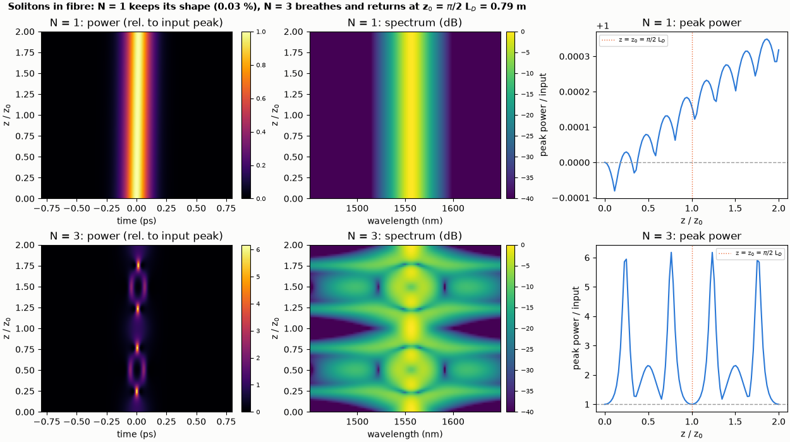
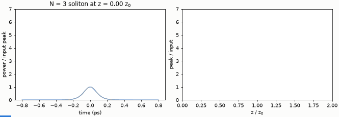

# Solitons in a fibre: shape-keeping and breathing

An N = 1 soliton keeps its shape and an N = 3 soliton breathes and returns after exactly one soliton period z0 = (pi/2) L_D.

**The story.** In anomalous dispersion the Kerr nonlinearity and the dispersion can cancel. A pulse with soliton number
N = √(γ P₀ T₀² / |β₂|) = 1 keeps its shape for ever. An N = 3 pulse does not: it is compressed, splits, recombines and **returns to its
input shape after exactly one soliton period z₀ = (π/2) L_D**, with L_D = T₀² / |β₂|. This is the textbook test of a
nonlinear-Schrödinger solver, and a good picture of what the fibre element does.





**Layout** (`solitons.py`): the `fiber` element with β₂ = -20 ps²/km, γ = 1.3 /(W km), no loss, Raman and self-steepening off
(so that the textbook equation holds); sech pulse T₀ = 100 fs (FWHM 176 fs) at 1550 nm, L_D = 0.50 m, z₀ = 0.785 m. The fibre is run at 90 lengths
from 0 to 2 z₀ for each N and the pictures are the output pulse after each length.

```bash
python solitons.py
python make_figures.py          # optional: hero.png, animation.gif (about 25 s)
```

```
fibre: beta2 = -20 ps^2/km, gamma = 1.3 /(W km), sech pulse T0 = 100 fs (FWHM 176 fs) at 1550 nm
dispersion length L_D = 0.500 m, soliton period z0 = pi/2 L_D = 0.785 m
N = 1: input peak power 1.54 kW (N^2 |beta2| / (gamma T0^2))
N = 3: input peak power 13.85 kW (N^2 |beta2| / (gamma T0^2))
N = 1: peak power stays within 0.03 % and the FWHM within 0.03 % of the input over two periods
N = 3: largest compression in the first period: peak 6.2 x the input at z = 0.60 m = 0.76 z0; the peak is back to 1.003 x at z0 = 0.785 m (grid step 0.018 m)
N = 3: after two periods the peak is 1.000 x the input
checks passed
```

**What it shows.** N = 1: peak power and width stay within 0.03 % of the input over two periods (the residual is the solver's
tolerance: the wiggle in the top-right panel is 3 parts in 10⁴). N = 3: the peak power rises to 6.2 times the input
at 0.76 z₀, and the pulse is back to 1.003 times its input peak at z₀ and 1.000 at 2 z₀: the period is z₀ = (π/2) L_D to the
grid step (0.018 m). The spectrum (middle column) breathes in step with the pulse.

**Limits.** Higher-order dispersion, Raman and self-steepening are off, as in the textbook equation. With them on, a higher-order
soliton fissions instead of returning: see [Raman soliton shift](../raman-soliton-shift/README.md) and the PCF
[supercontinuum](../../Nonlinear/supercontinuum/README.md).
