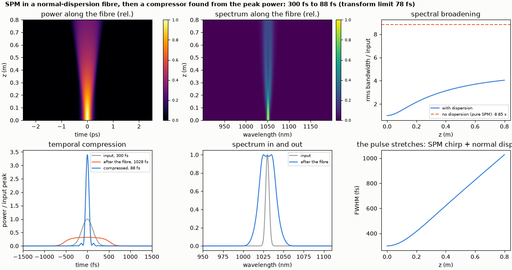
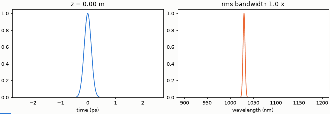

# Nonlinear pulse compression in a fibre

Self-phase modulation in a normal-dispersion fibre and a compressor found from the peak power alone shorten a 300 fs pulse to 88 fs.

**The story.** A 300 fs, 4 nJ pulse at 1030 nm goes through 0.8 m of normal-dispersion fibre. Self-phase modulation broadens the
spectrum while the dispersion stretches the pulse to about 1 ps; the pulse is chirped but its spectrum is broad. A compressor (here a
`dispersion` element of negative GDD) removes the chirp and the pulse comes out at 88 fs, with 3.4 times the peak power. This is the
workhorse of post-compression for high-power ytterbium lasers. The compressor's GDD is **found from the peak power alone**, by
the same modal search that tunes a deformable mirror.





**Layout** (`spm_compression.py`): `fiber` with β₂ = +23 ps²/km, γ = 1.0 /(W km), Raman and self-steepening off; a Gaussian pulse
(12.5 kW peak, γ P₀ L = 10 rad). The evolution is 30 runs of increasing length.

```bash
python spm_compression.py       # about 1.5 minutes
python make_figures.py
```

```
input: 300 fs, 4.0 nJ at 1030 nm (peak power 12.5 kW); fibre 0.8 m, beta2 = +23 ps^2/km, gamma = 1.0 /(W km)
peak nonlinear phase gamma P0 L = 10.0 rad (the dispersion length of the pulse is 1.41 m, so dispersion acts as well)
rms spectral width, same fibre without dispersion (pure SPM): 8.85 x the input (formula for a Gaussian pulse sqrt(1 + 4 phi^2 / (3 sqrt 3)) = 8.85 x)
rms spectral width, with the fibre's dispersion: 4.05 x (the pulse stretches while it is modulated, its power falls and so does the phase)
duration: input 300 fs, after the fibre 1028 fs, after a compressor of GDD -19.8 x 10^-27 s^2 (found from the peak power alone) 88 fs
peak power after compression 3.4 x the input; transform limit of the broadened spectrum: 78 fs (temporal Strehl 0.87)
checks passed
```

**What it shows.** Without dispersion (same fibre, β₂ = 0) the rms bandwidth grows by 8.85 times, exactly the SPM formula for a
Gaussian pulse `sqrt(1 + 4 φ²/(3√3))`, φ = γ P₀ L = 10 rad. With the real dispersion it grows only 4.05 times: the pulse stretches
while it is modulated, its power falls and so does the phase. After the compressor the pulse is 88 fs against a transform limit
of 78 fs (temporal Strehl 0.87): the remaining gap is not analysed here; a pure GDD cannot remove higher-order chirp.

**Limits.** Raman and self-steepening are off. The compressor is an ideal GDD element, not a grating pair or chirped mirrors
(see [stretcher-compressor](../../LaserSystems/stretcher-compressor/README.md)).
