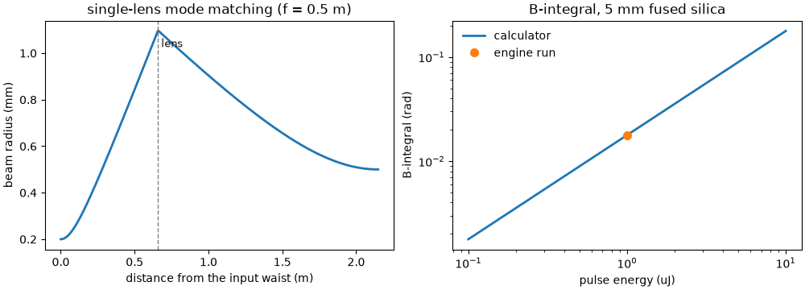

# The calculators: five design questions in one call each

ultrafast.calc answers pulse, beam, nonlinear and crystal design questions in one call each; its B-integral for 5 mm of fused silica matches a full engine run to three digits.

**The story.** Before a simulation, a design needs numbers: how short can this pulse be, which lens turns this waist into that one, how close to
self-focusing is this beam, which angle phase-matches this crystal. `ultrafast.calc` answers each in one call, in SI units with the unit in the
keyword (`wavelength_m`, `duration_s`, `n2_m2_per_w`). `calc.beam` and `calc.nonlinear` need only NumPy; `calc.crystal` and the measured-pulse
functions call the engine. The last step checks one answer, the B-integral, against a full engine run of the same plate: the calculator is the
quick estimate, the run is the answer, and they agree here because the plate is much shorter than the Rayleigh range (0.76 m) and the beam is
the same Gaussian.



**Layout** (`calculators.py`): a 1030 nm pulse of 100 fs (sech²) and 1 µJ; a 0.2 mm to 0.5 mm waist change with a lens of f = 0.5 m; 5 mm of fused
silica (n2 = 2.6e-20 m²/W, the engine's catalogue value, about 30 % uncertain; n0 = 1.45) at a beam radius of 0.5 mm; BBO of 1 mm. About 3 s.

```bash
python calculators.py
```

```
sech2 TBP 0.3148   100 fs -> 3.15 THz
100 fs with 20 nm at 1030 nm: 1.28 x the Gaussian limit, |GDD| 1759 fs^2
single lens: f_min 0.305 m, lens 0.658 m from the input waist, output waist 1.490 m behind it
ABCD check: radius at the output waist 0.5000 mm (asked 0.5 mm), flat wavefront: True
fused silica: P_cr 4.22 MW, peak power 8.81 MW, B (peak) 0.0178 rad
BBO type I SHG at 1030 nm: theta 23.37 deg, d_eff 1.98 pm/V
engine B-integral 0.0178 rad, calculator 0.0178 rad, ratio 1.00
```

**What it shows.**

1. **Pulse.** `calc.tbp("sech2")` is 0.3148 (Diels and Rudolph, table 2.1); a 100 fs sech² pulse has 3.15 THz of bandwidth.
   `calc.pulse.analyze` of a 100 fs pulse that has 20 nm at 1030 nm says it carries 1.28 times the bandwidth its duration needs, which a
   grating pair of about 1759 fs² of dispersion would have to account for.
2. **Beam.** `single_lens_match` gives the two lens positions (Self 1983); the second has a real output waist 1.49 m behind the lens. Propagating `q`
   through the ABCD matrices (`free_space`, `thin_lens`, `system_matrix`, `propagate_q`) returns the asked 0.5 mm radius and a flat wavefront.
3. **Nonlinear.** The critical power of the silica is 4.22 MW and the pulse peaks at 8.81 MW, so the beam is above it for self-focusing in a long
   piece; 5 mm is too short for it to matter (B = 0.0178 rad). `b_integral_estimate` also gives the pulse-averaged and beam-averaged values.
4. **Crystal.** Type-I SHG in BBO at 1030 nm is phase-matched at 23.37° (from the engine's Sellmeier equations; the number is not checked against a published table here); `best` also has the walk-off, acceptance bandwidths and the group-velocity mismatch.
5. **Check against the engine.** The calculator's peak B equals the engine's `totals.bIntegralRad`. The engine reports the peak, the pulse-averaged
   and the beam-averaged B-integral side by side.

**Limits.** The estimates assume a constant beam radius, no dispersion and the instantaneous Kerr effect; they are the first number, not the last. A
focus, a long plate, a chirped pulse or a plasma needs a run. See the [calculator reference](../../../reference/calculators.md), the
[pulse calculator](../../../reference/pulse-calculator.md) and [crystals](../../../reference/crystals.md#phase-matching-calculator).
