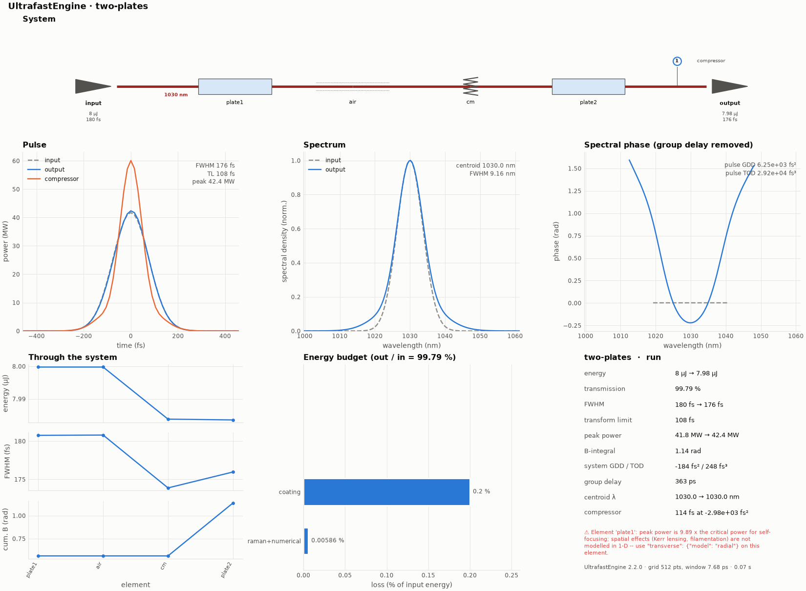

# 00 -- Python quick start

Build a system in Python, run it, read the results and scan a parameter.



*The overview figure of this example's run (`python make_figures.py` redraws it; the file is `hero.png`).*

```bash
python docs/examples/GettingStarted/quickstart/quickstart.py
```

Next: [Python API](../../../reference/python.md).
