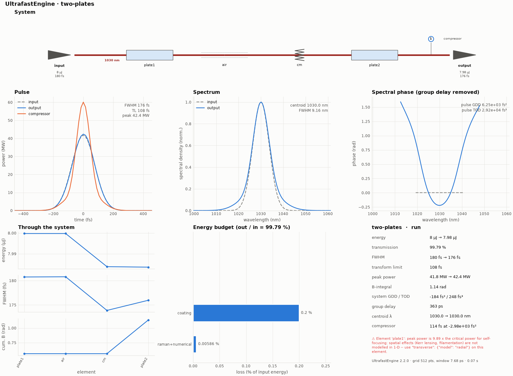

# Python quick start

Build a system in Python, run it, read the results and scan a parameter: two 3 mm fused-silica plates take a 180 fs, 8 µJ pulse at 1030 nm to a B-integral of 1.14 rad, and its broadened spectrum compresses to 114 fs.

**The story.** The first thing to do with the Python package: describe a small system in code with the builders of `ultrafast.build`
(each returns a typed dict, so the editor completes the arguments and the keys), run it with `ultrafast.run`, read the numbers from
`Result.summary` and `Result.instrument`, and repeat the run in a loop to scan a parameter. Two plates of fused silica with a chirped
mirror between them broaden the spectrum by self-phase modulation; the B-integral is the measure of how much, and the transform limit
of the broadened spectrum falls as the pulse energy rises. The same system is also written as a system file and a run spec
(`two-plates.ufs`, `run.json`), so the command line gives the same numbers.



**Layout** (`quickstart.py`, `two-plates.ufs`, `run.json`): `bulk` FusedSilica with `lengthM` = 3e-3 and a Gaussian `beam`
(`w0M` = 150e-6 at `zWaistM` = 1.5e-3, the plate centre), `gap` of air with `lengthM` = 0.10, `chirpedMirror` with `gddS2` = -150e-30 and
`bounces` = 2, and a second plate like the first. Pulse: Gaussian, `centerWavelengthM` = 1.03e-6, `durationFwhmS` = 180e-15,
`energyJ` = 8e-6. Instrument: an ideal compressor. One run takes about 0.1 s; the script (four more runs and a figure) about 3 s.

**Run it** in the example folder. The two tabs run the same simulation and print the same key numbers.

=== "CLI"

    ```bash
    ultrafast run two-plates.ufs run.json -o results     # about 0.1 s
    ```

    ```
    energy 7.984E-06 J (T = 99.79 %), FWHM 176 fs (TL 108 fs), peak 4.237E+07 W, B = 1.14 rad
    ```

=== "Python"

    <!-- snippet -->
    ```python
    import ultrafast as uf
    from ultrafast import build as b

    beam = b.gaussian_beam(w0_m=150e-6, z_waist_m=1.5e-3)      # waist at the centre of each 3 mm plate
    system = b.system("two-plates", [                         # the same system as two-plates.ufs
        b.bulk("plate1", "FusedSilica", 3e-3, beam=beam),
        b.gap("air", 0.10),
        b.chirped_mirror("cm", gdd_s2=-150e-30, bounces=2),
        b.bulk("plate2", "FusedSilica", 3e-3, beam=beam),
    ])
    spec = b.run_spec(b.pulse(1.03e-6, 180e-15, energy=8e-6),  # the same run as run.json
                      instruments=[b.instrument("compressor", name="compressor")])
    res = uf.run(system, spec)
    res.write("results")
    out, tot = res.summary["output"], res.summary["totals"]
    print(f"  energy {out['energyJ']:.4G} J (T = {100 * tot['energyTransmission']:.2f} %), FWHM {out['fwhmS'] * 1e15:.4G} fs "
          f"(TL {out['transformLimitFwhmS'] * 1e15:.4G} fs), peak {out['peakPowerW']:.4G} W, B = {tot['bIntegralRad']:.3G} rad")
    print(f"  compressible to {res.instrument('compressor')['compressedFwhmS'] * 1e15:.1f} fs")
    ```

    ```
    energy 7.984E-06 J (T = 99.79 %), FWHM 176 fs (TL 108 fs), peak 4.237E+07 W, B = 1.14 rad
    compressible to 114.1 fs
    ```

The full script also scans the pulse energy and saves `quickstart.png` (with matplotlib):

```bash
python quickstart.py
python make_figures.py          # optional: hero.png
```

```
output: 176.0 fs (TL 108.0 fs), B = 1.14 rad, compressible to 114.1 fs
  E =   2.0 uJ -> TL  161.2 fs
  E =   4.0 uJ -> TL  139.0 fs
  E =   8.0 uJ -> TL  108.0 fs
  E =  16.0 uJ -> TL   75.6 fs
```

**What it shows.**

* **B-integral** 1.14 rad (`totals.bIntegralRad`), shared by the two plates; the chirped mirror between them adds -300 fs² and keeps the
  pulse short for the second plate.
* **Spectral broadening:** the pulse leaves at 176 fs FWHM, close to the 180 fs it entered with (SPM changes the phase, not the
  envelope), but its spectrum now supports 108 fs (`transformLimitFwhmS`). The ideal compressor gets 114.1 fs, within 6 % of that limit.
* **Energy scan:** the transform limit falls from 161.2 fs at 2 µJ to 75.6 fs at 16 µJ as the B-integral grows with the peak power.
  A loop of `uf.run` is the simplest scan; `uf.scan` runs a grid of values in the engine, in parallel
  ([Python API](../../../reference/python.md)).
* **Transmission** 99.79 %: the two chirped-mirror bounces (`reflectance` 0.999 each). The plates have no coatings or interfaces here.

**Limits.** The beam is a fixed Gaussian in 1-D: the peak power is 9.9 times the critical power for self-focusing in silica and the
engine warns, as a real plate would focus the beam (Kerr lensing) and raise the B-integral; give the plates `"transverse": {"model":
"radial"}` to resolve it ([transverse reference](../../../reference/transverse.md)). The plates have no Fresnel losses (no `interface`
elements; see [SPM in a fused-silica plate](../spm-plate/README.md) for AR-coated faces). Next: [Python API](../../../reference/python.md).
