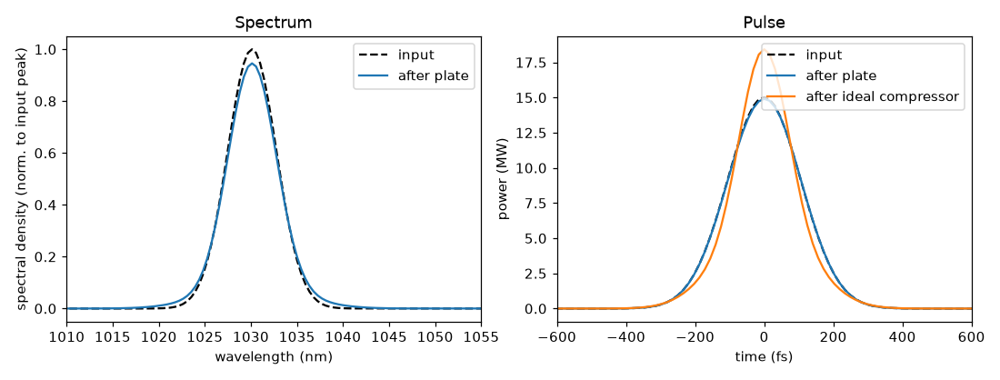

# SPM in a fused-silica plate

A 250 fs, 4 µJ pulse at 1030 nm crosses 6.35 mm of fused silica with a B-integral of 0.667 rad; self-phase modulation broadens the spectrum so that an ideal compressor shortens the pulse to 189 fs, close to its 184 fs transform limit.

**The story.** The smallest complete example: an AR-coated plate with the beam focused to its centre. The Kerr effect adds a phase
proportional to the instantaneous power, φ_NL(t) = γ P(t) L (self-phase modulation), which creates new frequencies without changing
the pulse envelope. The peak of that phase is the B-integral, B = (2π/λ) n2 ∫ I dz, which the engine integrates along the focus. The
plate (6.35 mm) is much shorter than the Rayleigh range in the silica (π w0² n / (M² λ) ≈ 58 mm), so the hand estimate
B ≈ (2π/λ) n2 I_peak L with the waist intensity (15.0 MW peak power, I_peak = 6.65e14 W/m²) gives 0.669 rad, within 0.3 % of the run.



**Layout** (`plate.ufs`, `run.json`): `interface` (Air to FusedSilica, coating `AR1030` with `R` = 0.002), `bulk` FusedSilica with
`lengthM` = 6.35e-3 and a Gaussian `beam` (`w0M` = 120e-6 at `zWaistM` = 3.175e-3, the plate centre, `m2` = 1.1), the back interface, and
0.5 m of air. Pulse: Gaussian, `centerWavelengthM` = 1.03e-6, `durationFwhmS` = 250e-15, `energyJ` = 4e-6, `repRateHz` = 100e3.
Physics: `selfSteepening` and `raman` on; adaptive stepper with `tolerance` 1e-6. Instruments: spectrometer (`resolutionM` = 0.1e-9),
autocorrelator, ideal compressor, pulse summary. About 1 s.

**Run it** in the example folder. The two tabs run the same simulation and print the same key numbers.

=== "CLI"

    ```bash
    ultrafast run plate.ufs run.json -o results     # about 1 s
    python plot.py                                  # optional: spm-plate.png from results/
    ```

    ```
    energy 3.984E-06 J (T = 99.60 %), FWHM 251.5 fs (TL 183.6 fs), peak 1.491E+07 W, B = 0.667 rad
    ```

=== "Python"

    <!-- snippet -->
    ```python
    import ultrafast as uf
    from ultrafast import build as b

    system = uf.System.load("plate.ufs")           # the example's own system file
    spec = b.run_spec(                             # run.json, written with the builders (typed: the editor completes every key)
        b.pulse(1.03e-6, 250e-15, energy=4e-6, rep_rate_hz=100e3),
        name="spm-plate",
        physics=b.physics(selfSteepening=True, raman=True),
        stepper={"method": "adaptive", "tolerance": 1e-6},
        instruments=[
            b.instrument("spectrometer", resolutionM=0.1e-9),
            b.instrument("autocorrelator"),
            b.instrument("compressor", name="ideal_compressor"),
            b.instrument("pulseSummary"),
        ],
    )
    res = uf.run(system, spec)                     # uf.run("plate.ufs", "run.json") runs the two files as they are
    res.write("results")                           # the same files as the CLI: python plot.py draws the figure from them
    out, tot = res.summary["output"], res.summary["totals"]
    print(f"  energy {out['energyJ']:.4G} J (T = {100 * tot['energyTransmission']:.2f} %), FWHM {out['fwhmS'] * 1e15:.4G} fs "
          f"(TL {out['transformLimitFwhmS'] * 1e15:.4G} fs), peak {out['peakPowerW']:.4G} W, B = {tot['bIntegralRad']:.3G} rad")
    comp = res.instrument("ideal_compressor")
    print(f"  ideal compressor: {comp['compressedFwhmS'] * 1e15:.0f} fs, peak {comp['compressedPeakPowerW'] / 1e6:.1f} MW, "
          f"GDD {comp['compressorGddS2'] * 1e30:.0f} fs^2")
    ```

    ```
    energy 3.984E-06 J (T = 99.60 %), FWHM 251.5 fs (TL 183.6 fs), peak 1.491E+07 W, B = 0.667 rad
    ideal compressor: 189 fs, peak 18.4 MW, GDD -6074 fs^2
    ```

**What it shows.**

* **B-integral** 0.667 rad (`results/summary.json` → `totals.bIntegralRad`, and `elements[1]` for the plate): the plate alone, as the
  interfaces and the air add nothing at this intensity. `criticalPowerRatio` there is 3.55: see **Limits**.
* **Spectrum** (left of the figure): SPM gives the spectrum weak wings and a lower peak; its FWHM is 6.37 nm (`output.spectralFwhmM`).
  The pulse is almost unchanged in time (251.5 fs FWHM against 250 fs) because SPM changes only the phase.
* **Compression:** the ideal compressor removes the remaining chirp with -6074 fs² and gives 189 fs at 18.4 MW, within 3 % of the
  183.6 fs transform limit of the broadened spectrum: the new bandwidth is real and usable.
* **Transmission** 99.60 %: the two AR coatings (0.2 % each, `lossBudget`). `provenance.json` says where every model came from (the
  built-in Malitson index, n2 = 2.6e-20 m²/W from the catalogue, ...).
* **Overrides:** add to `run.json` (or `overrides=[b.override("material:FusedSilica", "n2", value=2.2e-20)]` in Python) to change a
  material without touching the system file:

```json
"overrides": [ { "target": "material:FusedSilica", "property": "n2", "value": 2.2e-20 } ]
```

**Limits.** The peak power is 3.55 times the critical power for self-focusing in silica, and the engine warns because the plate is
simulated in 1-D: Kerr lensing would shrink the beam inside the plate and raise the B-integral. Add `"transverse": {"model": "radial"}`
to the plate to resolve diffraction and Kerr lensing (see [spatial Kerr](../../Nonlinear/spatial-kerr/README.md) and the
[transverse reference](../../../reference/transverse.md)). The n2 of the catalogue is about 30 % uncertain (the run notes say so).
