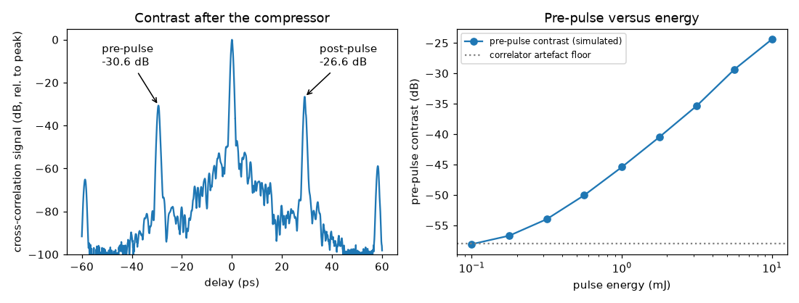

# 22 -- Contrast of an amplifier chain

Stretcher → uncoated window (its ghost is a post-pulse) → Kerr medium → compressor. The Kerr medium turns the
ghost into a pre-pulse after compression; a third-order cross-correlator measures both. Walk-through:
[Tutorial 5](../../../tutorials/05-contrast.md).

```bash
ultrafast run chain.ufs run.json -o results          # one run, ~1 s
ultrafast study study.json -o study-results          # pre-pulse vs energy, 9 runs, ~5 s
```

What to look at:

* `results/summary.json → instruments → xc`: `prePulseContrastDb` (-30.6 dB at -29.4 ps) and `postPulseContrastDb`
  (-26.6 dB at +29.1 ps); `elements → window → notes`: the ghost's delay and intensity.
* `study-results/study.csv`: the pre-pulse grows as B² (20 dB per decade of energy) above the correlator's own ε²
  artefact (-58 dB).



`python plot.py` draws this figure from `results/` and `study-results/`. The left panel is what a third-order
cross-correlator would record after the compressor: the main pulse at zero delay and two replicas about 29 ps away.
The one at +29.1 ps is the window's ghost, at -26.6 dB. The one at -29.4 ps is a pre-pulse, at -30.6 dB: the ghost
passed through the Kerr medium together with the main pulse and picked up a nonlinear phase, so the compressor
moves it ahead of the main pulse. A pre-pulse of this kind is not in the input, it is created inside the chain. The right
panel scans the pulse energy: above about 1 mJ the pre-pulse contrast worsens by 20 dB per decade of energy, as
expected for a B-integral that grows in proportion to the energy (the pre-pulse intensity scales as B^2); at the lowest
energies the curve flattens onto the correlator's own artefact floor at -58 dB.

New features used: plate ghosts, `pulse.pedestal`, the `crossCorrelator` instrument, parameter studies, and the
planner's B estimate after the stretcher.
