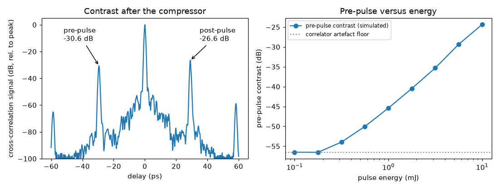

# Contrast of an amplifier chain

A 300 fs, 5 mJ pulse through a stretcher, an uncoated window and a Kerr medium: the window's ghost (relative intensity 1.1e-3, 29 ps after the main pulse) becomes a pre-pulse at -30.6 dB after compression (post-pulse -26.6 dB), and the pre-pulse worsens by 20 dB per decade of energy above 1 mJ.

**The story.** Stretcher → uncoated window (its ghost is a post-pulse) → Kerr medium → compressor. The Kerr medium turns the
ghost into a pre-pulse after compression: the ghost passes through the medium with the main pulse and picks up a nonlinear phase, so the
compressor moves it ahead of the main pulse. A third-order cross-correlator measures both. The check is the scaling: the pre-pulse
intensity grows as B², that is 20 dB per decade of energy. Walk-through: [Tutorial 5](../../../tutorials/05-contrast.md).



*Left: what a third-order cross-correlator records after the compressor. Right: the pre-pulse contrast against pulse energy.
`python plot.py` draws the figure from `results/` and `study-results/`.*

**Layout** (`chain.ufs`, `run.json`, `study.json`): `stretcher` and `compressor` (`dispersion`, `gddFs2` = ±5.0e6), `window` (`plate`,
FusedSilica, `thicknessM` = 3e-3, `ghosts` of 1 order: R² about 1.1e-3, 29 ps after the main pulse), `rod` (`bulk` YAG,
`lengthM` = 0.02, `nonlinear`, constant beam of `radiusM` = 0.5e-3, standing in for the amplifier). Pulse: Gaussian,
`centerWavelengthM` = 1.03e-6, `durationFwhmS` = 300e-15, `energyJ` = 5e-3, with an exponential `pedestal` of `level` 1e-6. Instruments: a
third-order `crossCorrelator` (±60 ps, `dynamicRangeDb` 100, probes at ±29 ps), `contrast` and the pulse summary. `study.json` scans
`pulse/energyJ` from 0.1 mJ to 10 mJ in 9 log steps. The run takes under 1 s and the study about 3 s.

**Run it** in the example folder. The two tabs run the same simulation and study and print the same key numbers.

=== "CLI"

    ```bash
    ultrafast run chain.ufs run.json -o results          # one run, about 1 s
    ultrafast study study.json -o study-results          # pre-pulse against energy, 9 runs, about 3 s
    python plot.py                                       # optional: contrast-chain.png from results/ and study-results/
    ```

    ```
    energy 0.004667 J (T = 93.47 %), FWHM 350.7 fs (TL 298.8 fs), peak 1.017E+10 W, B = 1.91 rad
    ```

    The study table is `study-results/study.csv` (the Python tab prints it).

=== "Python"

    <!-- snippet -->
    ```python
    import ultrafast as uf
    from ultrafast import build as b

    system = uf.System.load("chain.ufs")           # stretcher, uncoated window, YAG rod, compressor
    spec = b.run_spec(                             # run.json, written with the builders (typed: the editor completes every key)
        b.pulse(1.03e-6, 300e-15, energy=5e-3,
                pedestal=[b.pedestal("exponential", level=1e-6, riseS=2e-12, fallS=3e-12)]),
        name="contrast-chain",
        instruments=[
            b.instrument("crossCorrelator", at="end", name="xc", rangeS=[-60e-12, 60e-12], stepS=0.1e-12,
                         fineStepS=20e-15, fineRangeS=2e-12, dynamicRangeDb=100, probeDelaysS=[-29e-12, 29e-12]),
            b.instrument("contrast", at="end"),
            b.instrument("pulseSummary"),
        ],
    )
    res = uf.run(system, spec)                     # uf.run("chain.ufs", "run.json") runs the two files as they are
    res.write("results")                           # the same files as the CLI: python plot.py draws the figure from them
    out, tot = res.summary["output"], res.summary["totals"]
    print(f"energy {out['energyJ']:.4G} J (T = {100 * tot['energyTransmission']:.2f} %), FWHM {out['fwhmS'] * 1e15:.4G} fs "
          f"(TL {out['transformLimitFwhmS'] * 1e15:.4G} fs), peak {out['peakPowerW']:.4G} W, B = {tot['bIntegralRad']:.3G} rad")
    xc = res.instrument("xc")
    print(f"  pre-pulse {xc['prePulseContrastDb']:.1f} dB at {xc['prePulseDelayS'] * 1e12:.1f} ps, "
          f"post-pulse {xc['postPulseContrastDb']:.1f} dB at {xc['postPulseDelayS'] * 1e12:.1f} ps")
    study = uf.study(                              # study.json: 9 energies from 0.1 mJ to 10 mJ on a log scale
        system, spec,
        parameters=[{"path": "pulse/energyJ", "min": 0.1e-3, "max": 10e-3, "scale": "log", "points": 9}],
        outputs=["record:rod/BIntegralRad", "instrument:xc/prePulseContrastDb", "instrument:xc/postPulseContrastDb", "pulse:end/fwhmS"],
        mode="scan", sampling="grid", parallel=4, output="study-results")
    for row in study["rows"]:
        print(f"  {row['pulse/energyJ'] * 1e3:6.3f} mJ: B = {row['record:rod/BIntegralRad']:.3f} rad, "
              f"pre-pulse {row['instrument:xc/prePulseContrastDb']:.1f} dB, post-pulse {row['instrument:xc/postPulseContrastDb']:.1f} dB, "
              f"FWHM {row['pulse:end/fwhmS'] * 1e15:.0f} fs")
    ```

    ```
    energy 0.004667 J (T = 93.47 %), FWHM 350.7 fs (TL 298.8 fs), peak 1.017E+10 W, B = 1.91 rad
      pre-pulse -30.6 dB at -29.4 ps, post-pulse -26.6 dB at 29.1 ps
       0.100 mJ: B = 0.038 rad, pre-pulse -56.5 dB, post-pulse -29.5 dB, FWHM 300 fs
       0.178 mJ: B = 0.067 rad, pre-pulse -56.5 dB, post-pulse -29.5 dB, FWHM 300 fs
       0.316 mJ: B = 0.120 rad, pre-pulse -54.0 dB, post-pulse -29.5 dB, FWHM 300 fs
       0.562 mJ: B = 0.213 rad, pre-pulse -50.0 dB, post-pulse -29.6 dB, FWHM 300 fs
       1.000 mJ: B = 0.379 rad, pre-pulse -45.4 dB, post-pulse -29.5 dB, FWHM 300 fs
       1.778 mJ: B = 0.674 rad, pre-pulse -40.5 dB, post-pulse -29.1 dB, FWHM 302 fs
       3.162 mJ: B = 1.198 rad, pre-pulse -35.3 dB, post-pulse -28.4 dB, FWHM 313 fs
       5.623 mJ: B = 2.129 rad, pre-pulse -29.3 dB, post-pulse -25.9 dB, FWHM 379 fs
      10.000 mJ: B = 3.784 rad, pre-pulse -24.3 dB, post-pulse -23.0 dB, FWHM 1066 fs
    ```

**What it shows.**

Where the numbers are:

* `results/summary.json → instruments → xc`: `prePulseContrastDb` (-30.6 dB at -29.4 ps) and `postPulseContrastDb`
  (-26.6 dB at +29.1 ps); `elements → window → notes`: the ghost's delay and intensity.
* `study-results/study.csv`: the pre-pulse grows as B² (20 dB per decade of energy) above the correlator's own ε²
  artefact (about -56.5 dB at the lowest energies).

In the figure, the left panel is what a third-order
cross-correlator would record after the compressor: the main pulse at zero delay and two replicas about 29 ps away.
The one at +29.1 ps is the window's ghost, at -26.6 dB. The one at -29.4 ps is a pre-pulse, at -30.6 dB: the ghost
passed through the Kerr medium together with the main pulse and picked up a nonlinear phase, so the compressor
moves it ahead of the main pulse. A pre-pulse of this kind is not in the input, it is created inside the chain. The right
panel scans the pulse energy: above about 1 mJ the pre-pulse contrast worsens by 20 dB per decade of energy, as
expected for a B-integral that grows in proportion to the energy (the pre-pulse intensity scales as B^2); at the lowest
energies the curve flattens onto the correlator's own artefact floor at about -56.5 dB.

New features used: plate ghosts, `pulse.pedestal`, the `crossCorrelator` instrument, parameter studies, and the
planner's B estimate after the stretcher.

**Limits.** The rod is a 1-D Kerr medium with a constant beam: at 5 mJ its peak power is 70 times the critical power for self-focusing, so
the engine warns that Kerr lensing is not modelled and the B-integral and the pre-pulse level are upper estimates for a real beam. The ghost
is a single plate echo, not a full multiple-reflection train. See [Tutorial 5](../../../tutorials/05-contrast.md) and the
[instruments reference](../../../reference/instruments.md).
