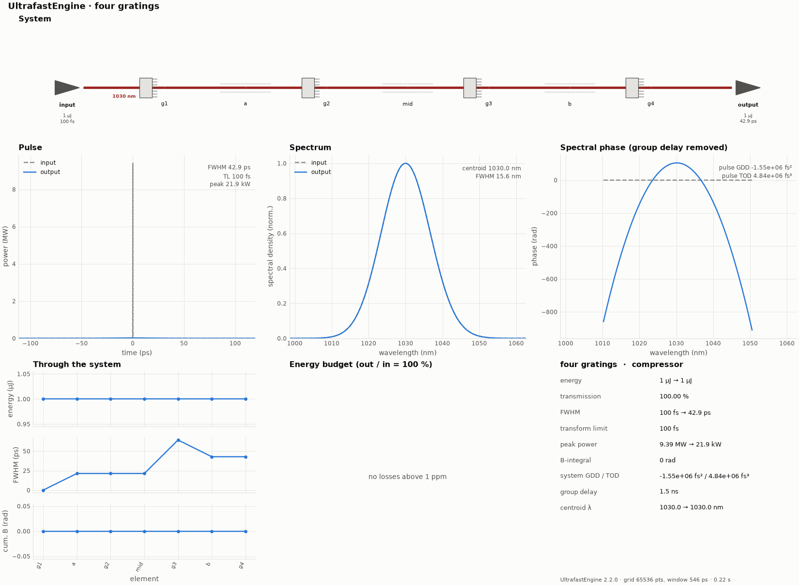

# A four-grating compressor, grating by grating

A compressor written grating by grating (1200 lines/mm, 45°): the spatial chirp opens to 28.3 mm per 100 nm after the first pair and closes to zero after the second, and the total GDD of -1.547 ps² equals Treacy's formula for two pairs.

**The story.** A compressor on the command line. Each `grating` and slant path is its own element, so the beam tracker follows the
spatial chirp through the line ([Components](../../../reference/components.md)). The second pair is the mirror image of the first, so the
spatial chirp opens and closes exactly. The check is Treacy's formula, GDD = -λ³ g / (2π c² d² cos³β) for one pair at the normal
separation g = L cosβ, with two pairs in the line. The 100 fs, 1 µJ pulse enters as a Gaussian beam of waist 2 mm.



*The overview figure of this example's run (`python make_figures.py` redraws it; the file is `hero.png`).*

**Layout** (`compressor.ufs`, `run.json`): `g1` (`grating`, `linesPerMm` = 1200, `aoiDeg` = -45, order 1), the slant path `a` (`gap`,
0.2 m), `g2` (`aoiDeg` = 31.930705, order -1), `mid` (0.05 m), `g3` (`aoiDeg` = 45), `b` (0.2 m) and `g4` (`aoiDeg` = -31.930705). Pulse:
Gaussian, `centerWavelengthM` = 1030e-9, `durationFwhmS` = 100e-15, `energyJ` = 1e-6; `inputBeam` Gaussian, `w0M` = 2e-3. Under 1 s.

**Run it** in the example folder. The two tabs run the same simulation and print the same key numbers.

=== "CLI"

    ```bash
    ultrafast run compressor.ufs run.json -o results     # under 1 s
    python report.py                                     # the spatial chirp and GDD along the line, and the Treacy value
    ```

    ```
    energy 1E-06 J (T = 100.00 %), FWHM 4.285E+04 fs (TL 100 fs), peak 2.191E+04 W, B = 0 rad
    g1   spatial chirp     0.000 mm per 100 nm   GDD          0 fs2
    a    spatial chirp    28.279 mm per 100 nm   GDD     773725 fs2
    g2   spatial chirp    23.561 mm per 100 nm   GDD    -773725 fs2
    mid  spatial chirp    23.561 mm per 100 nm   GDD    -773725 fs2
    g3   spatial chirp    28.279 mm per 100 nm   GDD   -2321174 fs2
    b    spatial chirp     0.000 mm per 100 nm   GDD   -1547449 fs2
    g4   spatial chirp     0.000 mm per 100 nm   GDD   -1547449 fs2
    Treacy, two pairs  -1547449 fs2
    ```

=== "Python"

    <!-- snippet -->
    ```python
    import math
    import ultrafast as uf
    from ultrafast import build as b

    system = uf.System.load("compressor.ufs")      # seven elements: four gratings and three slant paths
    spec = b.run_spec(                             # run.json, written with the builders (typed: the editor completes every key)
        b.pulse(1030e-9, 100e-15, energy=1e-6),
        name="compressor",
        input_beam=b.gaussian_beam(2e-3),          # the tracker needs a Gaussian input beam to follow the spatial chirp
    )
    res = uf.run(system, spec)                     # uf.run("compressor.ufs", "run.json") runs the two files as they are
    res.write("results")                           # the same files as the CLI: python report.py reads them
    out, tot = res.summary["output"], res.summary["totals"]
    print(f"energy {out['energyJ']:.4G} J (T = {100 * tot['energyTransmission']:.2f} %), FWHM {out['fwhmS'] * 1e15:.4G} fs "
          f"(TL {out['transformLimitFwhmS'] * 1e15:.4G} fs), peak {out['peakPowerW']:.4G} W, B = {tot['bIntegralRad']:.3G} rad")
    for e in res.elements():
        print("%-4s spatial chirp %9.3f mm per 100 nm   GDD %10.0f fs2" % (
            e["id"], e["values"].get("trackedSpatialChirpXMPerM", 0) * 1e-4, e["system"]["gddS2"] * 1e30))
    lam, d, slant = 1030e-9, 1 / 1.2e6, 0.2        # Treacy: one pass of a pair at normal separation g = slant cos(beta)
    beta = math.asin(lam / d - math.sin(math.radians(45)))
    gdd = -(lam ** 3 / (2 * math.pi * 299792458.0 ** 2 * d ** 2)) * slant / math.cos(beta) ** 2
    print("Treacy, two pairs  %.0f fs2" % (2 * gdd * 1e30))
    ```

    ```
    energy 1E-06 J (T = 100.00 %), FWHM 4.285E+04 fs (TL 100 fs), peak 2.191E+04 W, B = 0 rad
    g1   spatial chirp     0.000 mm per 100 nm   GDD          0 fs2
    a    spatial chirp    28.279 mm per 100 nm   GDD     773725 fs2
    g2   spatial chirp    23.561 mm per 100 nm   GDD    -773725 fs2
    mid  spatial chirp    23.561 mm per 100 nm   GDD    -773725 fs2
    g3   spatial chirp    28.279 mm per 100 nm   GDD   -2321174 fs2
    b    spatial chirp     0.000 mm per 100 nm   GDD   -1547449 fs2
    g4   spatial chirp     0.000 mm per 100 nm   GDD   -1547449 fs2
    Treacy, two pairs  -1547449 fs2
    ```

**What it shows.** The pulse leaves the line stretched to 42.85 ps: the compressor is run alone, so it stretches an unchirped 100 fs pulse
(a negative GDD of -1.55 ps² acts on it like a positive one). The second pair is the mirror image of the first, so the spatial chirp opens
(28.3 mm per 100 nm after `a`) and closes (0.000 mm after `b`), and the total GDD is that of two single passes: -1547449 fs² against
-1547449 fs² from Treacy, equal to the six digits printed. The GDD changes sign inside a pair because a slant path adds its own
dispersion before the second grating removes more.

**Limits.** The tracker carries the spatial chirp as a first-order beam property: the beam is not resolved on a transverse grid, so
beam clipping and grating aperture are not modelled. The grating efficiency is not set here (T = 100 %). See [Components](../../../reference/components.md)
and the [stretcher and compressor](../stretcher-compressor/README.md) example for the analytic pair.
