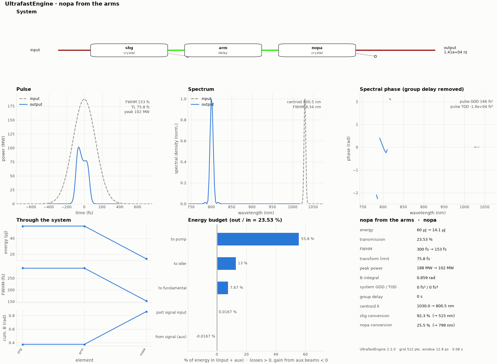

# A non-collinear OPA with the angle from the pump arm

A 1030 nm pulse is doubled in BBO, the 515 nm pump reaches a second BBO crystal through an arm tilted by 4° (2.42° inside the crystal, BBO's magic angle) and amplifies an 800 nm, 10 nJ seed to 14.1 µJ, with an idler of 7.8 µJ leaving at 11.3° and a Manley-Rowe residual of -2e-8.

**The story.** A NOPA in a Branched system. A 1030 nm, 300 fs, 60 µJ pulse is doubled in BBO. The second harmonic goes to an arm tilted by
4° and pumps a second BBO crystal. The 800 nm seed is a virtual input on that crystal's `signal` port. The crystal takes the crossing angle
from the arm's tilt, so no angle is typed into the crystal. The checks are the conservation laws: the idler leaves with the transverse
momentum the pump has left, k_i sin β = k_p sin α (balance 0), and the photon numbers add up (the Manley-Rowe residual is -2e-8).



*The overview figure of this example's run (`python make_figures.py` redraws it; the file is `hero.png`).*

**Layout** (`nopa.ufs`, `run.json`): `shg` (`crystal` BBO, `lengthM` = 1e-3, `cut` auto, type I second harmonic, Gaussian beam of
`w0M` = 400e-6), the `arm` (`delay` with `tiltXRad` = 0.06981317, 4°), and `nopa` (BBO, `lengthM` = 2e-3, `cut` auto, `opa` type I,
`mainRole` pump, the seed on the `signal` port: Gaussian, `centerWavelengthM` = 800e-9, `durationFwhmS` = 100e-15, `energyJ` = 10e-9,
`delayS` auto; the idler and the pump leave on virtual ports). Pulse: Gaussian, `centerWavelengthM` = 1030e-9, `durationFwhmS` = 300e-15,
`energyJ` = 60e-6. Under 1 s.

**Run it** in the example folder. The two tabs run the same simulation and print the same key numbers.

=== "CLI"

    ```bash
    ultrafast run nopa.ufs run.json -o results     # under 1 s
    python report.py                               # the geometry, the exit angles and the balances from summary.json
    ```

    ```
    energy 1.412E-05 J (T = 23.53 %), FWHM 152.8 fs (TL 75.78 fs), peak 1.017E+08 W, B = 0.859 rad
    cut 21.96 deg; pump 4.00 deg outside, 2.42 deg inside the crystal; idler 6.82 deg inside
    leaving at 0.00 deg (signal), 4.00 deg (pump), 11.28 deg (idler)
    transverse momentum balance 0.0e+00
    signal 14.12 uJ from a 10 nJ seed; idler 7.81 uJ; Manley-Rowe residual -2e-08
    ```

=== "Python"

    <!-- snippet -->
    ```python
    import math
    import ultrafast as uf
    from ultrafast import build as b

    system = uf.System.load("nopa.ufs")            # SHG crystal, the 4 deg pump arm and the NOPA crystal (a Branched system)
    spec = b.run_spec(                             # run.json, written with the builders (typed: the editor completes every key)
        b.pulse(1030e-9, 300e-15, energy=60e-6),
        name="nopa",
    )
    res = uf.run(system, spec)                     # uf.run("nopa.ufs", "run.json") runs the two files as they are
    res.write("results")                           # the same files as the CLI: python report.py reads them
    out, tot = res.summary["output"], res.summary["totals"]
    print(f"energy {out['energyJ']:.4G} J (T = {100 * tot['energyTransmission']:.2f} %), FWHM {out['fwhmS'] * 1e15:.4G} fs "
          f"(TL {out['transformLimitFwhmS'] * 1e15:.4G} fs), peak {out['peakPowerW']:.4G} W, B = {tot['bIntegralRad']:.3G} rad")
    v = next(e for e in res.elements() if e["id"] == "nopa")["values"]
    print("cut %.2f deg; pump %.2f deg outside, %.2f deg inside the crystal; idler %.2f deg inside" % (
        v["thetaDeg"], v["externalAngleDeg"], v["noncollinearDeg"], v["angleToSignalDeg_idler"]))
    print("leaving at %.2f deg (signal), %.2f deg (pump), %.2f deg (idler)" % (
        v["outputTiltDeg_signal"], v["outputTiltDeg_pump"], v["outputTiltDeg_idler"]))
    w = {k: 1 / v["wavelengthM_" + k] for k in ("signal", "idler", "pump")}   # frequencies in units of c / (2 pi)
    t = {k: math.radians(v["outputTiltDeg_" + k]) for k in w}
    left, right = w["pump"] * math.sin(t["pump"]), w["signal"] * math.sin(t["signal"]) + w["idler"] * math.sin(t["idler"])
    print("transverse momentum balance %.1e" % abs(1 - right / left))
    print("signal %.2f uJ from a 10 nJ seed; idler %.2f uJ; Manley-Rowe residual %.0e" % (
        v["energy_signal_J"] * 1e6, v["energy_idler_J"] * 1e6, v["manleyRoweResidual"]))
    ```

    ```
    energy 1.412E-05 J (T = 23.53 %), FWHM 152.8 fs (TL 75.78 fs), peak 1.017E+08 W, B = 0.859 rad
    cut 21.96 deg; pump 4.00 deg outside, 2.42 deg inside the crystal; idler 6.82 deg inside
    leaving at 0.00 deg (signal), 4.00 deg (pump), 11.28 deg (idler)
    transverse momentum balance 0.0e+00
    signal 14.12 uJ from a 10 nJ seed; idler 7.81 uJ; Manley-Rowe residual -2e-08
    ```

**What it shows.** The crystal's face is normal to the seed, which enters along the lab axis. The pump arm's tilt is therefore the pump's
external angle. Inside the crystal the pump refracts to 2.42°, close to BBO's broadband "magic" angle for 515 nm pumping (about 2.4° to
2.55°). `cut: "auto"` solves the phase matching for that geometry (cut 21.96°).

The idler takes the transverse momentum of the pump, k_i sin β = k_p sin α. It leaves on the pump's side, beyond the pump, at
ω_i sin t_i = ω_p sin t_p. That is why a NOPA separates its idler without a dichroic. Each port's path carries its tilt onward.

The seed's `"delayS": "auto"` centres it on the pump inside the crystal, whatever group delay the pump picked up in the first crystal.

**Limits.** This is the 1-D model with Gaussian overlap. The coupling falls as the pump and the seed part along the crystal. The geometric
smearing across the beams is reported as `geometricSmearingS` (77 fs here) but is not propagated; a Cartesian grid carries it. The gain is
saturated here, and depletion is uniform across the beam in 1-D. See [Crystals](../../../reference/crystals.md#non-collinear-opa-and-dfg).
